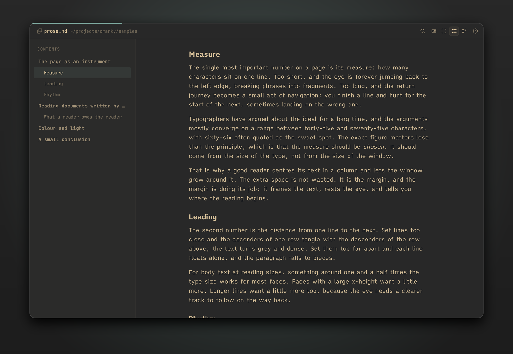
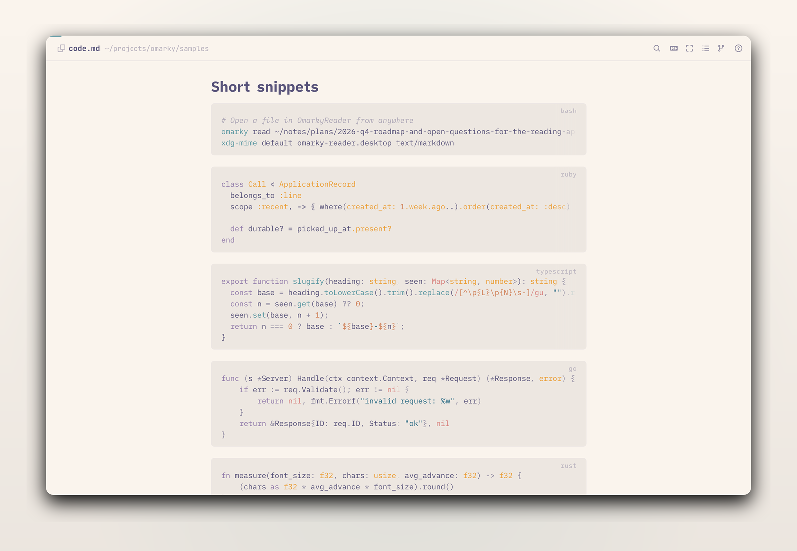
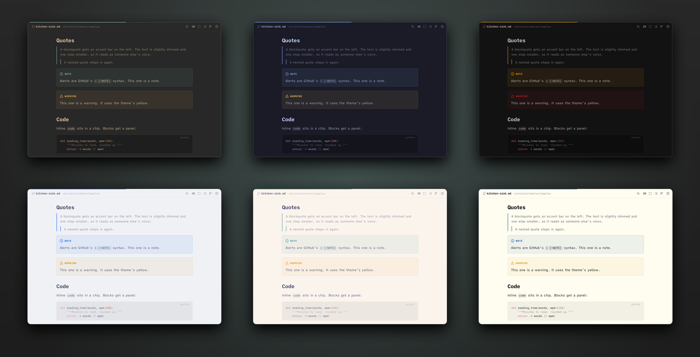
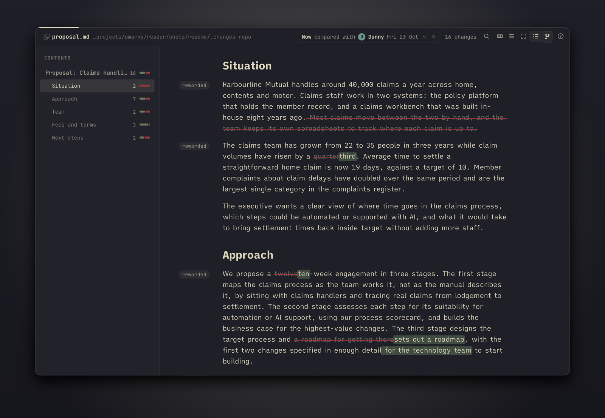
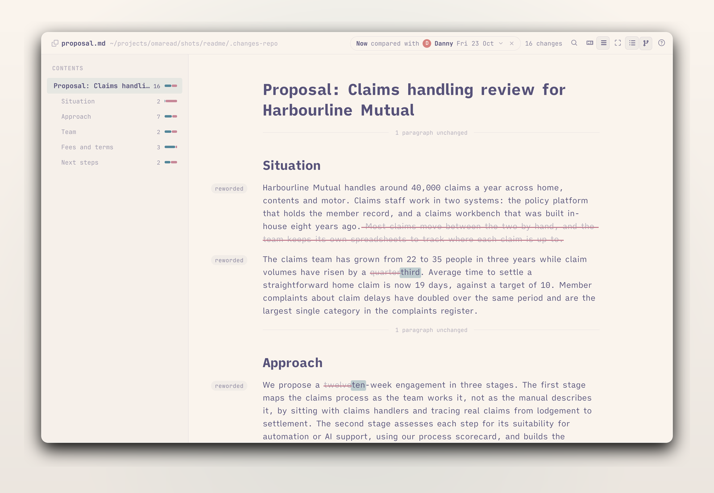
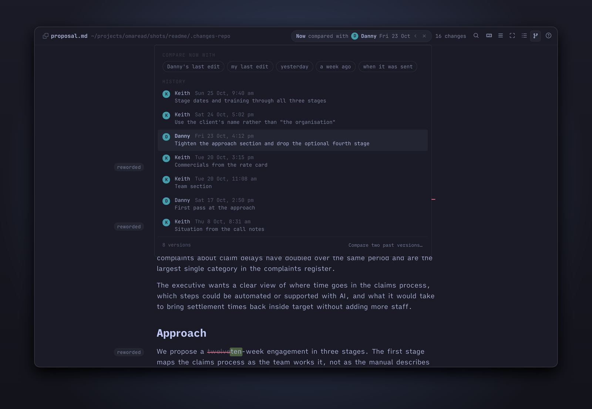
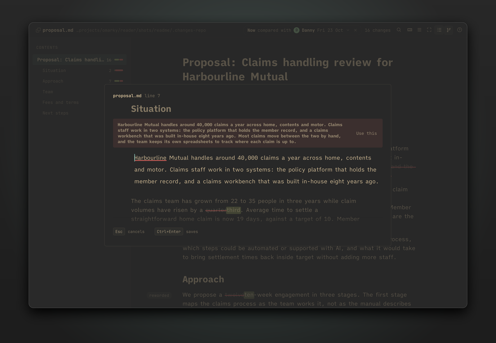
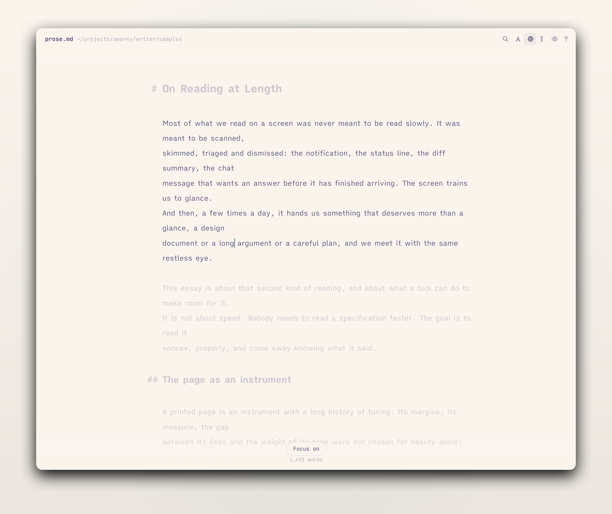
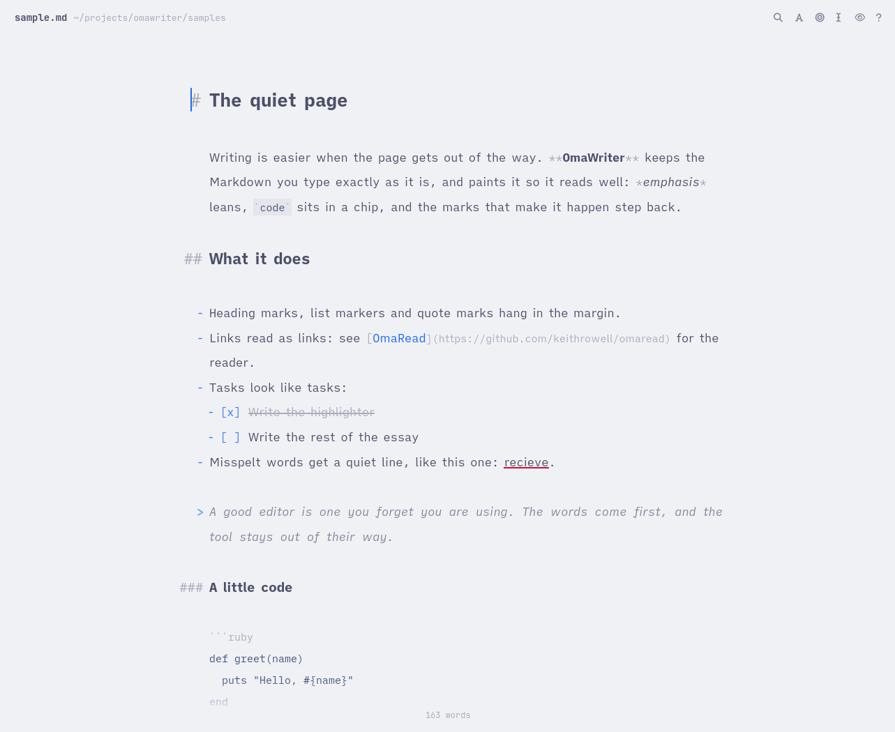

# Omarky

Markdown tools for [Omarchy](https://omarchy.org): a reader that sets a plain text file like a book, a writer for getting the words down, and the changes between two versions of a document shown on the page you read. Built by [Keith Rowell](https://github.com/keithrowell) in QML on Quickshell, with Ruby for the command line.

The site: [keithrowell.github.io/omarky](https://keithrowell.github.io/omarky/).


## Principles

A printed page is the work of centuries of craft. Its measure, its margins, the space between its lines and the weight of its type were settled by people who cared how it read. When a page is set well, you start reading and all of a sudden an hour has passed. Omarky sets a Markdown file the way a typesetter sets a page.

- **The page:** one centred column, about 68 characters wide, the measure of a well-set book. Line height and paragraph spacing give the text room. Bullets, numbers, heading marks and quote marks hang in the left margin, in both apps, so the text keeps one straight edge. Headings sit on a scale from the body size, with space above and little below, so each binds to the text it introduces.
- **The type:** iA Writer Quattro S for prose and its Mono S for code. The mono is lighter than a programmer's font, so a code block sits beside a paragraph without shouting, and it has no ligatures, because the reader's job is to show exactly what the file says. Headings are the same family in bold.
- **The colours:** the current Omarchy theme, read as you switch, light or dark. Code colours are generated from the theme's own `colors.toml`, so a code block matches the page around it. Neither app has a theme picker.
- **The chrome:** a header with the file's name, an outline that follows you through the document, and the page. In the writer the header and the word count step aside while you type and come back when you move the mouse. Keys do the rest, and `?` lists them.
- **The file:** the Markdown file on disk is the document. The reader reloads in place when another program changes the file, keeping your paragraph. The writer saves the text exactly as you typed it, and its marks are painted, not rewritten. The file is the only format.
- **Versions:** when a document lives in git, its history is "Danny, Friday 23 October" and "me, yesterday", and the reader shows what changed between two of them on the page you read.

## OmarkyReader

```
omarky read notes/plan.md
omarky read docs/spec.md#window-and-behaviour
```



Open a file and it is a page: one column, the outline at the left, and the first paragraph where your eye lands. Headings, lists, quotes, tables, code, images, footnotes, task lists and alerts are each given their own setting. The outline marks the section you are in and jumps on a click. Links to other Markdown files open in a new window at their heading, and web links open in your browser.





Find (`Ctrl+F` or `/`) steps through matches across the whole document. `W` widens the measure for tables and code. Right-click any block to copy its Markdown source. A hover on a heading shows a `#` that copies `file.md#heading`. The file is watched, so an edit in another program shows up in place, with the page kept on the same paragraph.

### Changes

```
omarky read proposal.md --from danny
omarky read proposal.md --from yesterday --to "danny fri"
omarky changes proposal.md
```



When the file has check-ins in git, a branching chip joins the header. Click it (or press `V`) and pick a version, and the window compares the file as it is now with that version in the same column: added words on a wash in the theme's green, removed words faded under a strike in its red, and a tag in the margin for each paragraph that changed. The pill in the header names the two ends and counts the changes, and the outline counts them per section.



`F` folds everything that did not change, so a long document with three edits is three paragraphs and a few hairlines. `N` and `P` step between changes. When the newer side is the file on disk, an edit in your editor re-runs the comparison and keeps your place.



A version is a person and a time: `danny`, `me`, `yesterday`, `a week ago`, `fri`, `23 oct`, `danny fri`, `sent` (the date in a `SENT.md` beside the file), `before danny`, or anything git understands. `--list` prints the file's versions with who, when and the message, and opens nothing.

### Editing a block



Reading, you find a sentence to fix. Press `E` and the block under the mouse opens in a sheet over the page, in OmarkyWriter's editor, with the blocks before and after it faint around it. `Shift+E` opens the whole section. Type, then `Ctrl+Enter`: the file is written and the page reloads under the sheet. `Esc` closes without writing. The sheet refuses to write over a change that landed while it was open. In changes mode a reworded block shows its older wording with a "Use this" chip, so putting a sentence back is two keys.

The sheet is for the sentence you noticed while reading, or the section that needs another pass. When the morning is for writing, open the file in OmarkyWriter.

## OmarkyWriter

```
omarky write notes/essay.md
omarky write
omarky write --end journal.md
```


The window holds the text and little else. You type plain Markdown and it looks finished as you write: emphasis leans, code sits in a chip, links read as links, and the marks that make it happen fade back once they have done their work. Heading marks, list markers and quote marks hang in the left margin, so the text keeps the same straight edge as the reader's page. The text in the window is always exactly the file's Markdown, and the keys below are the only things that change it.

| Keys | Does |
|---|---|
| `Enter` | Continues a list, a numbered list (counting up), a task list or a quote; on an empty item, ends the list |
| `Tab`, `Shift+Tab` | Indents or outdents a list item |
| `Ctrl+B`, `Ctrl+I`, `Ctrl+E` | Bold, italic, inline code; again to remove |
| `Ctrl+K` | A link around the selection, cursor in the URL |
| `Ctrl+1` to `Ctrl+6`, `Ctrl+0` | Heading level, or back to a paragraph |



Focus (`Ctrl+Shift+F`) fades every paragraph but the one you are in. Typewriter scrolling (`Ctrl+Shift+T`) keeps the line you are writing in the middle of the window. The header and the word count step aside while you type. Misspelt words get a quiet line once you have moved past them, so nothing flickers under the word you are still typing, and a right-click offers suggestions. Spelling is Australian English through Sonnet and Hunspell.


When you want to read what you have written, `Ctrl+P` shows the document as the reader sets it, opened at the paragraph you were in, and `Esc` puts you back at the same place in the source. The two apps share one renderer, so the page you read back is the page the reader will show.

With no file you get a new untitled document, saved as a draft while you type. `Ctrl+R` lists recent files and drafts, and `Ctrl+Shift+S` gives a draft a name. Named files save themselves a moment after you stop typing. A file changed by another program is reloaded in place when you have nothing unsaved, and offered as a choice when you do.



## Install

On Omarchy, with `quickshell`, `ruby`, `ttf-ia-writer`, `sonnet` and `hunspell-en_au` installed (and `cmake` with the Qt 6 headers for the editor's native module, which is optional):

```
git clone https://github.com/keithrowell/omarky.git ~/.local/src/omarky
~/.local/src/omarky/ops/install
```

The script links `omarky` into `~/.local/bin`, adds a desktop entry and an icon for each app, and builds the native module when it can. It leaves the default Markdown app alone. To make the reader the default:

```
xdg-mime default omarky-reader.desktop text/markdown
```

To update, pull and run the install script again. The reader's state (zoom, recent files) lives in `~/.local/state/omarky-reader`, the writer's (settings, recent files, drafts) in `~/.local/state/omarky-writer`, and each app logs to `qs.log` there.

## Keys in the reader

| Key | Does |
|---|---|
| `j` `k` `↓` `↑` | Scroll |
| `Space` `Shift+Space` | Page down, page up |
| `g g` `G` | Top, bottom |
| `O` or `Ctrl+\` | Show or hide the outline |
| `V` | Choose the versions to compare (when the file has check-ins) |
| `N` `P` | Next and previous change |
| `F` | Only what changed, or everything |
| `E` `Shift+E` | Edit the block under the mouse, or its section, in a sheet; `Ctrl+Enter` saves, `Esc` cancels |
| `W` | Switch between the reading measure (68 characters) and a wide one (100) |
| `Ctrl++` `Ctrl+-` `Ctrl+0` | Zoom the text (remembered) |
| `Ctrl+F` or `/` | Find; `Enter` and `Shift+Enter` (or `n` and `N`) step through matches, `Esc` closes |
| Right-click a block | Copy its Markdown source |
| `Ctrl+Shift+C` | Copy the Markdown of the block under the mouse |
| `Ctrl+Shift+A` | Copy the whole file |
| `Ctrl+O` | Open a file (or drop one on the window) |
| `Ctrl+R` | Reload |
| `Ctrl+W` or `q` | Close the window |
| `Esc` | Close the list or the find bar, or go back from a comparison to reading |
| `?` | Show all of this |

The writer's `Ctrl+/` shows its own sheet: the editing keys above plus `Ctrl+Shift+M` to cycle the font through iA Writer Quattro S, Duospace and Mono S, `Ctrl+=` and `Ctrl+-` for size, `Ctrl+Shift+L` for spelling, `Ctrl+F` for find, `Ctrl+N` for a new window, `Ctrl+O` to open, `Ctrl+W` to close.

## Architecture

Both apps are QML on [Quickshell](https://quickshell.org), the toolkit Omarchy's own shell is built with, so they are native Wayland windows without a web view. They share one library, the root of this repository, and each app is a thin shell on it:

| Path | Holds |
|---|---|
| `components/`, `services/`, `lib/` | The library: the Markdown parser and block model, the reading column and its blocks, the diff engine (`lib/diff/`), the editor, the chrome both apps use, and the services (theme, type, preferences, a watched file, code colours) |
| `native/` | The one native piece: a `QSyntaxHighlighter` that paints the writer's editor and sets its line layout, as the `Omarky.Native` QML module. Built by the launcher on first run; the editor runs plain without it |
| `launcher/` | Ruby, standard library only: one background process per app with hand-off over IPC, the native build, and a file's git history as people and times |
| `reader/`, `writer/` | The apps: a shell, a window, their own QML in `ui/app/`, a command line, and the offscreen checks that drive them |
| `bin/omarky` | The command: `read`, `changes`, `write`, `build` |
| `docs/decisions/` | Why things are the way they are, one numbered record per decision |

The parser is markdown-it with the blocks rendered as a flat list, one delegate per block (decision 0001), which is what keeps a long document scrolling smoothly. The reader's window leaves git to the launcher, which resolves "danny fri" to a version and hands the window two texts and two labels (decision 0013). The diff engine aligns the two documents by section and paragraph, then by word, and marks the newer document's runs (decision 0012). The highlighter sets line layout outside the undo history so `Ctrl+Z` only ever moves text (decision 0015). The editor lives in the library so the reader can borrow it for one block (decisions 0016 and 0018).

## Development

```
tools/test                              every suite: the library's QML and Ruby, the reader's CLI
reader/tools/check-changes              changes mode, offscreen, over IPC
reader/tools/check-sheet [--plain]      the edit sheet, with and without the native module
writer/tools/check [--plain]            the writer: keys, autosave, reload from disk
reader/tools/readme-shots               the reader's screenshots, under Omarchy themes
writer/tools/shot FILE OUT.png --theme X   one writer screenshot
```

Every screenshot in this README is of a sample document under `samples/`, rendered offscreen. `docs/superpowers/specs/` holds the design notes each piece was built from.

## Licence

MIT. `Commons/` and `Ui/` are copied from the Omarchy shell (MIT) and `vendor/markdown-it.js` is markdown-it (MIT).
