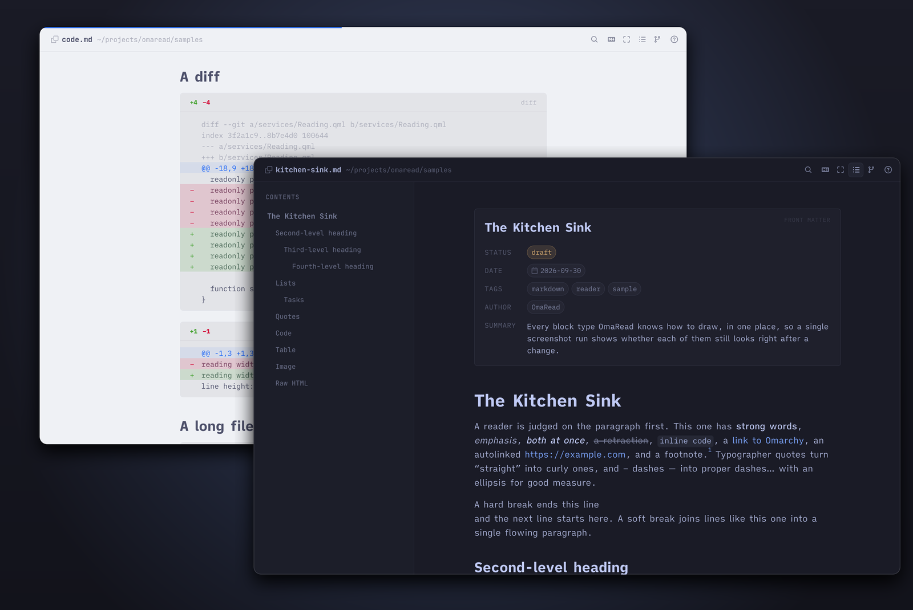
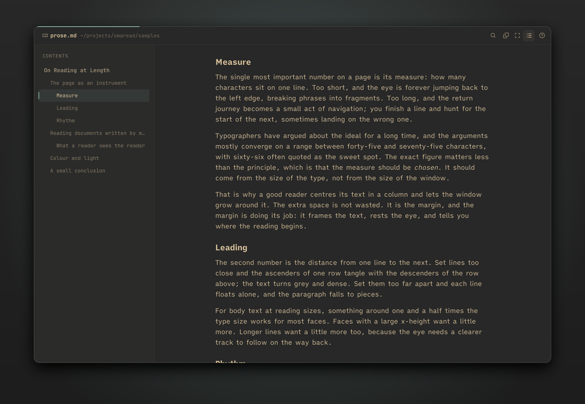
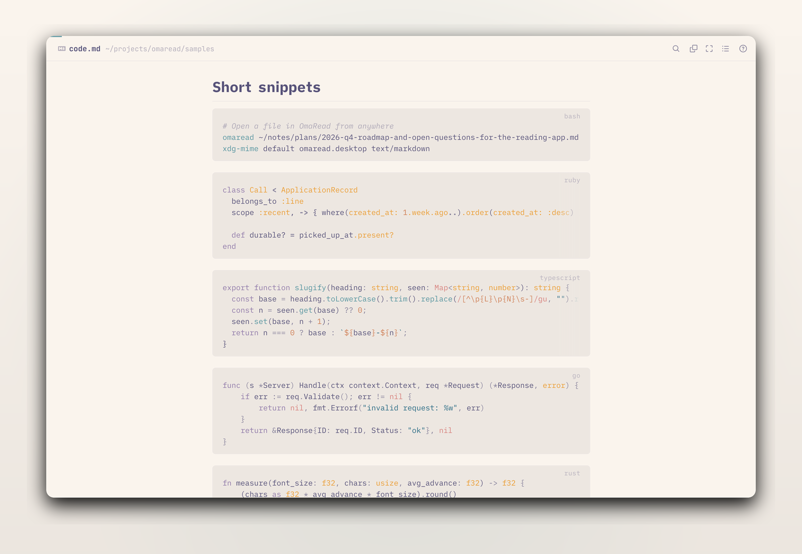
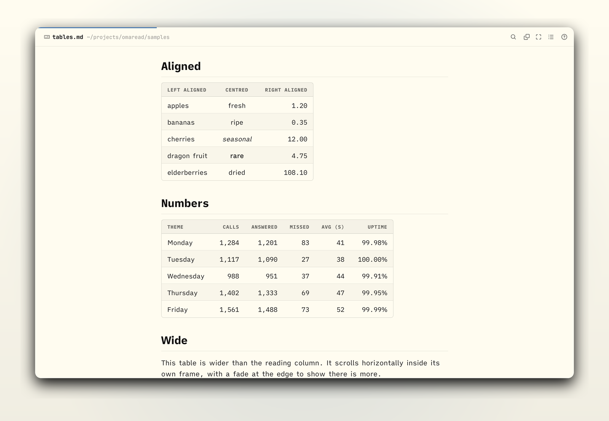
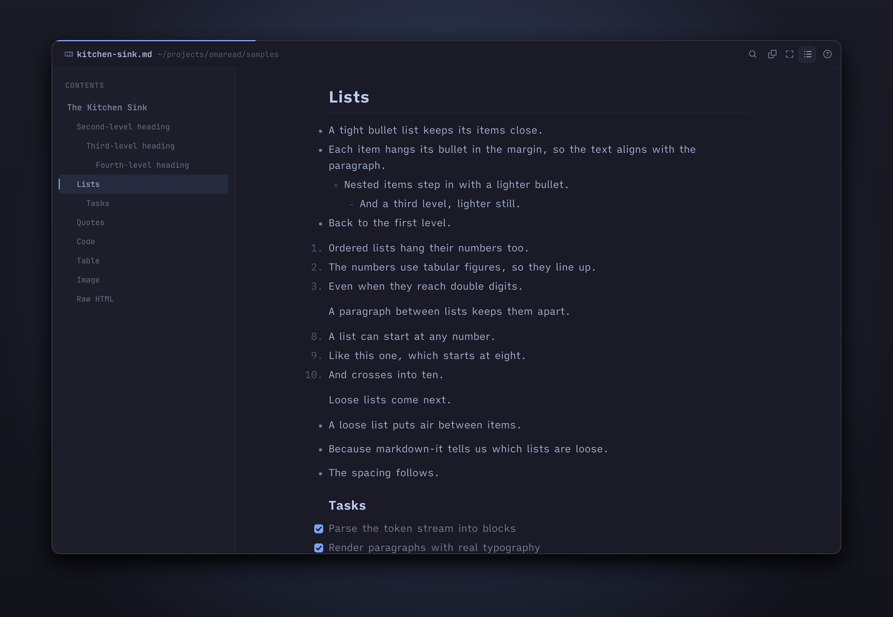
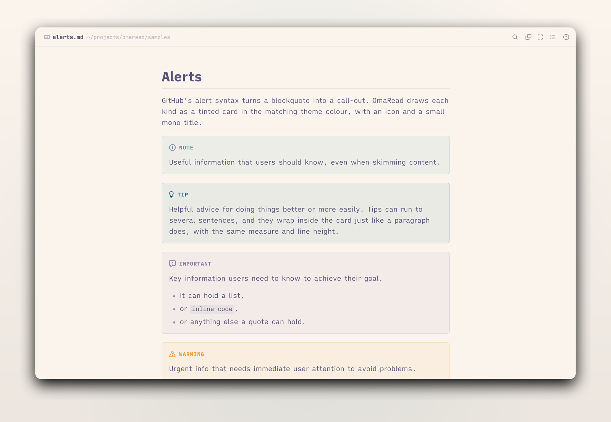
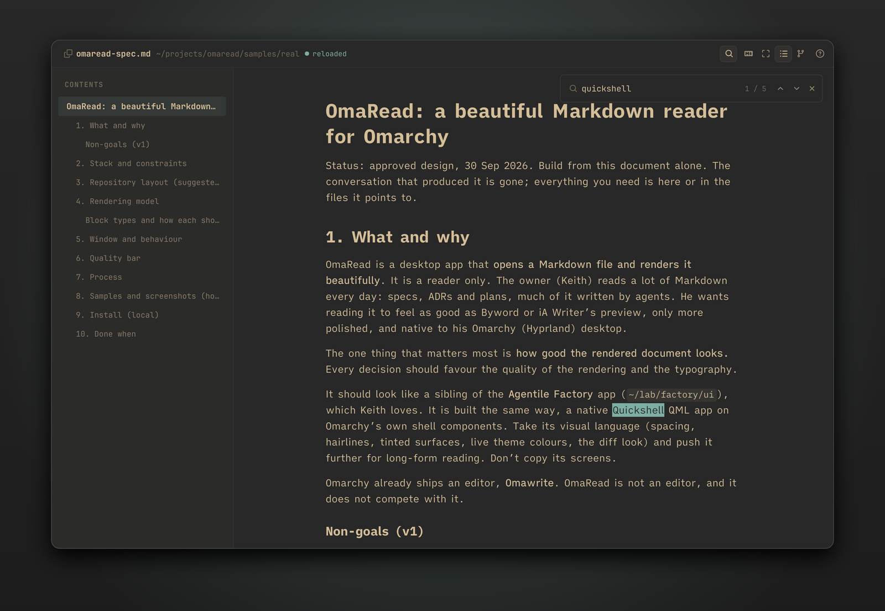
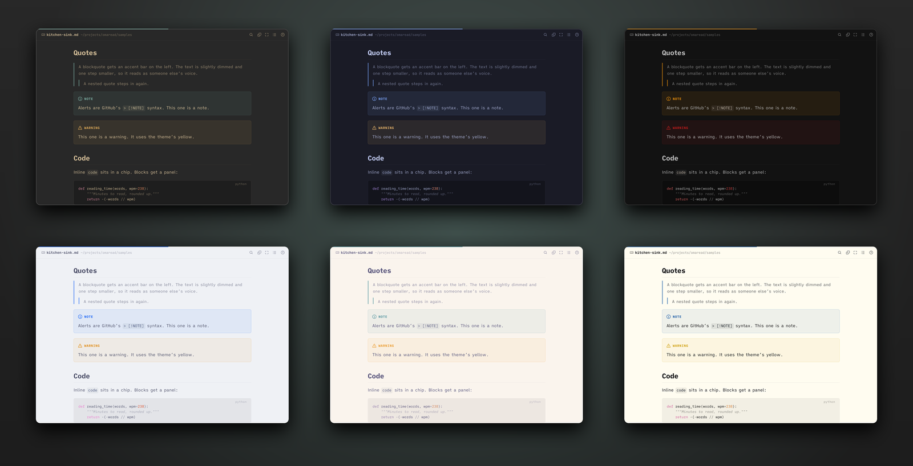
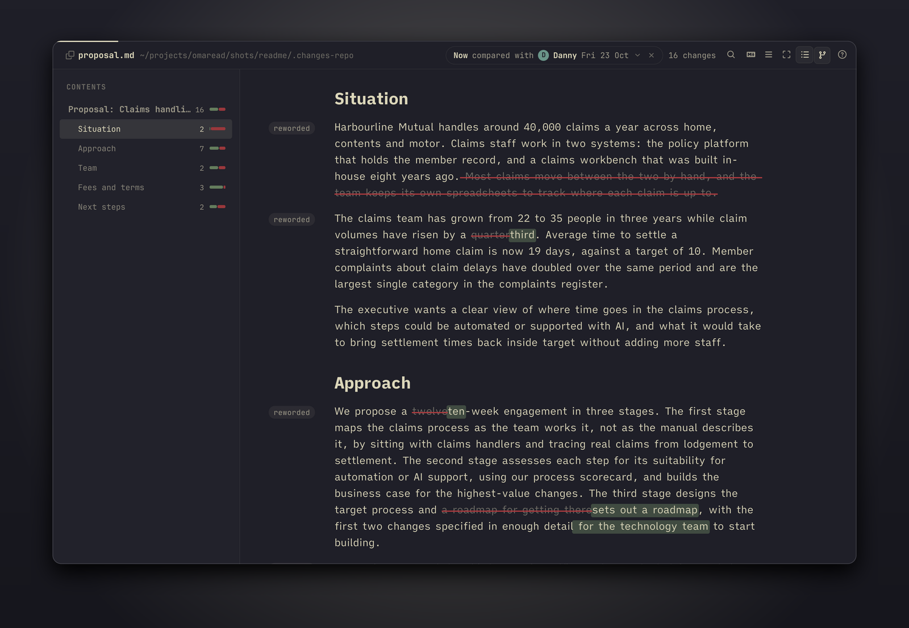

# OmaRead

A Markdown reader for [Omarchy](https://omarchy.org). It opens a file and sets it the way a
good book is set: a 68-character measure, real leading, and every block (tables, code, alerts,
front matter) drawn as its own native component. It follows your Omarchy theme as you switch,
keeps your place while an editor or agent rewrites the file, and shows what changed between two
versions of a file in git. It is a reader only.



Version 0.4.0. Built in QML on Quickshell and Omarchy's own shell components, with no web view.

## Install

On Omarchy (Arch Linux with Hyprland):

```
sudo pacman -S --needed quickshell ttf-ia-writer syntax-highlighting ruby git
git clone --recurse-submodules https://github.com/keithrowell/omaread.git ~/.local/src/omaread
~/.local/src/omaread/ops/install
```

The install script links `omaread` and `omachanges` into `~/.local/bin` and adds a desktop entry
and icon. The `ruby` package is needed even if you manage Ruby with mise: the launcher runs on
`/usr/bin/ruby`, so opening a document never depends on a version manager or on the directory it
was opened from. It does not make OmaRead your default Markdown app; to do that:

```
xdg-mime default omaread.desktop text/markdown
```

To update:

```
git -C ~/.local/src/omaread pull --recurse-submodules
```

`syntax-highlighting` (KDE's KSyntaxHighlighting) colours code blocks. Without it, code shows as
plain monospace. The fonts are iA Writer Quattro S and Mono S from `ttf-ia-writer`, and the icons
come from JetBrainsMono Nerd Font, which Omarchy installs.

## Use

```
omaread notes/plan.md
omaread docs/spec.md#5-window-and-behaviour
omaread
```

One background process owns every window. A second `omaread file.md` hands the file to it and
opens a new window straight away. With no file you get your recent files. Hyprland sees the
window class `omaread`.

## What it does



The reading column is measured from the font, not the window, and the outline marks the section
you are in as you scroll. The thin line along the top edge is how far through the file you are.



Code is highlighted in your theme's own colours: OmaRead generates a highlighting theme from each
Omarchy `colors.toml`. Blocks get a language badge, a copy button on hover, and line numbers past
eight lines. Diffs get green and red bands and a `+N −M` count.



Tables are a real grid: alignment from the separator row, tabular figures, and columns that fit
the page or scroll inside their own frame when they cannot.



Bullets and numbers hang in the margin, tasks get drawn checkboxes, and headings sit on a 1.25
scale.



`> [!NOTE]`, `[!TIP]`, `[!IMPORTANT]`, `[!WARNING]` and `[!CAUTION]` become tinted cards. Front
matter becomes a card too, with statuses and dates as pills, whether it is YAML between `---`
fences or bare `key: value` lines ended by a blank line. HTML comments, such as agent
snapshot headers, are hidden. HTML that is only `` tags, the usual way to put screenshots side
by side, shows the images in a row; any other raw HTML is shown as source, never interpreted.



Ctrl+F finds across the whole document. When the file changes on disk it reloads in place and
keeps you on the same paragraph, even when text is added above it.



## Changes



When the file is in a git repository with earlier check-ins, a branching chip joins the header.
Click it (or press `V`) and pick a version, and the window compares the file as it is now with
that version, set the same way: one reading column, the changes marked in the line. Added words
sit on a wash in your theme's green. Removed words stay where they were, faded, under a strike in
its red. The margin says what happened to each paragraph. Versions are people and times, never
commits. The pill in the header names the two ends, "Now compared with Danny, Fri 23 Oct", with
the change count beside it, and the outline adds each section's count at the right. A dot on the
chip means the file on disk differs from its last check-in.

```
omaread proposal.md --from danny
omaread proposal.md --from yesterday
omaread proposal.md --from sent
omaread proposal.md --from "before danny fri" --to "danny fri"
omaread proposal.md --changes
omaread proposal.md --list
```

`--changes` compares with the newest version whose text differs from the file on disk, so a file
with uncommitted edits shows them, and a clean file shows its last check-in against the one
before. `omachanges` is the same command with `--changes` implied.

| `--from` or `--to` | Resolves to |
|---|---|
| `danny`, `keith`, `me` | That person's most recent check-in of the file. A first name is enough; `me` is your git user name |
| `yesterday`, `today`, `3 days ago`, `a week ago`, `fri`, `23 oct`, `2026-10-23` | The last check-in at or before the end of that day. A bare weekday is the most recent one before today |
| `danny fri`, `keith 23 oct` | That person's last check-in on or before that day |
| `sent` | The check-in at or before the date in `SENT.md` in the file's directory |
| `before X` | The check-in just before whatever X resolves to; `before now` is what `--changes` uses |
| `now` | The file on disk |
| a SHA, `HEAD~2`, a tag | Still works, shown as a person and a time all the same |

`--list` prints the file's versions, one per line (person, time, message), and opens nothing.


`F` folds everything that did not change. Runs of unchanged paragraphs become one hairline row
that says how many there were, and untouched sections fold to their heading. Click a row to open
it in place. `N` and `P` move between changes. When the newer side is the file on disk, a change
on disk re-runs the comparison and keeps your place, so OmaRead can sit beside your editor and
follow the edit. `Esc`, or the cross on the pill, goes back to plain reading at the same place.


The list under the pill offers shortcuts first (each other author's last edit, your last edit,
yesterday, a week ago, and when it was sent if the directory has a `SENT.md`), then every
check-in of the file with the person, the time and the message. Rest on a row to read the whole
message. "Compare two past versions…" at the foot lets you pick both ends.

A skill at `~/.claude/skills/omachanges/SKILL.md` turns "show me the diff between this and
Danny's version" or "what changed in the proposal since yesterday" into the command above and
opens the window on the session's workspace.

## Keys

| Key | Does |
|---|---|
| `j` `k` `↓` `↑` | Scroll |
| `Space` `Shift+Space` | Page down, page up |
| `g g` `G` | Top, bottom |
| `O` or `Ctrl+\` | Show or hide the outline |
| `V` | Choose the versions to compare (when the file has check-ins) |
| `N` `P` | Next and previous change |
| `F` | Only what changed, or everything |
| `W` | Switch between the reading measure (68 characters) and a wide one (100) |
| `Ctrl++` `Ctrl+-` `Ctrl+0` | Zoom the text (remembered) |
| `Ctrl+F` or `/` | Find; `Enter` and `Shift+Enter` (or `n` and `N`) step through matches, `Esc` closes |
| Right-click a block | Copy its Markdown source |
| `Ctrl+Shift+C` | Copy the Markdown of the block under the mouse |
| `Ctrl+Shift+A` | Copy the whole file |
| `Ctrl+O` | Open a file (or drop one on the window) |
| `Ctrl+R` | Reload |
| `Ctrl+W` or `q` | Close the window |
| `Esc` | Close the list or the find bar, or go back from a comparison to reading |
| `?` | Show all of this |

Hovering a heading shows a `#` in the margin; clicking it copies `file.md#heading`. Links to
other Markdown files open in a new window at their anchor, and web links open in your browser.

## Development

| Command | What it does |
|---|---|
| `tools/test` | Runs the library's tests (the renderer, the diff engine, the launcher) and then this app's |
| `tools/check-changes` | Drives changes mode in an offscreen window over IPC on a sample history (`samples/changes/make-repo`) |
| `tools/screenshot [sample…] [--themes a,b]` | Renders samples under themes to `shots/`, offscreen, and fails on any warning in the log |
| `tools/readme-shots` | Renders the screenshots in this README |
| `tools/dev start FILE` | Starts a private offscreen instance to drive over IPC (`state`, `key`, `shot`) |
| `tools/check-live` | Edits, renames, deletes and restores a file under a running instance |
| `tools/check-theme` | Switches a fake Omarchy theme under a running instance |

`docs/spec.md` is the original brief, `docs/decisions/` records the choices made while building
it, and `docs/REPORT.md` covers how it was checked and what is still missing. The log is in
`~/.local/state/omaread/qs.log`.

| Path | Holds |
|---|---|
| `vendor/omarky/` | [Omarky](https://github.com/keithrowell/omarky), the library OmaRead and OmaWriter share: the renderer, the diff engine, the chrome, the launcher's Ruby, the tests and the samples. `tools/vendor` moves it to the library checkout's HEAD |
| `ui/shell.qml`, `ui/app/` | This app: the shell, the reader window, the header, the outline, the empty state and the shortcut sheet |
| `bin/omaread`, `launcher/` | The command line: flags into targets for the window, on `Omarky::Instance` |

## Using the renderer in another app

The reading column is a component of its own, `components/MarkdownView.qml` in
[Omarky](https://github.com/keithrowell/omarky). Vendor the library as a submodule, link its
`Commons`, `Ui`, `components`, `services`, `lib` and `vendor` directories into your Quickshell
root as this app does under `ui/`, and it takes a Markdown string (or a file path) and hands
links back:

```qml
import qs.components

MarkdownView {
  markdown: article.text
  baseUrl: article.url          // relative images and links resolve against it
  externalLinks: true           // web links come to you instead of the browser
  onLinkActivated: url => openArticle(url)
}
```

It also has `path` (a file, watched and reloaded), `wide`, `documentName`, the `notice(text)`
and `openFile(path, anchor)` signals, and `doc`, `view`, `finder` and `progress` for building
an outline, find or a progress line around it, as `components/ReaderWindow.qml` does.
MarkdownView draws no background of its own: paint `Theme.bg` behind it (from `qs.services`), as
the reader window does. A new `markdown` string opens at the top with find cleared; an empty
one clears the view.

A string read from a local file can still find its images and sibling files: give `baseUrl` a
directory (`/abs/dir` or `file:///abs/dir`), and relative links to `.md` files come back through
`openFile`. Set `keepPlace: true` when a new string is the same document edited (a file changed
on disk), and the reader stays where they were instead of going back to the top; set `markdown`
to `""` before showing a different document.

### Fonts

The reading column uses three families, each of which an app or the environment can change:

| Role | Default | Environment | From QML |
|---|---|---|---|
| Prose (paragraphs, lists, tables) | iA Writer Quattro S | `OMAREAD_PROSE_FONT` | `Reading.proseFamily` |
| Headings, `Family/Style` | iA Writer Quattro S/Bold | `OMAREAD_HEADING_FONT` | `Reading.headingFamily` |
| Code and labels | iA Writer Mono S | `OMAREAD_MONO_FONT` (or the older `OMAREAD_CODE_FONT`) | `Reading.monoFamily` |

```qml
import qs.services

Component.onCompleted: {
  Reading.proseFamily = "IBM Plex Sans"
  Reading.headingFamily = "IBM Plex Sans/Bold"
  Reading.monoFamily = "IBM Plex Mono"
}
```

The environment wins over the app, so it stays a switch for comparing candidates. A family that
is not installed falls back to the default above (a heading's style falls back with it), never
to whatever Qt would substitute, so an app can ask for a font before it is installed. The
68-character measure is computed from whichever prose font is in use. `Reading.refreshFonts()`
re-reads the installed families after a font is installed while the app is running.

## Licence

MIT. `Commons/` and `Ui/` are copied from the Omarchy shell (MIT) and `vendor/markdown-it.js` is
markdown-it (MIT).
