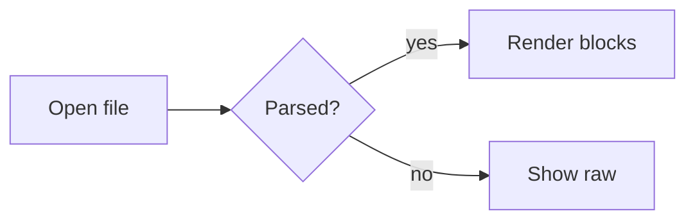

# Code

Code blocks are exhibits placed on the page. Each gets a panel, a language badge and a copy
button, and anything longer than eight lines gets line numbers. Long lines scroll inside the panel;
they never wrap.

## Short snippets

```bash
# Open a file in OmarkyReader from anywhere
omarky read ~/notes/plans/2026-q4-roadmap-and-open-questions-for-the-reading-app.md
xdg-mime default omarky-reader.desktop text/markdown
```

```ruby
class Call < ApplicationRecord
  belongs_to :line
  scope :recent, -> { where(created_at: 1.week.ago..).order(created_at: :desc) }

  def durable? = picked_up_at.present?
end
```

```typescript
export function slugify(heading: string, seen: Map<string, number>): string {
  const base = heading.toLowerCase().trim().replace(/[^\p{L}\p{N}\s-]/gu, "").replace(/\s/g, "-");
  const n = seen.get(base) ?? 0;
  seen.set(base, n + 1);
  return n === 0 ? base : `${base}-${n}`;
}
```

```go
func (s *Server) Handle(ctx context.Context, req *Request) (*Response, error) {
	if err := req.Validate(); err != nil {
		return nil, fmt.Errorf("invalid request: %w", err)
	}
	return &Response{ID: req.ID, Status: "ok"}, nil
}
```

```rust
fn measure(font_size: f32, chars: usize, avg_advance: f32) -> f32 {
    (chars as f32 * avg_advance * font_size).round()
}
```

```sql
SELECT line_id, count(*) AS calls, avg(duration_s)::int AS avg_s
FROM calls
WHERE picked_up_at >= now() - interval '7 days'
GROUP BY line_id
ORDER BY calls DESC;
```

```json
{ "name": "omarky-reader", "version": "1.0.0", "recent": ["~/notes/plan.md", "~/specs/spec.md"], "zoom": 1.1 }
```

```yaml
theme: gruvbox
reading:
  measure: 68
  line_height: 1.6
  fonts: [iA Writer Quattro S, iA Writer Mono S]
```

```toml
[font]
base-size = 14

[spacing]
scale = 1.0
```

```qml
TextEdit {
    readOnly: true
    selectByMouse: true
    textFormat: TextEdit.RichText
    font.family: "iA Writer Quattro S"
}
```

```css
.page { max-width: 68ch; margin: 0 auto; line-height: 1.6; font-family: "iA Writer Quattro S"; }
```

```lua
hl.bind("SUPER + R", function() hl.exec("omarky read ~/notes/today.md") end)
```

```c
static int clamp(int v, int lo, int hi) { return v < lo ? lo : v > hi ? hi : v; }
```

## A long line

```js
const message = "This line is deliberately far longer than the reading column so that the panel has to scroll horizontally instead of wrapping, which would destroy the shape of the code.";
```

## No language, unknown language, maths and diagrams

```
Plain fenced block with no info string.
    Indentation is preserved exactly.
```

    An indented code block, the CommonMark way.

```brainfuck-ish
++++++++[>++++[>++>+++>+++>+<<<<-]>+>+>->>+[<]<-]>>.>---.
```

```math
\int_0^1 x^2 \, dx = \frac{1}{3}
```



## A diff

```diff
diff --git a/services/Reading.qml b/services/Reading.qml
index 3f2a1c9..8b7e4d0 100644
--- a/services/Reading.qml
+++ b/services/Reading.qml
@@ -18,9 +18,8 @@ Singleton {
   readonly property real body: Math.round(Style.font.body * 1.2 * zoom)
-  readonly property real lineHeight: 1.45
-  readonly property real ratio: 1.2
-  readonly property real codeSize: Math.round(body * 0.9)
-  readonly property real codeLeading: 1.4
+  readonly property real lineHeight: 1.6
+  readonly property real ratio: 1.25
+  readonly property real codeSize: Math.round(body * 0.84)
+  readonly property real codeLeading: 1.5
 
   function size(step) { return Math.round(body * Math.pow(ratio, step)) }
 }
```

```patch
@@ -1,3 +1,3 @@
-reading width: 60
+reading width: 68
 line height: 1.6
```

## A long file

```python
"""Reading-time estimates and a tiny Markdown outline extractor.

This module is deliberately long so the code panel shows its line-number
gutter and how a big block sits in the reading column.
"""

from __future__ import annotations

import re
from dataclasses import dataclass, field
from pathlib import Path
from typing import Iterable, Iterator

WORDS_PER_MINUTE = 238
HEADING = re.compile(r"^(#{1,6})\s+(.*?)\s*#*\s*$")
FENCE = re.compile(r"^(`{3,}|~{3,})")


@dataclass
class Heading:
    level: int
    text: str
    line: int
    children: list["Heading"] = field(default_factory=list)

    @property
    def slug(self) -> str:
        base = re.sub(r"[^\w\s-]", "", self.text.lower()).strip()
        return re.sub(r"\s", "-", base)


@dataclass
class Document:
    path: Path
    lines: list[str]

    @classmethod
    def open(cls, path: str | Path) -> "Document":
        p = Path(path).expanduser()
        return cls(p, p.read_text(encoding="utf-8", errors="replace").splitlines())

    def words(self) -> int:
        return sum(len(line.split()) for line in self.prose_lines())

    def minutes(self) -> int:
        return max(1, -(-self.words() // WORDS_PER_MINUTE))

    def prose_lines(self) -> Iterator[str]:
        fence = None
        for line in self.lines:
            m = FENCE.match(line)
            if m:
                marker = m.group(1)[0]
                fence = None if fence == marker else (fence or marker)
                continue
            if fence is None:
                yield line

    def headings(self) -> list[Heading]:
        found: list[Heading] = []
        fence = None
        for n, line in enumerate(self.lines, start=1):
            m = FENCE.match(line)
            if m:
                marker = m.group(1)[0]
                fence = None if fence == marker else (fence or marker)
                continue
            if fence:
                continue
            h = HEADING.match(line)
            if h:
                found.append(Heading(len(h.group(1)), h.group(2), n))
        return found

    def outline(self) -> list[Heading]:
        roots: list[Heading] = []
        stack: list[Heading] = []
        for h in self.headings():
            while stack and stack[-1].level >= h.level:
                stack.pop()
            (stack[-1].children if stack else roots).append(h)
            stack.append(h)
        return roots


def walk(headings: Iterable[Heading], depth: int = 0) -> Iterator[tuple[int, Heading]]:
    for h in headings:
        yield depth, h
        yield from walk(h.children, depth + 1)


def render_outline(doc: Document) -> str:
    rows = [f"{'  ' * d}- {h.text}  (line {h.line})" for d, h in walk(doc.outline())]
    return "\n".join(rows)


def main(argv: list[str]) -> int:
    if len(argv) < 2:
        print("usage: outline.py FILE.md")
        return 2
    doc = Document.open(argv[1])
    print(f"{doc.path.name}: {doc.words()} words, about {doc.minutes()} min")
    print(render_outline(doc))
    return 0


if __name__ == "__main__":
    import sys

    raise SystemExit(main(sys.argv))
```
