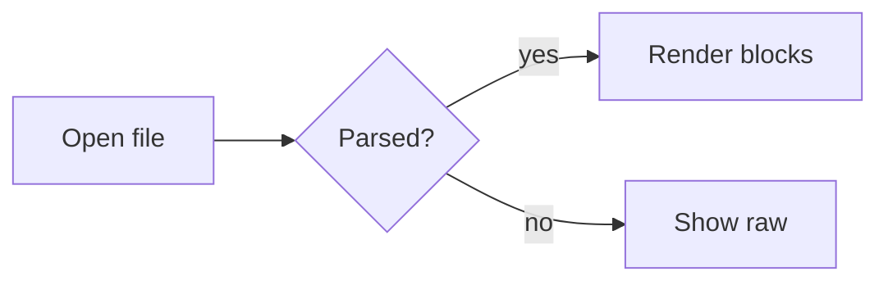

# A Very Long Document

Five thousand lines and more, stitched from the other samples, to check that OmarkyReader opens big files quickly and scrolls them smoothly.

# Chapter 1: Prose

## On Reading at Length

Most of what we read on a screen was never meant to be read slowly. It was meant to be scanned,
skimmed, triaged and dismissed: the notification, the status line, the diff summary, the chat
message that wants an answer before it has finished arriving. The screen trains us to glance.
And then, a few times a day, it hands us something that deserves more than a glance, a design
document or a long argument or a careful plan, and we meet it with the same restless eye.

This essay is about that second kind of reading, and about what a tool can do to make room for it.
It is not about speed. Nobody needs to read a specification faster. The goal is to read it
*once*, properly, and come away knowing what it said.

### The page as an instrument

A printed page is an instrument with a long history of tuning. Its margins, its measure, the gap
between its lines and the weight of its type were not chosen for beauty alone; they were adjusted,
over centuries, until reading stopped being work. When a book is set well, you do not notice the
setting. You notice only that an hour has passed.

Screens threw much of that away, not out of malice but out of indifference. Text was poured into
whatever container happened to be on hand. A line ran as wide as the window. Paragraphs were
separated by a blank line because that was what the markup produced. Headings were big because
big meant important. Every one of these defaults is defensible on its own, and together they make
reading harder than it needs to be.

The good news is that almost none of it is difficult to fix. The fixes are old and well known.
They simply have to be applied with care, one decision at a time, and then left alone.

#### Measure

The single most important number on a page is its measure: how many characters sit on one line.
Too short, and the eye is forever jumping back to the left edge, breaking phrases into fragments.
Too long, and the return journey becomes a small act of navigation; you finish a line and hunt
for the start of the next, sometimes landing on the wrong one.

Typographers have argued about the ideal for a long time, and the arguments mostly converge on a
range between forty-five and seventy-five characters, with sixty-six often quoted as the sweet
spot. The exact figure matters less than the principle, which is that the measure should be
*chosen*. It should come from the size of the type, not from the size of the window.

That is why a good reader centres its text in a column and lets the window grow around it. The
extra space is not wasted. It is the margin, and the margin is doing its job: it frames the text,
rests the eye, and tells you where the reading begins.

#### Leading

The second number is the distance from one line to the next. Set lines too close and the
ascenders of one row tangle with the descenders of the row above; the text turns grey and dense.
Set them too far apart and each line floats alone, and the paragraph falls to pieces.

For body text at reading sizes, something around one and a half times the type size works for
most faces. Faces with a large x-height want a little more. Longer lines want a little more too,
because the eye needs a clearer track to follow on the way back.

#### Rhythm

Beyond the two numbers there is rhythm: the pattern of space between paragraphs, before and after
headings, around quotations and lists and code. Rhythm is where most screen typography quietly
fails, because each element is spaced on its own terms and nobody looks at how they meet.

A heading should sit closer to the text it introduces than to the text it follows. It belongs to
what comes next. A quotation should step away from the body just far enough to be heard as another
voice. A code block should feel like an exhibit placed on the page, not a hole cut through it.

> Good typography is invisible. Bad typography is everywhere, and it is invisible too, which is
> exactly the problem: we have stopped noticing what it costs us.

None of these rules is absolute, and none of them needs to be applied with a ruler. They need to
be applied with an eye, and checked again with the eye, until the page reads the way a page
should.

### Reading documents written by machines

A growing share of what many of us read is written, at least in its first draft, by software.
Agents write plans, decisions, research notes and summaries. They write a great deal of them,
quickly, and they write them in Markdown, because Markdown is what they were trained on and what
the tools around them expect.

This changes the reading problem in a few interesting ways.

First, there is simply more to read. When a plan used to take an afternoon to write, it was
natural to read it carefully. When it takes a minute, the temptation is to skim it just as fast,
and skimming a plan is how the wrong thing gets built.

Second, machine-written documents are structurally rich. They lean on headings, lists, tables,
code blocks and call-outs, often all in one file. A reader that renders only paragraphs well will
render most of these documents badly. The structure is part of the message, and it has to look
like structure.

Third, these documents change while you read them. An agent revises its plan; a spec is updated in
place; a note gains a new section. A reader that notices the change and keeps your place, without
a flash and without losing the paragraph you were on, turns a jarring interruption into something
closer to watching a colleague edit a page on the desk beside you.

#### What a reader owes the reader

It is worth being plain about what a tool like this is for. It does not edit. It does not
organise files, sync them, publish them or share them. It opens one document and shows it as well
as it can be shown, and then it gets out of the way.

That narrowness is a feature. Every capability a reading tool adds is a capability that competes
for attention with the text. Toolbars, panels, badges and buttons are each a small tax, and the
taxes add up. The best reading tools feel almost empty: a column of text, a quiet margin, and
nothing else unless you ask for it.

What you do ask for should be instant. An outline, to see the shape of a long document and jump
around in it. A find bar, to locate the one paragraph you half remember. A way to copy a passage
as the Markdown it came from, so you can quote it back to the agent that wrote it. Each of these
should appear when called and vanish when dismissed.

### Colour and light

The last dimension is colour, and here a desktop reader has an advantage a printed book never had:
it can match its surroundings. If your desktop is dark and warm, the page can be dark and warm. If
you switch to a light theme at sunrise, the page can follow without being asked.

Matching the theme is not only a matter of swapping the background. Every tier of emphasis has to
move with it: the body text, the dimmer text of a quotation, the fainter text of a caption, the
tint behind a code block, the hairline under a heading. In a dark theme, surfaces rise toward the
light; in a light theme, they sink toward the ink. Get the tiers right and a single set of rules
produces a page that feels native in every theme. Get them wrong and one theme looks crafted while
the next looks like a ransom note.

Syntax colouring is the hardest case. Code in a reader should look like code in the reader's own
editor, which means drawing its colours from the same palette as everything else, not from a
separate scheme bolted on from elsewhere.

### A small conclusion

There is nothing new in any of this. The measure, the leading, the rhythm and the colour were all
worked out long ago, by people who cared about reading more than most of us ever will. The only
new thing is the volume of text now arriving on our screens, and the growing share of it that
deserves to be read properly.

A good reader is a small act of respect for that text and for the person reading it. It says:
this is worth your full attention, and here is a page that will not waste it.

# Chapter 2: Code

## Code

Code blocks are exhibits placed on the page. Each gets a panel, a language badge and a copy
button, and anything longer than eight lines gets line numbers. Long lines scroll inside the panel;
they never wrap.

### Short snippets

```bash
## Open a file in OmarkyReader from anywhere
omarky read ~/notes/plans/2026-q4-roadmap-and-open-questions-for-the-reading-app.md
xdg-mime default omarky-reader.desktop text/markdown
```

```ruby
class Call < ApplicationRecord
  belongs_to :line
  scope :recent, -> { where(created_at: 1.week.ago..).order(created_at: :desc) }

  def durable? = picked_up_at.present?
end
```

```typescript
export function slugify(heading: string, seen: Map<string, number>): string {
  const base = heading.toLowerCase().trim().replace(/[^\p{L}\p{N}\s-]/gu, "").replace(/\s/g, "-");
  const n = seen.get(base) ?? 0;
  seen.set(base, n + 1);
  return n === 0 ? base : `${base}-${n}`;
}
```

```go
func (s *Server) Handle(ctx context.Context, req *Request) (*Response, error) {
	if err := req.Validate(); err != nil {
		return nil, fmt.Errorf("invalid request: %w", err)
	}
	return &Response{ID: req.ID, Status: "ok"}, nil
}
```

```rust
fn measure(font_size: f32, chars: usize, avg_advance: f32) -> f32 {
    (chars as f32 * avg_advance * font_size).round()
}
```

```sql
SELECT line_id, count(*) AS calls, avg(duration_s)::int AS avg_s
FROM calls
WHERE picked_up_at >= now() - interval '7 days'
GROUP BY line_id
ORDER BY calls DESC;
```

```json
{ "name": "omarky-reader", "version": "1.0.0", "recent": ["~/notes/plan.md", "~/specs/spec.md"], "zoom": 1.1 }
```

```yaml
theme: gruvbox
reading:
  measure: 68
  line_height: 1.6
  fonts: [iA Writer Quattro S, iA Writer Mono S]
```

```toml
[font]
base-size = 14

[spacing]
scale = 1.0
```

```qml
TextEdit {
    readOnly: true
    selectByMouse: true
    textFormat: TextEdit.RichText
    font.family: "iA Writer Quattro S"
}
```

```css
.page { max-width: 68ch; margin: 0 auto; line-height: 1.6; font-family: "iA Writer Quattro S"; }
```

```lua
hl.bind("SUPER + R", function() hl.exec("omarky read ~/notes/today.md") end)
```

```c
static int clamp(int v, int lo, int hi) { return v < lo ? lo : v > hi ? hi : v; }
```

### A long line

```js
const message = "This line is deliberately far longer than the reading column so that the panel has to scroll horizontally instead of wrapping, which would destroy the shape of the code.";
```

### No language, unknown language, maths and diagrams

```
Plain fenced block with no info string.
    Indentation is preserved exactly.
```

    An indented code block, the CommonMark way.

```brainfuck-ish
++++++++[>++++[>++>+++>+++>+<<<<-]>+>+>->>+[<]<-]>>.>---.
```

```math
\int_0^1 x^2 \, dx = \frac{1}{3}
```



### A diff

```diff
diff --git a/services/Reading.qml b/services/Reading.qml
index 3f2a1c9..8b7e4d0 100644
--- a/services/Reading.qml
+++ b/services/Reading.qml
@@ -18,9 +18,8 @@ Singleton {
   readonly property real body: Math.round(Style.font.body * 1.2 * zoom)
-  readonly property real lineHeight: 1.45
-  readonly property real ratio: 1.2
-  readonly property real codeSize: Math.round(body * 0.9)
-  readonly property real codeLeading: 1.4
+  readonly property real lineHeight: 1.6
+  readonly property real ratio: 1.25
+  readonly property real codeSize: Math.round(body * 0.84)
+  readonly property real codeLeading: 1.5
 
   function size(step) { return Math.round(body * Math.pow(ratio, step)) }
 }
```

```patch
@@ -1,3 +1,3 @@
-reading width: 60
+reading width: 68
 line height: 1.6
```

### A long file

```python
"""Reading-time estimates and a tiny Markdown outline extractor.

This module is deliberately long so the code panel shows its line-number
gutter and how a big block sits in the reading column.
"""

from __future__ import annotations

import re
from dataclasses import dataclass, field
from pathlib import Path
from typing import Iterable, Iterator

WORDS_PER_MINUTE = 238
HEADING = re.compile(r"^(#{1,6})\s+(.*?)\s*#*\s*$")
FENCE = re.compile(r"^(`{3,}|~{3,})")


@dataclass
class Heading:
    level: int
    text: str
    line: int
    children: list["Heading"] = field(default_factory=list)

    @property
    def slug(self) -> str:
        base = re.sub(r"[^\w\s-]", "", self.text.lower()).strip()
        return re.sub(r"\s", "-", base)


@dataclass
class Document:
    path: Path
    lines: list[str]

    @classmethod
    def open(cls, path: str | Path) -> "Document":
        p = Path(path).expanduser()
        return cls(p, p.read_text(encoding="utf-8", errors="replace").splitlines())

    def words(self) -> int:
        return sum(len(line.split()) for line in self.prose_lines())

    def minutes(self) -> int:
        return max(1, -(-self.words() // WORDS_PER_MINUTE))

    def prose_lines(self) -> Iterator[str]:
        fence = None
        for line in self.lines:
            m = FENCE.match(line)
            if m:
                marker = m.group(1)[0]
                fence = None if fence == marker else (fence or marker)
                continue
            if fence is None:
                yield line

    def headings(self) -> list[Heading]:
        found: list[Heading] = []
        fence = None
        for n, line in enumerate(self.lines, start=1):
            m = FENCE.match(line)
            if m:
                marker = m.group(1)[0]
                fence = None if fence == marker else (fence or marker)
                continue
            if fence:
                continue
            h = HEADING.match(line)
            if h:
                found.append(Heading(len(h.group(1)), h.group(2), n))
        return found

    def outline(self) -> list[Heading]:
        roots: list[Heading] = []
        stack: list[Heading] = []
        for h in self.headings():
            while stack and stack[-1].level >= h.level:
                stack.pop()
            (stack[-1].children if stack else roots).append(h)
            stack.append(h)
        return roots


def walk(headings: Iterable[Heading], depth: int = 0) -> Iterator[tuple[int, Heading]]:
    for h in headings:
        yield depth, h
        yield from walk(h.children, depth + 1)


def render_outline(doc: Document) -> str:
    rows = [f"{'  ' * d}- {h.text}  (line {h.line})" for d, h in walk(doc.outline())]
    return "\n".join(rows)


def main(argv: list[str]) -> int:
    if len(argv) < 2:
        print("usage: outline.py FILE.md")
        return 2
    doc = Document.open(argv[1])
    print(f"{doc.path.name}: {doc.words()} words, about {doc.minutes()} min")
    print(render_outline(doc))
    return 0


if __name__ == "__main__":
    import sys

    raise SystemExit(main(sys.argv))
```

# Chapter 3: Tables

## Tables

A table is a real grid: a tinted header band, hairline rules between rows, generous padding and
column alignment taken from the separator row. Numbers use tabular figures so the digits line up.

### Narrow

| Key | Action |
|-----|--------|
| `j` / `k` | Scroll down / up |
| `g g` / `G` | Top / bottom |
| `Ctrl+F` | Find |
| `?` | Shortcut sheet |

### Aligned

| Left aligned | Centred | Right aligned |
|:-------------|:-------:|--------------:|
| apples | fresh | 1.20 |
| bananas | ripe | 0.35 |
| cherries | *seasonal* | 12.00 |
| dragon fruit | **rare** | 4.75 |
| elderberries | dried | 108.10 |

### Numbers

| Theme | Calls | Answered | Missed | Avg (s) | Uptime |
|:------|------:|---------:|-------:|--------:|-------:|
| Monday | 1,284 | 1,201 | 83 | 41 | 99.98% |
| Tuesday | 1,117 | 1,090 | 27 | 38 | 100.00% |
| Wednesday | 988 | 951 | 37 | 44 | 99.91% |
| Thursday | 1,402 | 1,333 | 69 | 47 | 99.95% |
| Friday | 1,561 | 1,488 | 73 | 52 | 99.99% |

### Wide

This table is wider than the reading column. It scrolls horizontally inside its own frame, with a
fade at the edge to show there is more.

| Decision | Status | Owner | Date | Context | Consequence | Alternatives considered | Follow-up |
|----------|--------|-------|------|---------|-------------|-------------------------|-----------|
| Flat blocks in a ListView | accepted | OmarkyReader | 2026-09-30 | A 5,000-line document must open in under a second and scroll without dropped frames | Only the blocks on screen are built; nested structure lives inside each block | One rich-text document; a Flickable with every block built up front | Measure the worst scroll step on every release |
| Code colours from the theme | accepted | OmarkyReader | 2026-09-30 | Built-in highlighting themes almost match the page, which looks worse than not matching at all | A highlighting theme is generated from each Omarchy colors.toml at start-up | The nearest built-in light or dark theme | Regenerate when a new theme appears |
| One reader, many windows | accepted | OmarkyReader | 2026-09-30 | Several documents are open side by side while an agent works | A single process owns every window; a second launch hands its file over | One process per window | Measure memory with ten windows open |

### Ragged

| One | Two | Three |
|-----|-----|-------|
| only one cell |
| a | b | c | d is extra |
| | | empty first cells |

### Inline content in cells

| Feature | Example | Notes |
|---------|---------|-------|
| Links | [omarchy.org](https://omarchy.org) | Accent colour |
| Code | `md.parse(src, env)` | Chip |
| Emphasis | **bold**, *italic*, ~~struck~~ | All inline styles work |
| Escaped pipe | a \| b | Stays in one cell |

# Chapter 4: Alerts

## Alerts

GitHub's alert syntax turns a blockquote into a call-out. OmarkyReader draws each kind as a tinted card
in the matching theme colour, with an icon and a small mono title.

> [!NOTE]
> Useful information that users should know, even when skimming content.

> [!TIP]
> Helpful advice for doing things better or more easily. Tips can run to several sentences, and
> they wrap inside the card just like a paragraph does, with the same measure and line height.

> [!IMPORTANT]
> Key information users need to know to achieve their goal.
>
> - It can hold a list,
> - or `inline code`,
> - or anything else a quote can hold.

> [!WARNING]
> Urgent info that needs immediate user attention to avoid problems.

> [!CAUTION]
> Advises about risks or negative outcomes of certain actions.
>
> ```bash
> rm -rf ~/.local/state/omarchy/current/theme   # never do this by hand
> ```

### Not alerts

> [!UNKNOWN]
> An unknown kind stays an ordinary blockquote.

> A normal quote, for comparison. It has an accent bar and slightly dimmer text.

> [!NOTE] Text on the same line as the marker keeps GitHub's behaviour: this is a plain quote.

# Chapter 5: Kitchen Sink


<!-- SNAPSHOT generated by agentile 0.14.2 — do not edit this header by hand -->

## The Kitchen Sink

A reader is judged on the paragraph first. This one has **strong words**, *emphasis*, ***both at
once***, ~~a retraction~~, `inline code`, a [link to Omarchy](https://omarchy.org), an autolinked
https://example.com, and a footnote. Typographer quotes turn "straight" into curly ones,
and -- dashes --- into proper dashes... with an ellipsis for good measure.

A hard break ends this line\
and the next line starts here. A soft break
joins lines like this one into a single flowing paragraph.

### Second-level heading

#### Third-level heading

##### Fourth-level heading

###### Fifth-level heading

###### Sixth-level heading

### Lists

- A tight bullet list keeps its items close.
- Each item hangs its bullet in the margin, so the text aligns with the paragraph.
  - Nested items step in with a lighter bullet.
    - And a third level, lighter still.
- Back to the first level.

1. Ordered lists hang their numbers too.
2. The numbers use tabular figures, so they line up.
3. Even when they reach double digits.

A paragraph between lists keeps them apart.

8. A list can start at any number.
9. Like this one, which starts at eight.
10. And crosses into ten.

Loose lists come next.

- A loose list puts air between items.

- Because markdown-it tells us which lists are loose.

- The spacing follows.

#### Tasks

- [x] Parse the token stream into blocks
- [x] Render paragraphs with real typography
- [ ] Draw checkboxes rather than glyphs
- [ ] Ship it

### Quotes

> A blockquote gets an accent bar on the left. The text is slightly dimmed and one step smaller,
> so it reads as someone else's voice.
>
> > A nested quote steps in again.

> [!NOTE]
> Alerts are GitHub's `> [!NOTE]` syntax. This one is a note.

> [!WARNING]
> This one is a warning. It uses the theme's yellow.

### Code

Inline `code` sits in a chip. Blocks get a panel:

```python
def reading_time(words, wpm=238):
    """Minutes to read, rounded up."""
    return -(-words // wpm)
```

```diff
@@ -1,4 +1,4 @@
 const measure = 68
-const lineHeight = 1.4
+const lineHeight = 1.6
 const ratio = 1.25
```

### Table

| Theme            | Mode  | Accent    |  Contrast |
|:-----------------|:-----:|:----------|----------:|
| gruvbox          | dark  | `#7daea3` |    11.2:1 |
| tokyo-night      | dark  | `#7aa2f7` |     9.8:1 |
| catppuccin-latte | light | `#1e66f5` |     7.1:1 |

---

### Image


### Raw HTML

<div class="callout">Raw HTML is shown, never interpreted.</div>

That's the whole sink.


# Chapter 6: Prose

## On Reading at Length

Most of what we read on a screen was never meant to be read slowly. It was meant to be scanned,
skimmed, triaged and dismissed: the notification, the status line, the diff summary, the chat
message that wants an answer before it has finished arriving. The screen trains us to glance.
And then, a few times a day, it hands us something that deserves more than a glance, a design
document or a long argument or a careful plan, and we meet it with the same restless eye.

This essay is about that second kind of reading, and about what a tool can do to make room for it.
It is not about speed. Nobody needs to read a specification faster. The goal is to read it
*once*, properly, and come away knowing what it said.

### The page as an instrument

A printed page is an instrument with a long history of tuning. Its margins, its measure, the gap
between its lines and the weight of its type were not chosen for beauty alone; they were adjusted,
over centuries, until reading stopped being work. When a book is set well, you do not notice the
setting. You notice only that an hour has passed.

Screens threw much of that away, not out of malice but out of indifference. Text was poured into
whatever container happened to be on hand. A line ran as wide as the window. Paragraphs were
separated by a blank line because that was what the markup produced. Headings were big because
big meant important. Every one of these defaults is defensible on its own, and together they make
reading harder than it needs to be.

The good news is that almost none of it is difficult to fix. The fixes are old and well known.
They simply have to be applied with care, one decision at a time, and then left alone.

#### Measure

The single most important number on a page is its measure: how many characters sit on one line.
Too short, and the eye is forever jumping back to the left edge, breaking phrases into fragments.
Too long, and the return journey becomes a small act of navigation; you finish a line and hunt
for the start of the next, sometimes landing on the wrong one.

Typographers have argued about the ideal for a long time, and the arguments mostly converge on a
range between forty-five and seventy-five characters, with sixty-six often quoted as the sweet
spot. The exact figure matters less than the principle, which is that the measure should be
*chosen*. It should come from the size of the type, not from the size of the window.

That is why a good reader centres its text in a column and lets the window grow around it. The
extra space is not wasted. It is the margin, and the margin is doing its job: it frames the text,
rests the eye, and tells you where the reading begins.

#### Leading

The second number is the distance from one line to the next. Set lines too close and the
ascenders of one row tangle with the descenders of the row above; the text turns grey and dense.
Set them too far apart and each line floats alone, and the paragraph falls to pieces.

For body text at reading sizes, something around one and a half times the type size works for
most faces. Faces with a large x-height want a little more. Longer lines want a little more too,
because the eye needs a clearer track to follow on the way back.

#### Rhythm

Beyond the two numbers there is rhythm: the pattern of space between paragraphs, before and after
headings, around quotations and lists and code. Rhythm is where most screen typography quietly
fails, because each element is spaced on its own terms and nobody looks at how they meet.

A heading should sit closer to the text it introduces than to the text it follows. It belongs to
what comes next. A quotation should step away from the body just far enough to be heard as another
voice. A code block should feel like an exhibit placed on the page, not a hole cut through it.

> Good typography is invisible. Bad typography is everywhere, and it is invisible too, which is
> exactly the problem: we have stopped noticing what it costs us.

None of these rules is absolute, and none of them needs to be applied with a ruler. They need to
be applied with an eye, and checked again with the eye, until the page reads the way a page
should.

### Reading documents written by machines

A growing share of what many of us read is written, at least in its first draft, by software.
Agents write plans, decisions, research notes and summaries. They write a great deal of them,
quickly, and they write them in Markdown, because Markdown is what they were trained on and what
the tools around them expect.

This changes the reading problem in a few interesting ways.

First, there is simply more to read. When a plan used to take an afternoon to write, it was
natural to read it carefully. When it takes a minute, the temptation is to skim it just as fast,
and skimming a plan is how the wrong thing gets built.

Second, machine-written documents are structurally rich. They lean on headings, lists, tables,
code blocks and call-outs, often all in one file. A reader that renders only paragraphs well will
render most of these documents badly. The structure is part of the message, and it has to look
like structure.

Third, these documents change while you read them. An agent revises its plan; a spec is updated in
place; a note gains a new section. A reader that notices the change and keeps your place, without
a flash and without losing the paragraph you were on, turns a jarring interruption into something
closer to watching a colleague edit a page on the desk beside you.

#### What a reader owes the reader

It is worth being plain about what a tool like this is for. It does not edit. It does not
organise files, sync them, publish them or share them. It opens one document and shows it as well
as it can be shown, and then it gets out of the way.

That narrowness is a feature. Every capability a reading tool adds is a capability that competes
for attention with the text. Toolbars, panels, badges and buttons are each a small tax, and the
taxes add up. The best reading tools feel almost empty: a column of text, a quiet margin, and
nothing else unless you ask for it.

What you do ask for should be instant. An outline, to see the shape of a long document and jump
around in it. A find bar, to locate the one paragraph you half remember. A way to copy a passage
as the Markdown it came from, so you can quote it back to the agent that wrote it. Each of these
should appear when called and vanish when dismissed.

### Colour and light

The last dimension is colour, and here a desktop reader has an advantage a printed book never had:
it can match its surroundings. If your desktop is dark and warm, the page can be dark and warm. If
you switch to a light theme at sunrise, the page can follow without being asked.

Matching the theme is not only a matter of swapping the background. Every tier of emphasis has to
move with it: the body text, the dimmer text of a quotation, the fainter text of a caption, the
tint behind a code block, the hairline under a heading. In a dark theme, surfaces rise toward the
light; in a light theme, they sink toward the ink. Get the tiers right and a single set of rules
produces a page that feels native in every theme. Get them wrong and one theme looks crafted while
the next looks like a ransom note.

Syntax colouring is the hardest case. Code in a reader should look like code in the reader's own
editor, which means drawing its colours from the same palette as everything else, not from a
separate scheme bolted on from elsewhere.

### A small conclusion

There is nothing new in any of this. The measure, the leading, the rhythm and the colour were all
worked out long ago, by people who cared about reading more than most of us ever will. The only
new thing is the volume of text now arriving on our screens, and the growing share of it that
deserves to be read properly.

A good reader is a small act of respect for that text and for the person reading it. It says:
this is worth your full attention, and here is a page that will not waste it.

# Chapter 7: Code

## Code

Code blocks are exhibits placed on the page. Each gets a panel, a language badge and a copy
button, and anything longer than eight lines gets line numbers. Long lines scroll inside the panel;
they never wrap.

### Short snippets

```bash
## Open a file in OmarkyReader from anywhere
omarky read ~/notes/plans/2026-q4-roadmap-and-open-questions-for-the-reading-app.md
xdg-mime default omarky-reader.desktop text/markdown
```

```ruby
class Call < ApplicationRecord
  belongs_to :line
  scope :recent, -> { where(created_at: 1.week.ago..).order(created_at: :desc) }

  def durable? = picked_up_at.present?
end
```

```typescript
export function slugify(heading: string, seen: Map<string, number>): string {
  const base = heading.toLowerCase().trim().replace(/[^\p{L}\p{N}\s-]/gu, "").replace(/\s/g, "-");
  const n = seen.get(base) ?? 0;
  seen.set(base, n + 1);
  return n === 0 ? base : `${base}-${n}`;
}
```

```go
func (s *Server) Handle(ctx context.Context, req *Request) (*Response, error) {
	if err := req.Validate(); err != nil {
		return nil, fmt.Errorf("invalid request: %w", err)
	}
	return &Response{ID: req.ID, Status: "ok"}, nil
}
```

```rust
fn measure(font_size: f32, chars: usize, avg_advance: f32) -> f32 {
    (chars as f32 * avg_advance * font_size).round()
}
```

```sql
SELECT line_id, count(*) AS calls, avg(duration_s)::int AS avg_s
FROM calls
WHERE picked_up_at >= now() - interval '7 days'
GROUP BY line_id
ORDER BY calls DESC;
```

```json
{ "name": "omarky-reader", "version": "1.0.0", "recent": ["~/notes/plan.md", "~/specs/spec.md"], "zoom": 1.1 }
```

```yaml
theme: gruvbox
reading:
  measure: 68
  line_height: 1.6
  fonts: [iA Writer Quattro S, iA Writer Mono S]
```

```toml
[font]
base-size = 14

[spacing]
scale = 1.0
```

```qml
TextEdit {
    readOnly: true
    selectByMouse: true
    textFormat: TextEdit.RichText
    font.family: "iA Writer Quattro S"
}
```

```css
.page { max-width: 68ch; margin: 0 auto; line-height: 1.6; font-family: "iA Writer Quattro S"; }
```

```lua
hl.bind("SUPER + R", function() hl.exec("omarky read ~/notes/today.md") end)
```

```c
static int clamp(int v, int lo, int hi) { return v < lo ? lo : v > hi ? hi : v; }
```

### A long line

```js
const message = "This line is deliberately far longer than the reading column so that the panel has to scroll horizontally instead of wrapping, which would destroy the shape of the code.";
```

### No language, unknown language, maths and diagrams

```
Plain fenced block with no info string.
    Indentation is preserved exactly.
```

    An indented code block, the CommonMark way.

```brainfuck-ish
++++++++[>++++[>++>+++>+++>+<<<<-]>+>+>->>+[<]<-]>>.>---.
```

```math
\int_0^1 x^2 \, dx = \frac{1}{3}
```


### A diff

```diff
diff --git a/services/Reading.qml b/services/Reading.qml
index 3f2a1c9..8b7e4d0 100644
--- a/services/Reading.qml
+++ b/services/Reading.qml
@@ -18,9 +18,8 @@ Singleton {
   readonly property real body: Math.round(Style.font.body * 1.2 * zoom)
-  readonly property real lineHeight: 1.45
-  readonly property real ratio: 1.2
-  readonly property real codeSize: Math.round(body * 0.9)
-  readonly property real codeLeading: 1.4
+  readonly property real lineHeight: 1.6
+  readonly property real ratio: 1.25
+  readonly property real codeSize: Math.round(body * 0.84)
+  readonly property real codeLeading: 1.5
 
   function size(step) { return Math.round(body * Math.pow(ratio, step)) }
 }
```

```patch
@@ -1,3 +1,3 @@
-reading width: 60
+reading width: 68
 line height: 1.6
```

### A long file

```python
"""Reading-time estimates and a tiny Markdown outline extractor.

This module is deliberately long so the code panel shows its line-number
gutter and how a big block sits in the reading column.
"""

from __future__ import annotations

import re
from dataclasses import dataclass, field
from pathlib import Path
from typing import Iterable, Iterator

WORDS_PER_MINUTE = 238
HEADING = re.compile(r"^(#{1,6})\s+(.*?)\s*#*\s*$")
FENCE = re.compile(r"^(`{3,}|~{3,})")


@dataclass
class Heading:
    level: int
    text: str
    line: int
    children: list["Heading"] = field(default_factory=list)

    @property
    def slug(self) -> str:
        base = re.sub(r"[^\w\s-]", "", self.text.lower()).strip()
        return re.sub(r"\s", "-", base)


@dataclass
class Document:
    path: Path
    lines: list[str]

    @classmethod
    def open(cls, path: str | Path) -> "Document":
        p = Path(path).expanduser()
        return cls(p, p.read_text(encoding="utf-8", errors="replace").splitlines())

    def words(self) -> int:
        return sum(len(line.split()) for line in self.prose_lines())

    def minutes(self) -> int:
        return max(1, -(-self.words() // WORDS_PER_MINUTE))

    def prose_lines(self) -> Iterator[str]:
        fence = None
        for line in self.lines:
            m = FENCE.match(line)
            if m:
                marker = m.group(1)[0]
                fence = None if fence == marker else (fence or marker)
                continue
            if fence is None:
                yield line

    def headings(self) -> list[Heading]:
        found: list[Heading] = []
        fence = None
        for n, line in enumerate(self.lines, start=1):
            m = FENCE.match(line)
            if m:
                marker = m.group(1)[0]
                fence = None if fence == marker else (fence or marker)
                continue
            if fence:
                continue
            h = HEADING.match(line)
            if h:
                found.append(Heading(len(h.group(1)), h.group(2), n))
        return found

    def outline(self) -> list[Heading]:
        roots: list[Heading] = []
        stack: list[Heading] = []
        for h in self.headings():
            while stack and stack[-1].level >= h.level:
                stack.pop()
            (stack[-1].children if stack else roots).append(h)
            stack.append(h)
        return roots


def walk(headings: Iterable[Heading], depth: int = 0) -> Iterator[tuple[int, Heading]]:
    for h in headings:
        yield depth, h
        yield from walk(h.children, depth + 1)


def render_outline(doc: Document) -> str:
    rows = [f"{'  ' * d}- {h.text}  (line {h.line})" for d, h in walk(doc.outline())]
    return "\n".join(rows)


def main(argv: list[str]) -> int:
    if len(argv) < 2:
        print("usage: outline.py FILE.md")
        return 2
    doc = Document.open(argv[1])
    print(f"{doc.path.name}: {doc.words()} words, about {doc.minutes()} min")
    print(render_outline(doc))
    return 0


if __name__ == "__main__":
    import sys

    raise SystemExit(main(sys.argv))
```

# Chapter 8: Tables

## Tables

A table is a real grid: a tinted header band, hairline rules between rows, generous padding and
column alignment taken from the separator row. Numbers use tabular figures so the digits line up.

### Narrow

| Key | Action |
|-----|--------|
| `j` / `k` | Scroll down / up |
| `g g` / `G` | Top / bottom |
| `Ctrl+F` | Find |
| `?` | Shortcut sheet |

### Aligned

| Left aligned | Centred | Right aligned |
|:-------------|:-------:|--------------:|
| apples | fresh | 1.20 |
| bananas | ripe | 0.35 |
| cherries | *seasonal* | 12.00 |
| dragon fruit | **rare** | 4.75 |
| elderberries | dried | 108.10 |

### Numbers

| Theme | Calls | Answered | Missed | Avg (s) | Uptime |
|:------|------:|---------:|-------:|--------:|-------:|
| Monday | 1,284 | 1,201 | 83 | 41 | 99.98% |
| Tuesday | 1,117 | 1,090 | 27 | 38 | 100.00% |
| Wednesday | 988 | 951 | 37 | 44 | 99.91% |
| Thursday | 1,402 | 1,333 | 69 | 47 | 99.95% |
| Friday | 1,561 | 1,488 | 73 | 52 | 99.99% |

### Wide

This table is wider than the reading column. It scrolls horizontally inside its own frame, with a
fade at the edge to show there is more.

| Decision | Status | Owner | Date | Context | Consequence | Alternatives considered | Follow-up |
|----------|--------|-------|------|---------|-------------|-------------------------|-----------|
| Flat blocks in a ListView | accepted | OmarkyReader | 2026-09-30 | A 5,000-line document must open in under a second and scroll without dropped frames | Only the blocks on screen are built; nested structure lives inside each block | One rich-text document; a Flickable with every block built up front | Measure the worst scroll step on every release |
| Code colours from the theme | accepted | OmarkyReader | 2026-09-30 | Built-in highlighting themes almost match the page, which looks worse than not matching at all | A highlighting theme is generated from each Omarchy colors.toml at start-up | The nearest built-in light or dark theme | Regenerate when a new theme appears |
| One reader, many windows | accepted | OmarkyReader | 2026-09-30 | Several documents are open side by side while an agent works | A single process owns every window; a second launch hands its file over | One process per window | Measure memory with ten windows open |

### Ragged

| One | Two | Three |
|-----|-----|-------|
| only one cell |
| a | b | c | d is extra |
| | | empty first cells |

### Inline content in cells

| Feature | Example | Notes |
|---------|---------|-------|
| Links | [omarchy.org](https://omarchy.org) | Accent colour |
| Code | `md.parse(src, env)` | Chip |
| Emphasis | **bold**, *italic*, ~~struck~~ | All inline styles work |
| Escaped pipe | a \| b | Stays in one cell |

# Chapter 9: Alerts

## Alerts

GitHub's alert syntax turns a blockquote into a call-out. OmarkyReader draws each kind as a tinted card
in the matching theme colour, with an icon and a small mono title.

> [!NOTE]
> Useful information that users should know, even when skimming content.

> [!TIP]
> Helpful advice for doing things better or more easily. Tips can run to several sentences, and
> they wrap inside the card just like a paragraph does, with the same measure and line height.

> [!IMPORTANT]
> Key information users need to know to achieve their goal.
>
> - It can hold a list,
> - or `inline code`,
> - or anything else a quote can hold.

> [!WARNING]
> Urgent info that needs immediate user attention to avoid problems.

> [!CAUTION]
> Advises about risks or negative outcomes of certain actions.
>
> ```bash
> rm -rf ~/.local/state/omarchy/current/theme   # never do this by hand
> ```

### Not alerts

> [!UNKNOWN]
> An unknown kind stays an ordinary blockquote.

> A normal quote, for comparison. It has an accent bar and slightly dimmer text.

> [!NOTE] Text on the same line as the marker keeps GitHub's behaviour: this is a plain quote.

# Chapter 10: Kitchen Sink


<!-- SNAPSHOT generated by agentile 0.14.2 — do not edit this header by hand -->

## The Kitchen Sink

A reader is judged on the paragraph first. This one has **strong words**, *emphasis*, ***both at
once***, ~~a retraction~~, `inline code`, a [link to Omarchy](https://omarchy.org), an autolinked
https://example.com, and a footnote. Typographer quotes turn "straight" into curly ones,
and -- dashes --- into proper dashes... with an ellipsis for good measure.

A hard break ends this line\
and the next line starts here. A soft break
joins lines like this one into a single flowing paragraph.

### Second-level heading

#### Third-level heading

##### Fourth-level heading

###### Fifth-level heading

###### Sixth-level heading

### Lists

- A tight bullet list keeps its items close.
- Each item hangs its bullet in the margin, so the text aligns with the paragraph.
  - Nested items step in with a lighter bullet.
    - And a third level, lighter still.
- Back to the first level.

1. Ordered lists hang their numbers too.
2. The numbers use tabular figures, so they line up.
3. Even when they reach double digits.

A paragraph between lists keeps them apart.

8. A list can start at any number.
9. Like this one, which starts at eight.
10. And crosses into ten.

Loose lists come next.

- A loose list puts air between items.

- Because markdown-it tells us which lists are loose.

- The spacing follows.

#### Tasks

- [x] Parse the token stream into blocks
- [x] Render paragraphs with real typography
- [ ] Draw checkboxes rather than glyphs
- [ ] Ship it

### Quotes

> A blockquote gets an accent bar on the left. The text is slightly dimmed and one step smaller,
> so it reads as someone else's voice.
>
> > A nested quote steps in again.

> [!NOTE]
> Alerts are GitHub's `> [!NOTE]` syntax. This one is a note.

> [!WARNING]
> This one is a warning. It uses the theme's yellow.

### Code

Inline `code` sits in a chip. Blocks get a panel:

```python
def reading_time(words, wpm=238):
    """Minutes to read, rounded up."""
    return -(-words // wpm)
```

```diff
@@ -1,4 +1,4 @@
 const measure = 68
-const lineHeight = 1.4
+const lineHeight = 1.6
 const ratio = 1.25
```

### Table

| Theme            | Mode  | Accent    |  Contrast |
|:-----------------|:-----:|:----------|----------:|
| gruvbox          | dark  | `#7daea3` |    11.2:1 |
| tokyo-night      | dark  | `#7aa2f7` |     9.8:1 |
| catppuccin-latte | light | `#1e66f5` |     7.1:1 |

---

### Image


### Raw HTML

<div class="callout">Raw HTML is shown, never interpreted.</div>

That's the whole sink.


# Chapter 11: Prose

## On Reading at Length

Most of what we read on a screen was never meant to be read slowly. It was meant to be scanned,
skimmed, triaged and dismissed: the notification, the status line, the diff summary, the chat
message that wants an answer before it has finished arriving. The screen trains us to glance.
And then, a few times a day, it hands us something that deserves more than a glance, a design
document or a long argument or a careful plan, and we meet it with the same restless eye.

This essay is about that second kind of reading, and about what a tool can do to make room for it.
It is not about speed. Nobody needs to read a specification faster. The goal is to read it
*once*, properly, and come away knowing what it said.

### The page as an instrument

A printed page is an instrument with a long history of tuning. Its margins, its measure, the gap
between its lines and the weight of its type were not chosen for beauty alone; they were adjusted,
over centuries, until reading stopped being work. When a book is set well, you do not notice the
setting. You notice only that an hour has passed.

Screens threw much of that away, not out of malice but out of indifference. Text was poured into
whatever container happened to be on hand. A line ran as wide as the window. Paragraphs were
separated by a blank line because that was what the markup produced. Headings were big because
big meant important. Every one of these defaults is defensible on its own, and together they make
reading harder than it needs to be.

The good news is that almost none of it is difficult to fix. The fixes are old and well known.
They simply have to be applied with care, one decision at a time, and then left alone.

#### Measure

The single most important number on a page is its measure: how many characters sit on one line.
Too short, and the eye is forever jumping back to the left edge, breaking phrases into fragments.
Too long, and the return journey becomes a small act of navigation; you finish a line and hunt
for the start of the next, sometimes landing on the wrong one.

Typographers have argued about the ideal for a long time, and the arguments mostly converge on a
range between forty-five and seventy-five characters, with sixty-six often quoted as the sweet
spot. The exact figure matters less than the principle, which is that the measure should be
*chosen*. It should come from the size of the type, not from the size of the window.

That is why a good reader centres its text in a column and lets the window grow around it. The
extra space is not wasted. It is the margin, and the margin is doing its job: it frames the text,
rests the eye, and tells you where the reading begins.

#### Leading

The second number is the distance from one line to the next. Set lines too close and the
ascenders of one row tangle with the descenders of the row above; the text turns grey and dense.
Set them too far apart and each line floats alone, and the paragraph falls to pieces.

For body text at reading sizes, something around one and a half times the type size works for
most faces. Faces with a large x-height want a little more. Longer lines want a little more too,
because the eye needs a clearer track to follow on the way back.

#### Rhythm

Beyond the two numbers there is rhythm: the pattern of space between paragraphs, before and after
headings, around quotations and lists and code. Rhythm is where most screen typography quietly
fails, because each element is spaced on its own terms and nobody looks at how they meet.

A heading should sit closer to the text it introduces than to the text it follows. It belongs to
what comes next. A quotation should step away from the body just far enough to be heard as another
voice. A code block should feel like an exhibit placed on the page, not a hole cut through it.

> Good typography is invisible. Bad typography is everywhere, and it is invisible too, which is
> exactly the problem: we have stopped noticing what it costs us.

None of these rules is absolute, and none of them needs to be applied with a ruler. They need to
be applied with an eye, and checked again with the eye, until the page reads the way a page
should.

### Reading documents written by machines

A growing share of what many of us read is written, at least in its first draft, by software.
Agents write plans, decisions, research notes and summaries. They write a great deal of them,
quickly, and they write them in Markdown, because Markdown is what they were trained on and what
the tools around them expect.

This changes the reading problem in a few interesting ways.

First, there is simply more to read. When a plan used to take an afternoon to write, it was
natural to read it carefully. When it takes a minute, the temptation is to skim it just as fast,
and skimming a plan is how the wrong thing gets built.

Second, machine-written documents are structurally rich. They lean on headings, lists, tables,
code blocks and call-outs, often all in one file. A reader that renders only paragraphs well will
render most of these documents badly. The structure is part of the message, and it has to look
like structure.

Third, these documents change while you read them. An agent revises its plan; a spec is updated in
place; a note gains a new section. A reader that notices the change and keeps your place, without
a flash and without losing the paragraph you were on, turns a jarring interruption into something
closer to watching a colleague edit a page on the desk beside you.

#### What a reader owes the reader

It is worth being plain about what a tool like this is for. It does not edit. It does not
organise files, sync them, publish them or share them. It opens one document and shows it as well
as it can be shown, and then it gets out of the way.

That narrowness is a feature. Every capability a reading tool adds is a capability that competes
for attention with the text. Toolbars, panels, badges and buttons are each a small tax, and the
taxes add up. The best reading tools feel almost empty: a column of text, a quiet margin, and
nothing else unless you ask for it.

What you do ask for should be instant. An outline, to see the shape of a long document and jump
around in it. A find bar, to locate the one paragraph you half remember. A way to copy a passage
as the Markdown it came from, so you can quote it back to the agent that wrote it. Each of these
should appear when called and vanish when dismissed.

### Colour and light

The last dimension is colour, and here a desktop reader has an advantage a printed book never had:
it can match its surroundings. If your desktop is dark and warm, the page can be dark and warm. If
you switch to a light theme at sunrise, the page can follow without being asked.

Matching the theme is not only a matter of swapping the background. Every tier of emphasis has to
move with it: the body text, the dimmer text of a quotation, the fainter text of a caption, the
tint behind a code block, the hairline under a heading. In a dark theme, surfaces rise toward the
light; in a light theme, they sink toward the ink. Get the tiers right and a single set of rules
produces a page that feels native in every theme. Get them wrong and one theme looks crafted while
the next looks like a ransom note.

Syntax colouring is the hardest case. Code in a reader should look like code in the reader's own
editor, which means drawing its colours from the same palette as everything else, not from a
separate scheme bolted on from elsewhere.

### A small conclusion

There is nothing new in any of this. The measure, the leading, the rhythm and the colour were all
worked out long ago, by people who cared about reading more than most of us ever will. The only
new thing is the volume of text now arriving on our screens, and the growing share of it that
deserves to be read properly.

A good reader is a small act of respect for that text and for the person reading it. It says:
this is worth your full attention, and here is a page that will not waste it.

# Chapter 12: Code

## Code

Code blocks are exhibits placed on the page. Each gets a panel, a language badge and a copy
button, and anything longer than eight lines gets line numbers. Long lines scroll inside the panel;
they never wrap.

### Short snippets

```bash
## Open a file in OmarkyReader from anywhere
omarky read ~/notes/plans/2026-q4-roadmap-and-open-questions-for-the-reading-app.md
xdg-mime default omarky-reader.desktop text/markdown
```

```ruby
class Call < ApplicationRecord
  belongs_to :line
  scope :recent, -> { where(created_at: 1.week.ago..).order(created_at: :desc) }

  def durable? = picked_up_at.present?
end
```

```typescript
export function slugify(heading: string, seen: Map<string, number>): string {
  const base = heading.toLowerCase().trim().replace(/[^\p{L}\p{N}\s-]/gu, "").replace(/\s/g, "-");
  const n = seen.get(base) ?? 0;
  seen.set(base, n + 1);
  return n === 0 ? base : `${base}-${n}`;
}
```

```go
func (s *Server) Handle(ctx context.Context, req *Request) (*Response, error) {
	if err := req.Validate(); err != nil {
		return nil, fmt.Errorf("invalid request: %w", err)
	}
	return &Response{ID: req.ID, Status: "ok"}, nil
}
```

```rust
fn measure(font_size: f32, chars: usize, avg_advance: f32) -> f32 {
    (chars as f32 * avg_advance * font_size).round()
}
```

```sql
SELECT line_id, count(*) AS calls, avg(duration_s)::int AS avg_s
FROM calls
WHERE picked_up_at >= now() - interval '7 days'
GROUP BY line_id
ORDER BY calls DESC;
```

```json
{ "name": "omarky-reader", "version": "1.0.0", "recent": ["~/notes/plan.md", "~/specs/spec.md"], "zoom": 1.1 }
```

```yaml
theme: gruvbox
reading:
  measure: 68
  line_height: 1.6
  fonts: [iA Writer Quattro S, iA Writer Mono S]
```

```toml
[font]
base-size = 14

[spacing]
scale = 1.0
```

```qml
TextEdit {
    readOnly: true
    selectByMouse: true
    textFormat: TextEdit.RichText
    font.family: "iA Writer Quattro S"
}
```

```css
.page { max-width: 68ch; margin: 0 auto; line-height: 1.6; font-family: "iA Writer Quattro S"; }
```

```lua
hl.bind("SUPER + R", function() hl.exec("omarky read ~/notes/today.md") end)
```

```c
static int clamp(int v, int lo, int hi) { return v < lo ? lo : v > hi ? hi : v; }
```

### A long line

```js
const message = "This line is deliberately far longer than the reading column so that the panel has to scroll horizontally instead of wrapping, which would destroy the shape of the code.";
```

### No language, unknown language, maths and diagrams

```
Plain fenced block with no info string.
    Indentation is preserved exactly.
```

    An indented code block, the CommonMark way.

```brainfuck-ish
++++++++[>++++[>++>+++>+++>+<<<<-]>+>+>->>+[<]<-]>>.>---.
```

```math
\int_0^1 x^2 \, dx = \frac{1}{3}
```


### A diff

```diff
diff --git a/services/Reading.qml b/services/Reading.qml
index 3f2a1c9..8b7e4d0 100644
--- a/services/Reading.qml
+++ b/services/Reading.qml
@@ -18,9 +18,8 @@ Singleton {
   readonly property real body: Math.round(Style.font.body * 1.2 * zoom)
-  readonly property real lineHeight: 1.45
-  readonly property real ratio: 1.2
-  readonly property real codeSize: Math.round(body * 0.9)
-  readonly property real codeLeading: 1.4
+  readonly property real lineHeight: 1.6
+  readonly property real ratio: 1.25
+  readonly property real codeSize: Math.round(body * 0.84)
+  readonly property real codeLeading: 1.5
 
   function size(step) { return Math.round(body * Math.pow(ratio, step)) }
 }
```

```patch
@@ -1,3 +1,3 @@
-reading width: 60
+reading width: 68
 line height: 1.6
```

### A long file

```python
"""Reading-time estimates and a tiny Markdown outline extractor.

This module is deliberately long so the code panel shows its line-number
gutter and how a big block sits in the reading column.
"""

from __future__ import annotations

import re
from dataclasses import dataclass, field
from pathlib import Path
from typing import Iterable, Iterator

WORDS_PER_MINUTE = 238
HEADING = re.compile(r"^(#{1,6})\s+(.*?)\s*#*\s*$")
FENCE = re.compile(r"^(`{3,}|~{3,})")


@dataclass
class Heading:
    level: int
    text: str
    line: int
    children: list["Heading"] = field(default_factory=list)

    @property
    def slug(self) -> str:
        base = re.sub(r"[^\w\s-]", "", self.text.lower()).strip()
        return re.sub(r"\s", "-", base)


@dataclass
class Document:
    path: Path
    lines: list[str]

    @classmethod
    def open(cls, path: str | Path) -> "Document":
        p = Path(path).expanduser()
        return cls(p, p.read_text(encoding="utf-8", errors="replace").splitlines())

    def words(self) -> int:
        return sum(len(line.split()) for line in self.prose_lines())

    def minutes(self) -> int:
        return max(1, -(-self.words() // WORDS_PER_MINUTE))

    def prose_lines(self) -> Iterator[str]:
        fence = None
        for line in self.lines:
            m = FENCE.match(line)
            if m:
                marker = m.group(1)[0]
                fence = None if fence == marker else (fence or marker)
                continue
            if fence is None:
                yield line

    def headings(self) -> list[Heading]:
        found: list[Heading] = []
        fence = None
        for n, line in enumerate(self.lines, start=1):
            m = FENCE.match(line)
            if m:
                marker = m.group(1)[0]
                fence = None if fence == marker else (fence or marker)
                continue
            if fence:
                continue
            h = HEADING.match(line)
            if h:
                found.append(Heading(len(h.group(1)), h.group(2), n))
        return found

    def outline(self) -> list[Heading]:
        roots: list[Heading] = []
        stack: list[Heading] = []
        for h in self.headings():
            while stack and stack[-1].level >= h.level:
                stack.pop()
            (stack[-1].children if stack else roots).append(h)
            stack.append(h)
        return roots


def walk(headings: Iterable[Heading], depth: int = 0) -> Iterator[tuple[int, Heading]]:
    for h in headings:
        yield depth, h
        yield from walk(h.children, depth + 1)


def render_outline(doc: Document) -> str:
    rows = [f"{'  ' * d}- {h.text}  (line {h.line})" for d, h in walk(doc.outline())]
    return "\n".join(rows)


def main(argv: list[str]) -> int:
    if len(argv) < 2:
        print("usage: outline.py FILE.md")
        return 2
    doc = Document.open(argv[1])
    print(f"{doc.path.name}: {doc.words()} words, about {doc.minutes()} min")
    print(render_outline(doc))
    return 0


if __name__ == "__main__":
    import sys

    raise SystemExit(main(sys.argv))
```

# Chapter 13: Tables

## Tables

A table is a real grid: a tinted header band, hairline rules between rows, generous padding and
column alignment taken from the separator row. Numbers use tabular figures so the digits line up.

### Narrow

| Key | Action |
|-----|--------|
| `j` / `k` | Scroll down / up |
| `g g` / `G` | Top / bottom |
| `Ctrl+F` | Find |
| `?` | Shortcut sheet |

### Aligned

| Left aligned | Centred | Right aligned |
|:-------------|:-------:|--------------:|
| apples | fresh | 1.20 |
| bananas | ripe | 0.35 |
| cherries | *seasonal* | 12.00 |
| dragon fruit | **rare** | 4.75 |
| elderberries | dried | 108.10 |

### Numbers

| Theme | Calls | Answered | Missed | Avg (s) | Uptime |
|:------|------:|---------:|-------:|--------:|-------:|
| Monday | 1,284 | 1,201 | 83 | 41 | 99.98% |
| Tuesday | 1,117 | 1,090 | 27 | 38 | 100.00% |
| Wednesday | 988 | 951 | 37 | 44 | 99.91% |
| Thursday | 1,402 | 1,333 | 69 | 47 | 99.95% |
| Friday | 1,561 | 1,488 | 73 | 52 | 99.99% |

### Wide

This table is wider than the reading column. It scrolls horizontally inside its own frame, with a
fade at the edge to show there is more.

| Decision | Status | Owner | Date | Context | Consequence | Alternatives considered | Follow-up |
|----------|--------|-------|------|---------|-------------|-------------------------|-----------|
| Flat blocks in a ListView | accepted | OmarkyReader | 2026-09-30 | A 5,000-line document must open in under a second and scroll without dropped frames | Only the blocks on screen are built; nested structure lives inside each block | One rich-text document; a Flickable with every block built up front | Measure the worst scroll step on every release |
| Code colours from the theme | accepted | OmarkyReader | 2026-09-30 | Built-in highlighting themes almost match the page, which looks worse than not matching at all | A highlighting theme is generated from each Omarchy colors.toml at start-up | The nearest built-in light or dark theme | Regenerate when a new theme appears |
| One reader, many windows | accepted | OmarkyReader | 2026-09-30 | Several documents are open side by side while an agent works | A single process owns every window; a second launch hands its file over | One process per window | Measure memory with ten windows open |

### Ragged

| One | Two | Three |
|-----|-----|-------|
| only one cell |
| a | b | c | d is extra |
| | | empty first cells |

### Inline content in cells

| Feature | Example | Notes |
|---------|---------|-------|
| Links | [omarchy.org](https://omarchy.org) | Accent colour |
| Code | `md.parse(src, env)` | Chip |
| Emphasis | **bold**, *italic*, ~~struck~~ | All inline styles work |
| Escaped pipe | a \| b | Stays in one cell |

# Chapter 14: Alerts

## Alerts

GitHub's alert syntax turns a blockquote into a call-out. OmarkyReader draws each kind as a tinted card
in the matching theme colour, with an icon and a small mono title.

> [!NOTE]
> Useful information that users should know, even when skimming content.

> [!TIP]
> Helpful advice for doing things better or more easily. Tips can run to several sentences, and
> they wrap inside the card just like a paragraph does, with the same measure and line height.

> [!IMPORTANT]
> Key information users need to know to achieve their goal.
>
> - It can hold a list,
> - or `inline code`,
> - or anything else a quote can hold.

> [!WARNING]
> Urgent info that needs immediate user attention to avoid problems.

> [!CAUTION]
> Advises about risks or negative outcomes of certain actions.
>
> ```bash
> rm -rf ~/.local/state/omarchy/current/theme   # never do this by hand
> ```

### Not alerts

> [!UNKNOWN]
> An unknown kind stays an ordinary blockquote.

> A normal quote, for comparison. It has an accent bar and slightly dimmer text.

> [!NOTE] Text on the same line as the marker keeps GitHub's behaviour: this is a plain quote.

# Chapter 15: Kitchen Sink


<!-- SNAPSHOT generated by agentile 0.14.2 — do not edit this header by hand -->

## The Kitchen Sink

A reader is judged on the paragraph first. This one has **strong words**, *emphasis*, ***both at
once***, ~~a retraction~~, `inline code`, a [link to Omarchy](https://omarchy.org), an autolinked
https://example.com, and a footnote. Typographer quotes turn "straight" into curly ones,
and -- dashes --- into proper dashes... with an ellipsis for good measure.

A hard break ends this line\
and the next line starts here. A soft break
joins lines like this one into a single flowing paragraph.

### Second-level heading

#### Third-level heading

##### Fourth-level heading

###### Fifth-level heading

###### Sixth-level heading

### Lists

- A tight bullet list keeps its items close.
- Each item hangs its bullet in the margin, so the text aligns with the paragraph.
  - Nested items step in with a lighter bullet.
    - And a third level, lighter still.
- Back to the first level.

1. Ordered lists hang their numbers too.
2. The numbers use tabular figures, so they line up.
3. Even when they reach double digits.

A paragraph between lists keeps them apart.

8. A list can start at any number.
9. Like this one, which starts at eight.
10. And crosses into ten.

Loose lists come next.

- A loose list puts air between items.

- Because markdown-it tells us which lists are loose.

- The spacing follows.

#### Tasks

- [x] Parse the token stream into blocks
- [x] Render paragraphs with real typography
- [ ] Draw checkboxes rather than glyphs
- [ ] Ship it

### Quotes

> A blockquote gets an accent bar on the left. The text is slightly dimmed and one step smaller,
> so it reads as someone else's voice.
>
> > A nested quote steps in again.

> [!NOTE]
> Alerts are GitHub's `> [!NOTE]` syntax. This one is a note.

> [!WARNING]
> This one is a warning. It uses the theme's yellow.

### Code

Inline `code` sits in a chip. Blocks get a panel:

```python
def reading_time(words, wpm=238):
    """Minutes to read, rounded up."""
    return -(-words // wpm)
```

```diff
@@ -1,4 +1,4 @@
 const measure = 68
-const lineHeight = 1.4
+const lineHeight = 1.6
 const ratio = 1.25
```

### Table

| Theme            | Mode  | Accent    |  Contrast |
|:-----------------|:-----:|:----------|----------:|
| gruvbox          | dark  | `#7daea3` |    11.2:1 |
| tokyo-night      | dark  | `#7aa2f7` |     9.8:1 |
| catppuccin-latte | light | `#1e66f5` |     7.1:1 |

---

### Image


### Raw HTML

<div class="callout">Raw HTML is shown, never interpreted.</div>

That's the whole sink.


# Chapter 16: Prose

## On Reading at Length

Most of what we read on a screen was never meant to be read slowly. It was meant to be scanned,
skimmed, triaged and dismissed: the notification, the status line, the diff summary, the chat
message that wants an answer before it has finished arriving. The screen trains us to glance.
And then, a few times a day, it hands us something that deserves more than a glance, a design
document or a long argument or a careful plan, and we meet it with the same restless eye.

This essay is about that second kind of reading, and about what a tool can do to make room for it.
It is not about speed. Nobody needs to read a specification faster. The goal is to read it
*once*, properly, and come away knowing what it said.

### The page as an instrument

A printed page is an instrument with a long history of tuning. Its margins, its measure, the gap
between its lines and the weight of its type were not chosen for beauty alone; they were adjusted,
over centuries, until reading stopped being work. When a book is set well, you do not notice the
setting. You notice only that an hour has passed.

Screens threw much of that away, not out of malice but out of indifference. Text was poured into
whatever container happened to be on hand. A line ran as wide as the window. Paragraphs were
separated by a blank line because that was what the markup produced. Headings were big because
big meant important. Every one of these defaults is defensible on its own, and together they make
reading harder than it needs to be.

The good news is that almost none of it is difficult to fix. The fixes are old and well known.
They simply have to be applied with care, one decision at a time, and then left alone.

#### Measure

The single most important number on a page is its measure: how many characters sit on one line.
Too short, and the eye is forever jumping back to the left edge, breaking phrases into fragments.
Too long, and the return journey becomes a small act of navigation; you finish a line and hunt
for the start of the next, sometimes landing on the wrong one.

Typographers have argued about the ideal for a long time, and the arguments mostly converge on a
range between forty-five and seventy-five characters, with sixty-six often quoted as the sweet
spot. The exact figure matters less than the principle, which is that the measure should be
*chosen*. It should come from the size of the type, not from the size of the window.

That is why a good reader centres its text in a column and lets the window grow around it. The
extra space is not wasted. It is the margin, and the margin is doing its job: it frames the text,
rests the eye, and tells you where the reading begins.

#### Leading

The second number is the distance from one line to the next. Set lines too close and the
ascenders of one row tangle with the descenders of the row above; the text turns grey and dense.
Set them too far apart and each line floats alone, and the paragraph falls to pieces.

For body text at reading sizes, something around one and a half times the type size works for
most faces. Faces with a large x-height want a little more. Longer lines want a little more too,
because the eye needs a clearer track to follow on the way back.

#### Rhythm

Beyond the two numbers there is rhythm: the pattern of space between paragraphs, before and after
headings, around quotations and lists and code. Rhythm is where most screen typography quietly
fails, because each element is spaced on its own terms and nobody looks at how they meet.

A heading should sit closer to the text it introduces than to the text it follows. It belongs to
what comes next. A quotation should step away from the body just far enough to be heard as another
voice. A code block should feel like an exhibit placed on the page, not a hole cut through it.

> Good typography is invisible. Bad typography is everywhere, and it is invisible too, which is
> exactly the problem: we have stopped noticing what it costs us.

None of these rules is absolute, and none of them needs to be applied with a ruler. They need to
be applied with an eye, and checked again with the eye, until the page reads the way a page
should.

### Reading documents written by machines

A growing share of what many of us read is written, at least in its first draft, by software.
Agents write plans, decisions, research notes and summaries. They write a great deal of them,
quickly, and they write them in Markdown, because Markdown is what they were trained on and what
the tools around them expect.

This changes the reading problem in a few interesting ways.

First, there is simply more to read. When a plan used to take an afternoon to write, it was
natural to read it carefully. When it takes a minute, the temptation is to skim it just as fast,
and skimming a plan is how the wrong thing gets built.

Second, machine-written documents are structurally rich. They lean on headings, lists, tables,
code blocks and call-outs, often all in one file. A reader that renders only paragraphs well will
render most of these documents badly. The structure is part of the message, and it has to look
like structure.

Third, these documents change while you read them. An agent revises its plan; a spec is updated in
place; a note gains a new section. A reader that notices the change and keeps your place, without
a flash and without losing the paragraph you were on, turns a jarring interruption into something
closer to watching a colleague edit a page on the desk beside you.

#### What a reader owes the reader

It is worth being plain about what a tool like this is for. It does not edit. It does not
organise files, sync them, publish them or share them. It opens one document and shows it as well
as it can be shown, and then it gets out of the way.

That narrowness is a feature. Every capability a reading tool adds is a capability that competes
for attention with the text. Toolbars, panels, badges and buttons are each a small tax, and the
taxes add up. The best reading tools feel almost empty: a column of text, a quiet margin, and
nothing else unless you ask for it.

What you do ask for should be instant. An outline, to see the shape of a long document and jump
around in it. A find bar, to locate the one paragraph you half remember. A way to copy a passage
as the Markdown it came from, so you can quote it back to the agent that wrote it. Each of these
should appear when called and vanish when dismissed.

### Colour and light

The last dimension is colour, and here a desktop reader has an advantage a printed book never had:
it can match its surroundings. If your desktop is dark and warm, the page can be dark and warm. If
you switch to a light theme at sunrise, the page can follow without being asked.

Matching the theme is not only a matter of swapping the background. Every tier of emphasis has to
move with it: the body text, the dimmer text of a quotation, the fainter text of a caption, the
tint behind a code block, the hairline under a heading. In a dark theme, surfaces rise toward the
light; in a light theme, they sink toward the ink. Get the tiers right and a single set of rules
produces a page that feels native in every theme. Get them wrong and one theme looks crafted while
the next looks like a ransom note.

Syntax colouring is the hardest case. Code in a reader should look like code in the reader's own
editor, which means drawing its colours from the same palette as everything else, not from a
separate scheme bolted on from elsewhere.

### A small conclusion

There is nothing new in any of this. The measure, the leading, the rhythm and the colour were all
worked out long ago, by people who cared about reading more than most of us ever will. The only
new thing is the volume of text now arriving on our screens, and the growing share of it that
deserves to be read properly.

A good reader is a small act of respect for that text and for the person reading it. It says:
this is worth your full attention, and here is a page that will not waste it.

# Chapter 17: Code

## Code

Code blocks are exhibits placed on the page. Each gets a panel, a language badge and a copy
button, and anything longer than eight lines gets line numbers. Long lines scroll inside the panel;
they never wrap.

### Short snippets

```bash
## Open a file in OmarkyReader from anywhere
omarky read ~/notes/plans/2026-q4-roadmap-and-open-questions-for-the-reading-app.md
xdg-mime default omarky-reader.desktop text/markdown
```

```ruby
class Call < ApplicationRecord
  belongs_to :line
  scope :recent, -> { where(created_at: 1.week.ago..).order(created_at: :desc) }

  def durable? = picked_up_at.present?
end
```

```typescript
export function slugify(heading: string, seen: Map<string, number>): string {
  const base = heading.toLowerCase().trim().replace(/[^\p{L}\p{N}\s-]/gu, "").replace(/\s/g, "-");
  const n = seen.get(base) ?? 0;
  seen.set(base, n + 1);
  return n === 0 ? base : `${base}-${n}`;
}
```

```go
func (s *Server) Handle(ctx context.Context, req *Request) (*Response, error) {
	if err := req.Validate(); err != nil {
		return nil, fmt.Errorf("invalid request: %w", err)
	}
	return &Response{ID: req.ID, Status: "ok"}, nil
}
```

```rust
fn measure(font_size: f32, chars: usize, avg_advance: f32) -> f32 {
    (chars as f32 * avg_advance * font_size).round()
}
```

```sql
SELECT line_id, count(*) AS calls, avg(duration_s)::int AS avg_s
FROM calls
WHERE picked_up_at >= now() - interval '7 days'
GROUP BY line_id
ORDER BY calls DESC;
```

```json
{ "name": "omarky-reader", "version": "1.0.0", "recent": ["~/notes/plan.md", "~/specs/spec.md"], "zoom": 1.1 }
```

```yaml
theme: gruvbox
reading:
  measure: 68
  line_height: 1.6
  fonts: [iA Writer Quattro S, iA Writer Mono S]
```

```toml
[font]
base-size = 14

[spacing]
scale = 1.0
```

```qml
TextEdit {
    readOnly: true
    selectByMouse: true
    textFormat: TextEdit.RichText
    font.family: "iA Writer Quattro S"
}
```

```css
.page { max-width: 68ch; margin: 0 auto; line-height: 1.6; font-family: "iA Writer Quattro S"; }
```

```lua
hl.bind("SUPER + R", function() hl.exec("omarky read ~/notes/today.md") end)
```

```c
static int clamp(int v, int lo, int hi) { return v < lo ? lo : v > hi ? hi : v; }
```

### A long line

```js
const message = "This line is deliberately far longer than the reading column so that the panel has to scroll horizontally instead of wrapping, which would destroy the shape of the code.";
```

### No language, unknown language, maths and diagrams

```
Plain fenced block with no info string.
    Indentation is preserved exactly.
```

    An indented code block, the CommonMark way.

```brainfuck-ish
++++++++[>++++[>++>+++>+++>+<<<<-]>+>+>->>+[<]<-]>>.>---.
```

```math
\int_0^1 x^2 \, dx = \frac{1}{3}
```


### A diff

```diff
diff --git a/services/Reading.qml b/services/Reading.qml
index 3f2a1c9..8b7e4d0 100644
--- a/services/Reading.qml
+++ b/services/Reading.qml
@@ -18,9 +18,8 @@ Singleton {
   readonly property real body: Math.round(Style.font.body * 1.2 * zoom)
-  readonly property real lineHeight: 1.45
-  readonly property real ratio: 1.2
-  readonly property real codeSize: Math.round(body * 0.9)
-  readonly property real codeLeading: 1.4
+  readonly property real lineHeight: 1.6
+  readonly property real ratio: 1.25
+  readonly property real codeSize: Math.round(body * 0.84)
+  readonly property real codeLeading: 1.5
 
   function size(step) { return Math.round(body * Math.pow(ratio, step)) }
 }
```

```patch
@@ -1,3 +1,3 @@
-reading width: 60
+reading width: 68
 line height: 1.6
```

### A long file

```python
"""Reading-time estimates and a tiny Markdown outline extractor.

This module is deliberately long so the code panel shows its line-number
gutter and how a big block sits in the reading column.
"""

from __future__ import annotations

import re
from dataclasses import dataclass, field
from pathlib import Path
from typing import Iterable, Iterator

WORDS_PER_MINUTE = 238
HEADING = re.compile(r"^(#{1,6})\s+(.*?)\s*#*\s*$")
FENCE = re.compile(r"^(`{3,}|~{3,})")


@dataclass
class Heading:
    level: int
    text: str
    line: int
    children: list["Heading"] = field(default_factory=list)

    @property
    def slug(self) -> str:
        base = re.sub(r"[^\w\s-]", "", self.text.lower()).strip()
        return re.sub(r"\s", "-", base)


@dataclass
class Document:
    path: Path
    lines: list[str]

    @classmethod
    def open(cls, path: str | Path) -> "Document":
        p = Path(path).expanduser()
        return cls(p, p.read_text(encoding="utf-8", errors="replace").splitlines())

    def words(self) -> int:
        return sum(len(line.split()) for line in self.prose_lines())

    def minutes(self) -> int:
        return max(1, -(-self.words() // WORDS_PER_MINUTE))

    def prose_lines(self) -> Iterator[str]:
        fence = None
        for line in self.lines:
            m = FENCE.match(line)
            if m:
                marker = m.group(1)[0]
                fence = None if fence == marker else (fence or marker)
                continue
            if fence is None:
                yield line

    def headings(self) -> list[Heading]:
        found: list[Heading] = []
        fence = None
        for n, line in enumerate(self.lines, start=1):
            m = FENCE.match(line)
            if m:
                marker = m.group(1)[0]
                fence = None if fence == marker else (fence or marker)
                continue
            if fence:
                continue
            h = HEADING.match(line)
            if h:
                found.append(Heading(len(h.group(1)), h.group(2), n))
        return found

    def outline(self) -> list[Heading]:
        roots: list[Heading] = []
        stack: list[Heading] = []
        for h in self.headings():
            while stack and stack[-1].level >= h.level:
                stack.pop()
            (stack[-1].children if stack else roots).append(h)
            stack.append(h)
        return roots


def walk(headings: Iterable[Heading], depth: int = 0) -> Iterator[tuple[int, Heading]]:
    for h in headings:
        yield depth, h
        yield from walk(h.children, depth + 1)


def render_outline(doc: Document) -> str:
    rows = [f"{'  ' * d}- {h.text}  (line {h.line})" for d, h in walk(doc.outline())]
    return "\n".join(rows)


def main(argv: list[str]) -> int:
    if len(argv) < 2:
        print("usage: outline.py FILE.md")
        return 2
    doc = Document.open(argv[1])
    print(f"{doc.path.name}: {doc.words()} words, about {doc.minutes()} min")
    print(render_outline(doc))
    return 0


if __name__ == "__main__":
    import sys

    raise SystemExit(main(sys.argv))
```

# Chapter 18: Tables

## Tables

A table is a real grid: a tinted header band, hairline rules between rows, generous padding and
column alignment taken from the separator row. Numbers use tabular figures so the digits line up.

### Narrow

| Key | Action |
|-----|--------|
| `j` / `k` | Scroll down / up |
| `g g` / `G` | Top / bottom |
| `Ctrl+F` | Find |
| `?` | Shortcut sheet |

### Aligned

| Left aligned | Centred | Right aligned |
|:-------------|:-------:|--------------:|
| apples | fresh | 1.20 |
| bananas | ripe | 0.35 |
| cherries | *seasonal* | 12.00 |
| dragon fruit | **rare** | 4.75 |
| elderberries | dried | 108.10 |

### Numbers

| Theme | Calls | Answered | Missed | Avg (s) | Uptime |
|:------|------:|---------:|-------:|--------:|-------:|
| Monday | 1,284 | 1,201 | 83 | 41 | 99.98% |
| Tuesday | 1,117 | 1,090 | 27 | 38 | 100.00% |
| Wednesday | 988 | 951 | 37 | 44 | 99.91% |
| Thursday | 1,402 | 1,333 | 69 | 47 | 99.95% |
| Friday | 1,561 | 1,488 | 73 | 52 | 99.99% |

### Wide

This table is wider than the reading column. It scrolls horizontally inside its own frame, with a
fade at the edge to show there is more.

| Decision | Status | Owner | Date | Context | Consequence | Alternatives considered | Follow-up |
|----------|--------|-------|------|---------|-------------|-------------------------|-----------|
| Flat blocks in a ListView | accepted | OmarkyReader | 2026-09-30 | A 5,000-line document must open in under a second and scroll without dropped frames | Only the blocks on screen are built; nested structure lives inside each block | One rich-text document; a Flickable with every block built up front | Measure the worst scroll step on every release |
| Code colours from the theme | accepted | OmarkyReader | 2026-09-30 | Built-in highlighting themes almost match the page, which looks worse than not matching at all | A highlighting theme is generated from each Omarchy colors.toml at start-up | The nearest built-in light or dark theme | Regenerate when a new theme appears |
| One reader, many windows | accepted | OmarkyReader | 2026-09-30 | Several documents are open side by side while an agent works | A single process owns every window; a second launch hands its file over | One process per window | Measure memory with ten windows open |

### Ragged

| One | Two | Three |
|-----|-----|-------|
| only one cell |
| a | b | c | d is extra |
| | | empty first cells |

### Inline content in cells

| Feature | Example | Notes |
|---------|---------|-------|
| Links | [omarchy.org](https://omarchy.org) | Accent colour |
| Code | `md.parse(src, env)` | Chip |
| Emphasis | **bold**, *italic*, ~~struck~~ | All inline styles work |
| Escaped pipe | a \| b | Stays in one cell |

# Chapter 19: Alerts

## Alerts

GitHub's alert syntax turns a blockquote into a call-out. OmarkyReader draws each kind as a tinted card
in the matching theme colour, with an icon and a small mono title.

> [!NOTE]
> Useful information that users should know, even when skimming content.

> [!TIP]
> Helpful advice for doing things better or more easily. Tips can run to several sentences, and
> they wrap inside the card just like a paragraph does, with the same measure and line height.

> [!IMPORTANT]
> Key information users need to know to achieve their goal.
>
> - It can hold a list,
> - or `inline code`,
> - or anything else a quote can hold.

> [!WARNING]
> Urgent info that needs immediate user attention to avoid problems.

> [!CAUTION]
> Advises about risks or negative outcomes of certain actions.
>
> ```bash
> rm -rf ~/.local/state/omarchy/current/theme   # never do this by hand
> ```

### Not alerts

> [!UNKNOWN]
> An unknown kind stays an ordinary blockquote.

> A normal quote, for comparison. It has an accent bar and slightly dimmer text.

> [!NOTE] Text on the same line as the marker keeps GitHub's behaviour: this is a plain quote.

# Chapter 20: Kitchen Sink


<!-- SNAPSHOT generated by agentile 0.14.2 — do not edit this header by hand -->

## The Kitchen Sink

A reader is judged on the paragraph first. This one has **strong words**, *emphasis*, ***both at
once***, ~~a retraction~~, `inline code`, a [link to Omarchy](https://omarchy.org), an autolinked
https://example.com, and a footnote. Typographer quotes turn "straight" into curly ones,
and -- dashes --- into proper dashes... with an ellipsis for good measure.

A hard break ends this line\
and the next line starts here. A soft break
joins lines like this one into a single flowing paragraph.

### Second-level heading

#### Third-level heading

##### Fourth-level heading

###### Fifth-level heading

###### Sixth-level heading

### Lists

- A tight bullet list keeps its items close.
- Each item hangs its bullet in the margin, so the text aligns with the paragraph.
  - Nested items step in with a lighter bullet.
    - And a third level, lighter still.
- Back to the first level.

1. Ordered lists hang their numbers too.
2. The numbers use tabular figures, so they line up.
3. Even when they reach double digits.

A paragraph between lists keeps them apart.

8. A list can start at any number.
9. Like this one, which starts at eight.
10. And crosses into ten.

Loose lists come next.

- A loose list puts air between items.

- Because markdown-it tells us which lists are loose.

- The spacing follows.

#### Tasks

- [x] Parse the token stream into blocks
- [x] Render paragraphs with real typography
- [ ] Draw checkboxes rather than glyphs
- [ ] Ship it

### Quotes

> A blockquote gets an accent bar on the left. The text is slightly dimmed and one step smaller,
> so it reads as someone else's voice.
>
> > A nested quote steps in again.

> [!NOTE]
> Alerts are GitHub's `> [!NOTE]` syntax. This one is a note.

> [!WARNING]
> This one is a warning. It uses the theme's yellow.

### Code

Inline `code` sits in a chip. Blocks get a panel:

```python
def reading_time(words, wpm=238):
    """Minutes to read, rounded up."""
    return -(-words // wpm)
```

```diff
@@ -1,4 +1,4 @@
 const measure = 68
-const lineHeight = 1.4
+const lineHeight = 1.6
 const ratio = 1.25
```

### Table

| Theme            | Mode  | Accent    |  Contrast |
|:-----------------|:-----:|:----------|----------:|
| gruvbox          | dark  | `#7daea3` |    11.2:1 |
| tokyo-night      | dark  | `#7aa2f7` |     9.8:1 |
| catppuccin-latte | light | `#1e66f5` |     7.1:1 |

---

### Image


### Raw HTML

<div class="callout">Raw HTML is shown, never interpreted.</div>

That's the whole sink.


# Chapter 21: Prose

## On Reading at Length

Most of what we read on a screen was never meant to be read slowly. It was meant to be scanned,
skimmed, triaged and dismissed: the notification, the status line, the diff summary, the chat
message that wants an answer before it has finished arriving. The screen trains us to glance.
And then, a few times a day, it hands us something that deserves more than a glance, a design
document or a long argument or a careful plan, and we meet it with the same restless eye.

This essay is about that second kind of reading, and about what a tool can do to make room for it.
It is not about speed. Nobody needs to read a specification faster. The goal is to read it
*once*, properly, and come away knowing what it said.

### The page as an instrument

A printed page is an instrument with a long history of tuning. Its margins, its measure, the gap
between its lines and the weight of its type were not chosen for beauty alone; they were adjusted,
over centuries, until reading stopped being work. When a book is set well, you do not notice the
setting. You notice only that an hour has passed.

Screens threw much of that away, not out of malice but out of indifference. Text was poured into
whatever container happened to be on hand. A line ran as wide as the window. Paragraphs were
separated by a blank line because that was what the markup produced. Headings were big because
big meant important. Every one of these defaults is defensible on its own, and together they make
reading harder than it needs to be.

The good news is that almost none of it is difficult to fix. The fixes are old and well known.
They simply have to be applied with care, one decision at a time, and then left alone.

#### Measure

The single most important number on a page is its measure: how many characters sit on one line.
Too short, and the eye is forever jumping back to the left edge, breaking phrases into fragments.
Too long, and the return journey becomes a small act of navigation; you finish a line and hunt
for the start of the next, sometimes landing on the wrong one.

Typographers have argued about the ideal for a long time, and the arguments mostly converge on a
range between forty-five and seventy-five characters, with sixty-six often quoted as the sweet
spot. The exact figure matters less than the principle, which is that the measure should be
*chosen*. It should come from the size of the type, not from the size of the window.

That is why a good reader centres its text in a column and lets the window grow around it. The
extra space is not wasted. It is the margin, and the margin is doing its job: it frames the text,
rests the eye, and tells you where the reading begins.

#### Leading

The second number is the distance from one line to the next. Set lines too close and the
ascenders of one row tangle with the descenders of the row above; the text turns grey and dense.
Set them too far apart and each line floats alone, and the paragraph falls to pieces.

For body text at reading sizes, something around one and a half times the type size works for
most faces. Faces with a large x-height want a little more. Longer lines want a little more too,
because the eye needs a clearer track to follow on the way back.

#### Rhythm

Beyond the two numbers there is rhythm: the pattern of space between paragraphs, before and after
headings, around quotations and lists and code. Rhythm is where most screen typography quietly
fails, because each element is spaced on its own terms and nobody looks at how they meet.

A heading should sit closer to the text it introduces than to the text it follows. It belongs to
what comes next. A quotation should step away from the body just far enough to be heard as another
voice. A code block should feel like an exhibit placed on the page, not a hole cut through it.

> Good typography is invisible. Bad typography is everywhere, and it is invisible too, which is
> exactly the problem: we have stopped noticing what it costs us.

None of these rules is absolute, and none of them needs to be applied with a ruler. They need to
be applied with an eye, and checked again with the eye, until the page reads the way a page
should.

### Reading documents written by machines

A growing share of what many of us read is written, at least in its first draft, by software.
Agents write plans, decisions, research notes and summaries. They write a great deal of them,
quickly, and they write them in Markdown, because Markdown is what they were trained on and what
the tools around them expect.

This changes the reading problem in a few interesting ways.

First, there is simply more to read. When a plan used to take an afternoon to write, it was
natural to read it carefully. When it takes a minute, the temptation is to skim it just as fast,
and skimming a plan is how the wrong thing gets built.

Second, machine-written documents are structurally rich. They lean on headings, lists, tables,
code blocks and call-outs, often all in one file. A reader that renders only paragraphs well will
render most of these documents badly. The structure is part of the message, and it has to look
like structure.

Third, these documents change while you read them. An agent revises its plan; a spec is updated in
place; a note gains a new section. A reader that notices the change and keeps your place, without
a flash and without losing the paragraph you were on, turns a jarring interruption into something
closer to watching a colleague edit a page on the desk beside you.

#### What a reader owes the reader

It is worth being plain about what a tool like this is for. It does not edit. It does not
organise files, sync them, publish them or share them. It opens one document and shows it as well
as it can be shown, and then it gets out of the way.

That narrowness is a feature. Every capability a reading tool adds is a capability that competes
for attention with the text. Toolbars, panels, badges and buttons are each a small tax, and the
taxes add up. The best reading tools feel almost empty: a column of text, a quiet margin, and
nothing else unless you ask for it.

What you do ask for should be instant. An outline, to see the shape of a long document and jump
around in it. A find bar, to locate the one paragraph you half remember. A way to copy a passage
as the Markdown it came from, so you can quote it back to the agent that wrote it. Each of these
should appear when called and vanish when dismissed.

### Colour and light

The last dimension is colour, and here a desktop reader has an advantage a printed book never had:
it can match its surroundings. If your desktop is dark and warm, the page can be dark and warm. If
you switch to a light theme at sunrise, the page can follow without being asked.

Matching the theme is not only a matter of swapping the background. Every tier of emphasis has to
move with it: the body text, the dimmer text of a quotation, the fainter text of a caption, the
tint behind a code block, the hairline under a heading. In a dark theme, surfaces rise toward the
light; in a light theme, they sink toward the ink. Get the tiers right and a single set of rules
produces a page that feels native in every theme. Get them wrong and one theme looks crafted while
the next looks like a ransom note.

Syntax colouring is the hardest case. Code in a reader should look like code in the reader's own
editor, which means drawing its colours from the same palette as everything else, not from a
separate scheme bolted on from elsewhere.

### A small conclusion

There is nothing new in any of this. The measure, the leading, the rhythm and the colour were all
worked out long ago, by people who cared about reading more than most of us ever will. The only
new thing is the volume of text now arriving on our screens, and the growing share of it that
deserves to be read properly.

A good reader is a small act of respect for that text and for the person reading it. It says:
this is worth your full attention, and here is a page that will not waste it.

# Chapter 22: Code

## Code

Code blocks are exhibits placed on the page. Each gets a panel, a language badge and a copy
button, and anything longer than eight lines gets line numbers. Long lines scroll inside the panel;
they never wrap.

### Short snippets

```bash
## Open a file in OmarkyReader from anywhere
omarky read ~/notes/plans/2026-q4-roadmap-and-open-questions-for-the-reading-app.md
xdg-mime default omarky-reader.desktop text/markdown
```

```ruby
class Call < ApplicationRecord
  belongs_to :line
  scope :recent, -> { where(created_at: 1.week.ago..).order(created_at: :desc) }

  def durable? = picked_up_at.present?
end
```

```typescript
export function slugify(heading: string, seen: Map<string, number>): string {
  const base = heading.toLowerCase().trim().replace(/[^\p{L}\p{N}\s-]/gu, "").replace(/\s/g, "-");
  const n = seen.get(base) ?? 0;
  seen.set(base, n + 1);
  return n === 0 ? base : `${base}-${n}`;
}
```

```go
func (s *Server) Handle(ctx context.Context, req *Request) (*Response, error) {
	if err := req.Validate(); err != nil {
		return nil, fmt.Errorf("invalid request: %w", err)
	}
	return &Response{ID: req.ID, Status: "ok"}, nil
}
```

```rust
fn measure(font_size: f32, chars: usize, avg_advance: f32) -> f32 {
    (chars as f32 * avg_advance * font_size).round()
}
```

```sql
SELECT line_id, count(*) AS calls, avg(duration_s)::int AS avg_s
FROM calls
WHERE picked_up_at >= now() - interval '7 days'
GROUP BY line_id
ORDER BY calls DESC;
```

```json
{ "name": "omarky-reader", "version": "1.0.0", "recent": ["~/notes/plan.md", "~/specs/spec.md"], "zoom": 1.1 }
```

```yaml
theme: gruvbox
reading:
  measure: 68
  line_height: 1.6
  fonts: [iA Writer Quattro S, iA Writer Mono S]
```

```toml
[font]
base-size = 14

[spacing]
scale = 1.0
```

```qml
TextEdit {
    readOnly: true
    selectByMouse: true
    textFormat: TextEdit.RichText
    font.family: "iA Writer Quattro S"
}
```

```css
.page { max-width: 68ch; margin: 0 auto; line-height: 1.6; font-family: "iA Writer Quattro S"; }
```

```lua
hl.bind("SUPER + R", function() hl.exec("omarky read ~/notes/today.md") end)
```

```c
static int clamp(int v, int lo, int hi) { return v < lo ? lo : v > hi ? hi : v; }
```

### A long line

```js
const message = "This line is deliberately far longer than the reading column so that the panel has to scroll horizontally instead of wrapping, which would destroy the shape of the code.";
```

### No language, unknown language, maths and diagrams

```
Plain fenced block with no info string.
    Indentation is preserved exactly.
```

    An indented code block, the CommonMark way.

```brainfuck-ish
++++++++[>++++[>++>+++>+++>+<<<<-]>+>+>->>+[<]<-]>>.>---.
```

```math
\int_0^1 x^2 \, dx = \frac{1}{3}
```


### A diff

```diff
diff --git a/services/Reading.qml b/services/Reading.qml
index 3f2a1c9..8b7e4d0 100644
--- a/services/Reading.qml
+++ b/services/Reading.qml
@@ -18,9 +18,8 @@ Singleton {
   readonly property real body: Math.round(Style.font.body * 1.2 * zoom)
-  readonly property real lineHeight: 1.45
-  readonly property real ratio: 1.2
-  readonly property real codeSize: Math.round(body * 0.9)
-  readonly property real codeLeading: 1.4
+  readonly property real lineHeight: 1.6
+  readonly property real ratio: 1.25
+  readonly property real codeSize: Math.round(body * 0.84)
+  readonly property real codeLeading: 1.5
 
   function size(step) { return Math.round(body * Math.pow(ratio, step)) }
 }
```

```patch
@@ -1,3 +1,3 @@
-reading width: 60
+reading width: 68
 line height: 1.6
```

### A long file

```python
"""Reading-time estimates and a tiny Markdown outline extractor.

This module is deliberately long so the code panel shows its line-number
gutter and how a big block sits in the reading column.
"""

from __future__ import annotations

import re
from dataclasses import dataclass, field
from pathlib import Path
from typing import Iterable, Iterator

WORDS_PER_MINUTE = 238
HEADING = re.compile(r"^(#{1,6})\s+(.*?)\s*#*\s*$")
FENCE = re.compile(r"^(`{3,}|~{3,})")


@dataclass
class Heading:
    level: int
    text: str
    line: int
    children: list["Heading"] = field(default_factory=list)

    @property
    def slug(self) -> str:
        base = re.sub(r"[^\w\s-]", "", self.text.lower()).strip()
        return re.sub(r"\s", "-", base)


@dataclass
class Document:
    path: Path
    lines: list[str]

    @classmethod
    def open(cls, path: str | Path) -> "Document":
        p = Path(path).expanduser()
        return cls(p, p.read_text(encoding="utf-8", errors="replace").splitlines())

    def words(self) -> int:
        return sum(len(line.split()) for line in self.prose_lines())

    def minutes(self) -> int:
        return max(1, -(-self.words() // WORDS_PER_MINUTE))

    def prose_lines(self) -> Iterator[str]:
        fence = None
        for line in self.lines:
            m = FENCE.match(line)
            if m:
                marker = m.group(1)[0]
                fence = None if fence == marker else (fence or marker)
                continue
            if fence is None:
                yield line

    def headings(self) -> list[Heading]:
        found: list[Heading] = []
        fence = None
        for n, line in enumerate(self.lines, start=1):
            m = FENCE.match(line)
            if m:
                marker = m.group(1)[0]
                fence = None if fence == marker else (fence or marker)
                continue
            if fence:
                continue
            h = HEADING.match(line)
            if h:
                found.append(Heading(len(h.group(1)), h.group(2), n))
        return found

    def outline(self) -> list[Heading]:
        roots: list[Heading] = []
        stack: list[Heading] = []
        for h in self.headings():
            while stack and stack[-1].level >= h.level:
                stack.pop()
            (stack[-1].children if stack else roots).append(h)
            stack.append(h)
        return roots


def walk(headings: Iterable[Heading], depth: int = 0) -> Iterator[tuple[int, Heading]]:
    for h in headings:
        yield depth, h
        yield from walk(h.children, depth + 1)


def render_outline(doc: Document) -> str:
    rows = [f"{'  ' * d}- {h.text}  (line {h.line})" for d, h in walk(doc.outline())]
    return "\n".join(rows)


def main(argv: list[str]) -> int:
    if len(argv) < 2:
        print("usage: outline.py FILE.md")
        return 2
    doc = Document.open(argv[1])
    print(f"{doc.path.name}: {doc.words()} words, about {doc.minutes()} min")
    print(render_outline(doc))
    return 0


if __name__ == "__main__":
    import sys

    raise SystemExit(main(sys.argv))
```

# Chapter 23: Tables

## Tables

A table is a real grid: a tinted header band, hairline rules between rows, generous padding and
column alignment taken from the separator row. Numbers use tabular figures so the digits line up.

### Narrow

| Key | Action |
|-----|--------|
| `j` / `k` | Scroll down / up |
| `g g` / `G` | Top / bottom |
| `Ctrl+F` | Find |
| `?` | Shortcut sheet |

### Aligned

| Left aligned | Centred | Right aligned |
|:-------------|:-------:|--------------:|
| apples | fresh | 1.20 |
| bananas | ripe | 0.35 |
| cherries | *seasonal* | 12.00 |
| dragon fruit | **rare** | 4.75 |
| elderberries | dried | 108.10 |

### Numbers

| Theme | Calls | Answered | Missed | Avg (s) | Uptime |
|:------|------:|---------:|-------:|--------:|-------:|
| Monday | 1,284 | 1,201 | 83 | 41 | 99.98% |
| Tuesday | 1,117 | 1,090 | 27 | 38 | 100.00% |
| Wednesday | 988 | 951 | 37 | 44 | 99.91% |
| Thursday | 1,402 | 1,333 | 69 | 47 | 99.95% |
| Friday | 1,561 | 1,488 | 73 | 52 | 99.99% |

### Wide

This table is wider than the reading column. It scrolls horizontally inside its own frame, with a
fade at the edge to show there is more.

| Decision | Status | Owner | Date | Context | Consequence | Alternatives considered | Follow-up |
|----------|--------|-------|------|---------|-------------|-------------------------|-----------|
| Flat blocks in a ListView | accepted | OmarkyReader | 2026-09-30 | A 5,000-line document must open in under a second and scroll without dropped frames | Only the blocks on screen are built; nested structure lives inside each block | One rich-text document; a Flickable with every block built up front | Measure the worst scroll step on every release |
| Code colours from the theme | accepted | OmarkyReader | 2026-09-30 | Built-in highlighting themes almost match the page, which looks worse than not matching at all | A highlighting theme is generated from each Omarchy colors.toml at start-up | The nearest built-in light or dark theme | Regenerate when a new theme appears |
| One reader, many windows | accepted | OmarkyReader | 2026-09-30 | Several documents are open side by side while an agent works | A single process owns every window; a second launch hands its file over | One process per window | Measure memory with ten windows open |

### Ragged

| One | Two | Three |
|-----|-----|-------|
| only one cell |
| a | b | c | d is extra |
| | | empty first cells |

### Inline content in cells

| Feature | Example | Notes |
|---------|---------|-------|
| Links | [omarchy.org](https://omarchy.org) | Accent colour |
| Code | `md.parse(src, env)` | Chip |
| Emphasis | **bold**, *italic*, ~~struck~~ | All inline styles work |
| Escaped pipe | a \| b | Stays in one cell |

# Chapter 24: Alerts

## Alerts

GitHub's alert syntax turns a blockquote into a call-out. OmarkyReader draws each kind as a tinted card
in the matching theme colour, with an icon and a small mono title.

> [!NOTE]
> Useful information that users should know, even when skimming content.

> [!TIP]
> Helpful advice for doing things better or more easily. Tips can run to several sentences, and
> they wrap inside the card just like a paragraph does, with the same measure and line height.

> [!IMPORTANT]
> Key information users need to know to achieve their goal.
>
> - It can hold a list,
> - or `inline code`,
> - or anything else a quote can hold.

> [!WARNING]
> Urgent info that needs immediate user attention to avoid problems.

> [!CAUTION]
> Advises about risks or negative outcomes of certain actions.
>
> ```bash
> rm -rf ~/.local/state/omarchy/current/theme   # never do this by hand
> ```

### Not alerts

> [!UNKNOWN]
> An unknown kind stays an ordinary blockquote.

> A normal quote, for comparison. It has an accent bar and slightly dimmer text.

> [!NOTE] Text on the same line as the marker keeps GitHub's behaviour: this is a plain quote.

# Chapter 25: Kitchen Sink


<!-- SNAPSHOT generated by agentile 0.14.2 — do not edit this header by hand -->

## The Kitchen Sink

A reader is judged on the paragraph first. This one has **strong words**, *emphasis*, ***both at
once***, ~~a retraction~~, `inline code`, a [link to Omarchy](https://omarchy.org), an autolinked
https://example.com, and a footnote. Typographer quotes turn "straight" into curly ones,
and -- dashes --- into proper dashes... with an ellipsis for good measure.

A hard break ends this line\
and the next line starts here. A soft break
joins lines like this one into a single flowing paragraph.

### Second-level heading

#### Third-level heading

##### Fourth-level heading

###### Fifth-level heading

###### Sixth-level heading

### Lists

- A tight bullet list keeps its items close.
- Each item hangs its bullet in the margin, so the text aligns with the paragraph.
  - Nested items step in with a lighter bullet.
    - And a third level, lighter still.
- Back to the first level.

1. Ordered lists hang their numbers too.
2. The numbers use tabular figures, so they line up.
3. Even when they reach double digits.

A paragraph between lists keeps them apart.

8. A list can start at any number.
9. Like this one, which starts at eight.
10. And crosses into ten.

Loose lists come next.

- A loose list puts air between items.

- Because markdown-it tells us which lists are loose.

- The spacing follows.

#### Tasks

- [x] Parse the token stream into blocks
- [x] Render paragraphs with real typography
- [ ] Draw checkboxes rather than glyphs
- [ ] Ship it

### Quotes

> A blockquote gets an accent bar on the left. The text is slightly dimmed and one step smaller,
> so it reads as someone else's voice.
>
> > A nested quote steps in again.

> [!NOTE]
> Alerts are GitHub's `> [!NOTE]` syntax. This one is a note.

> [!WARNING]
> This one is a warning. It uses the theme's yellow.

### Code

Inline `code` sits in a chip. Blocks get a panel:

```python
def reading_time(words, wpm=238):
    """Minutes to read, rounded up."""
    return -(-words // wpm)
```

```diff
@@ -1,4 +1,4 @@
 const measure = 68
-const lineHeight = 1.4
+const lineHeight = 1.6
 const ratio = 1.25
```

### Table

| Theme            | Mode  | Accent    |  Contrast |
|:-----------------|:-----:|:----------|----------:|
| gruvbox          | dark  | `#7daea3` |    11.2:1 |
| tokyo-night      | dark  | `#7aa2f7` |     9.8:1 |
| catppuccin-latte | light | `#1e66f5` |     7.1:1 |

---

### Image


### Raw HTML

<div class="callout">Raw HTML is shown, never interpreted.</div>

That's the whole sink.


# Chapter 26: Prose

## On Reading at Length

Most of what we read on a screen was never meant to be read slowly. It was meant to be scanned,
skimmed, triaged and dismissed: the notification, the status line, the diff summary, the chat
message that wants an answer before it has finished arriving. The screen trains us to glance.
And then, a few times a day, it hands us something that deserves more than a glance, a design
document or a long argument or a careful plan, and we meet it with the same restless eye.

This essay is about that second kind of reading, and about what a tool can do to make room for it.
It is not about speed. Nobody needs to read a specification faster. The goal is to read it
*once*, properly, and come away knowing what it said.

### The page as an instrument

A printed page is an instrument with a long history of tuning. Its margins, its measure, the gap
between its lines and the weight of its type were not chosen for beauty alone; they were adjusted,
over centuries, until reading stopped being work. When a book is set well, you do not notice the
setting. You notice only that an hour has passed.

Screens threw much of that away, not out of malice but out of indifference. Text was poured into
whatever container happened to be on hand. A line ran as wide as the window. Paragraphs were
separated by a blank line because that was what the markup produced. Headings were big because
big meant important. Every one of these defaults is defensible on its own, and together they make
reading harder than it needs to be.

The good news is that almost none of it is difficult to fix. The fixes are old and well known.
They simply have to be applied with care, one decision at a time, and then left alone.

#### Measure

The single most important number on a page is its measure: how many characters sit on one line.
Too short, and the eye is forever jumping back to the left edge, breaking phrases into fragments.
Too long, and the return journey becomes a small act of navigation; you finish a line and hunt
for the start of the next, sometimes landing on the wrong one.

Typographers have argued about the ideal for a long time, and the arguments mostly converge on a
range between forty-five and seventy-five characters, with sixty-six often quoted as the sweet
spot. The exact figure matters less than the principle, which is that the measure should be
*chosen*. It should come from the size of the type, not from the size of the window.

That is why a good reader centres its text in a column and lets the window grow around it. The
extra space is not wasted. It is the margin, and the margin is doing its job: it frames the text,
rests the eye, and tells you where the reading begins.

#### Leading

The second number is the distance from one line to the next. Set lines too close and the
ascenders of one row tangle with the descenders of the row above; the text turns grey and dense.
Set them too far apart and each line floats alone, and the paragraph falls to pieces.

For body text at reading sizes, something around one and a half times the type size works for
most faces. Faces with a large x-height want a little more. Longer lines want a little more too,
because the eye needs a clearer track to follow on the way back.

#### Rhythm

Beyond the two numbers there is rhythm: the pattern of space between paragraphs, before and after
headings, around quotations and lists and code. Rhythm is where most screen typography quietly
fails, because each element is spaced on its own terms and nobody looks at how they meet.

A heading should sit closer to the text it introduces than to the text it follows. It belongs to
what comes next. A quotation should step away from the body just far enough to be heard as another
voice. A code block should feel like an exhibit placed on the page, not a hole cut through it.

> Good typography is invisible. Bad typography is everywhere, and it is invisible too, which is
> exactly the problem: we have stopped noticing what it costs us.

None of these rules is absolute, and none of them needs to be applied with a ruler. They need to
be applied with an eye, and checked again with the eye, until the page reads the way a page
should.

### Reading documents written by machines

A growing share of what many of us read is written, at least in its first draft, by software.
Agents write plans, decisions, research notes and summaries. They write a great deal of them,
quickly, and they write them in Markdown, because Markdown is what they were trained on and what
the tools around them expect.

This changes the reading problem in a few interesting ways.

First, there is simply more to read. When a plan used to take an afternoon to write, it was
natural to read it carefully. When it takes a minute, the temptation is to skim it just as fast,
and skimming a plan is how the wrong thing gets built.

Second, machine-written documents are structurally rich. They lean on headings, lists, tables,
code blocks and call-outs, often all in one file. A reader that renders only paragraphs well will
render most of these documents badly. The structure is part of the message, and it has to look
like structure.

Third, these documents change while you read them. An agent revises its plan; a spec is updated in
place; a note gains a new section. A reader that notices the change and keeps your place, without
a flash and without losing the paragraph you were on, turns a jarring interruption into something
closer to watching a colleague edit a page on the desk beside you.

#### What a reader owes the reader

It is worth being plain about what a tool like this is for. It does not edit. It does not
organise files, sync them, publish them or share them. It opens one document and shows it as well
as it can be shown, and then it gets out of the way.

That narrowness is a feature. Every capability a reading tool adds is a capability that competes
for attention with the text. Toolbars, panels, badges and buttons are each a small tax, and the
taxes add up. The best reading tools feel almost empty: a column of text, a quiet margin, and
nothing else unless you ask for it.

What you do ask for should be instant. An outline, to see the shape of a long document and jump
around in it. A find bar, to locate the one paragraph you half remember. A way to copy a passage
as the Markdown it came from, so you can quote it back to the agent that wrote it. Each of these
should appear when called and vanish when dismissed.

### Colour and light

The last dimension is colour, and here a desktop reader has an advantage a printed book never had:
it can match its surroundings. If your desktop is dark and warm, the page can be dark and warm. If
you switch to a light theme at sunrise, the page can follow without being asked.

Matching the theme is not only a matter of swapping the background. Every tier of emphasis has to
move with it: the body text, the dimmer text of a quotation, the fainter text of a caption, the
tint behind a code block, the hairline under a heading. In a dark theme, surfaces rise toward the
light; in a light theme, they sink toward the ink. Get the tiers right and a single set of rules
produces a page that feels native in every theme. Get them wrong and one theme looks crafted while
the next looks like a ransom note.

Syntax colouring is the hardest case. Code in a reader should look like code in the reader's own
editor, which means drawing its colours from the same palette as everything else, not from a
separate scheme bolted on from elsewhere.

### A small conclusion

There is nothing new in any of this. The measure, the leading, the rhythm and the colour were all
worked out long ago, by people who cared about reading more than most of us ever will. The only
new thing is the volume of text now arriving on our screens, and the growing share of it that
deserves to be read properly.

A good reader is a small act of respect for that text and for the person reading it. It says:
this is worth your full attention, and here is a page that will not waste it.

# Chapter 27: Code

## Code

Code blocks are exhibits placed on the page. Each gets a panel, a language badge and a copy
button, and anything longer than eight lines gets line numbers. Long lines scroll inside the panel;
they never wrap.

### Short snippets

```bash
## Open a file in OmarkyReader from anywhere
omarky read ~/notes/plans/2026-q4-roadmap-and-open-questions-for-the-reading-app.md
xdg-mime default omarky-reader.desktop text/markdown
```

```ruby
class Call < ApplicationRecord
  belongs_to :line
  scope :recent, -> { where(created_at: 1.week.ago..).order(created_at: :desc) }

  def durable? = picked_up_at.present?
end
```

```typescript
export function slugify(heading: string, seen: Map<string, number>): string {
  const base = heading.toLowerCase().trim().replace(/[^\p{L}\p{N}\s-]/gu, "").replace(/\s/g, "-");
  const n = seen.get(base) ?? 0;
  seen.set(base, n + 1);
  return n === 0 ? base : `${base}-${n}`;
}
```

```go
func (s *Server) Handle(ctx context.Context, req *Request) (*Response, error) {
	if err := req.Validate(); err != nil {
		return nil, fmt.Errorf("invalid request: %w", err)
	}
	return &Response{ID: req.ID, Status: "ok"}, nil
}
```

```rust
fn measure(font_size: f32, chars: usize, avg_advance: f32) -> f32 {
    (chars as f32 * avg_advance * font_size).round()
}
```

```sql
SELECT line_id, count(*) AS calls, avg(duration_s)::int AS avg_s
FROM calls
WHERE picked_up_at >= now() - interval '7 days'
GROUP BY line_id
ORDER BY calls DESC;
```

```json
{ "name": "omarky-reader", "version": "1.0.0", "recent": ["~/notes/plan.md", "~/specs/spec.md"], "zoom": 1.1 }
```

```yaml
theme: gruvbox
reading:
  measure: 68
  line_height: 1.6
  fonts: [iA Writer Quattro S, iA Writer Mono S]
```

```toml
[font]
base-size = 14

[spacing]
scale = 1.0
```

```qml
TextEdit {
    readOnly: true
    selectByMouse: true
    textFormat: TextEdit.RichText
    font.family: "iA Writer Quattro S"
}
```

```css
.page { max-width: 68ch; margin: 0 auto; line-height: 1.6; font-family: "iA Writer Quattro S"; }
```

```lua
hl.bind("SUPER + R", function() hl.exec("omarky read ~/notes/today.md") end)
```

```c
static int clamp(int v, int lo, int hi) { return v < lo ? lo : v > hi ? hi : v; }
```

### A long line

```js
const message = "This line is deliberately far longer than the reading column so that the panel has to scroll horizontally instead of wrapping, which would destroy the shape of the code.";
```

### No language, unknown language, maths and diagrams

```
Plain fenced block with no info string.
    Indentation is preserved exactly.
```

    An indented code block, the CommonMark way.

```brainfuck-ish
++++++++[>++++[>++>+++>+++>+<<<<-]>+>+>->>+[<]<-]>>.>---.
```

```math
\int_0^1 x^2 \, dx = \frac{1}{3}
```


### A diff

```diff
diff --git a/services/Reading.qml b/services/Reading.qml
index 3f2a1c9..8b7e4d0 100644
--- a/services/Reading.qml
+++ b/services/Reading.qml
@@ -18,9 +18,8 @@ Singleton {
   readonly property real body: Math.round(Style.font.body * 1.2 * zoom)
-  readonly property real lineHeight: 1.45
-  readonly property real ratio: 1.2
-  readonly property real codeSize: Math.round(body * 0.9)
-  readonly property real codeLeading: 1.4
+  readonly property real lineHeight: 1.6
+  readonly property real ratio: 1.25
+  readonly property real codeSize: Math.round(body * 0.84)
+  readonly property real codeLeading: 1.5
 
   function size(step) { return Math.round(body * Math.pow(ratio, step)) }
 }
```

```patch
@@ -1,3 +1,3 @@
-reading width: 60
+reading width: 68
 line height: 1.6
```

### A long file

```python
"""Reading-time estimates and a tiny Markdown outline extractor.

This module is deliberately long so the code panel shows its line-number
gutter and how a big block sits in the reading column.
"""

from __future__ import annotations

import re
from dataclasses import dataclass, field
from pathlib import Path
from typing import Iterable, Iterator

WORDS_PER_MINUTE = 238
HEADING = re.compile(r"^(#{1,6})\s+(.*?)\s*#*\s*$")
FENCE = re.compile(r"^(`{3,}|~{3,})")


@dataclass
class Heading:
    level: int
    text: str
    line: int
    children: list["Heading"] = field(default_factory=list)

    @property
    def slug(self) -> str:
        base = re.sub(r"[^\w\s-]", "", self.text.lower()).strip()
        return re.sub(r"\s", "-", base)


@dataclass
class Document:
    path: Path
    lines: list[str]

    @classmethod
    def open(cls, path: str | Path) -> "Document":
        p = Path(path).expanduser()
        return cls(p, p.read_text(encoding="utf-8", errors="replace").splitlines())

    def words(self) -> int:
        return sum(len(line.split()) for line in self.prose_lines())

    def minutes(self) -> int:
        return max(1, -(-self.words() // WORDS_PER_MINUTE))

    def prose_lines(self) -> Iterator[str]:
        fence = None
        for line in self.lines:
            m = FENCE.match(line)
            if m:
                marker = m.group(1)[0]
                fence = None if fence == marker else (fence or marker)
                continue
            if fence is None:
                yield line

    def headings(self) -> list[Heading]:
        found: list[Heading] = []
        fence = None
        for n, line in enumerate(self.lines, start=1):
            m = FENCE.match(line)
            if m:
                marker = m.group(1)[0]
                fence = None if fence == marker else (fence or marker)
                continue
            if fence:
                continue
            h = HEADING.match(line)
            if h:
                found.append(Heading(len(h.group(1)), h.group(2), n))
        return found

    def outline(self) -> list[Heading]:
        roots: list[Heading] = []
        stack: list[Heading] = []
        for h in self.headings():
            while stack and stack[-1].level >= h.level:
                stack.pop()
            (stack[-1].children if stack else roots).append(h)
            stack.append(h)
        return roots


def walk(headings: Iterable[Heading], depth: int = 0) -> Iterator[tuple[int, Heading]]:
    for h in headings:
        yield depth, h
        yield from walk(h.children, depth + 1)


def render_outline(doc: Document) -> str:
    rows = [f"{'  ' * d}- {h.text}  (line {h.line})" for d, h in walk(doc.outline())]
    return "\n".join(rows)


def main(argv: list[str]) -> int:
    if len(argv) < 2:
        print("usage: outline.py FILE.md")
        return 2
    doc = Document.open(argv[1])
    print(f"{doc.path.name}: {doc.words()} words, about {doc.minutes()} min")
    print(render_outline(doc))
    return 0


if __name__ == "__main__":
    import sys

    raise SystemExit(main(sys.argv))
```

# Chapter 28: Tables

## Tables

A table is a real grid: a tinted header band, hairline rules between rows, generous padding and
column alignment taken from the separator row. Numbers use tabular figures so the digits line up.

### Narrow

| Key | Action |
|-----|--------|
| `j` / `k` | Scroll down / up |
| `g g` / `G` | Top / bottom |
| `Ctrl+F` | Find |
| `?` | Shortcut sheet |

### Aligned

| Left aligned | Centred | Right aligned |
|:-------------|:-------:|--------------:|
| apples | fresh | 1.20 |
| bananas | ripe | 0.35 |
| cherries | *seasonal* | 12.00 |
| dragon fruit | **rare** | 4.75 |
| elderberries | dried | 108.10 |

### Numbers

| Theme | Calls | Answered | Missed | Avg (s) | Uptime |
|:------|------:|---------:|-------:|--------:|-------:|
| Monday | 1,284 | 1,201 | 83 | 41 | 99.98% |
| Tuesday | 1,117 | 1,090 | 27 | 38 | 100.00% |
| Wednesday | 988 | 951 | 37 | 44 | 99.91% |
| Thursday | 1,402 | 1,333 | 69 | 47 | 99.95% |
| Friday | 1,561 | 1,488 | 73 | 52 | 99.99% |

### Wide

This table is wider than the reading column. It scrolls horizontally inside its own frame, with a
fade at the edge to show there is more.

| Decision | Status | Owner | Date | Context | Consequence | Alternatives considered | Follow-up |
|----------|--------|-------|------|---------|-------------|-------------------------|-----------|
| Flat blocks in a ListView | accepted | OmarkyReader | 2026-09-30 | A 5,000-line document must open in under a second and scroll without dropped frames | Only the blocks on screen are built; nested structure lives inside each block | One rich-text document; a Flickable with every block built up front | Measure the worst scroll step on every release |
| Code colours from the theme | accepted | OmarkyReader | 2026-09-30 | Built-in highlighting themes almost match the page, which looks worse than not matching at all | A highlighting theme is generated from each Omarchy colors.toml at start-up | The nearest built-in light or dark theme | Regenerate when a new theme appears |
| One reader, many windows | accepted | OmarkyReader | 2026-09-30 | Several documents are open side by side while an agent works | A single process owns every window; a second launch hands its file over | One process per window | Measure memory with ten windows open |

### Ragged

| One | Two | Three |
|-----|-----|-------|
| only one cell |
| a | b | c | d is extra |
| | | empty first cells |

### Inline content in cells

| Feature | Example | Notes |
|---------|---------|-------|
| Links | [omarchy.org](https://omarchy.org) | Accent colour |
| Code | `md.parse(src, env)` | Chip |
| Emphasis | **bold**, *italic*, ~~struck~~ | All inline styles work |
| Escaped pipe | a \| b | Stays in one cell |

# Chapter 29: Alerts

## Alerts

GitHub's alert syntax turns a blockquote into a call-out. OmarkyReader draws each kind as a tinted card
in the matching theme colour, with an icon and a small mono title.

> [!NOTE]
> Useful information that users should know, even when skimming content.

> [!TIP]
> Helpful advice for doing things better or more easily. Tips can run to several sentences, and
> they wrap inside the card just like a paragraph does, with the same measure and line height.

> [!IMPORTANT]
> Key information users need to know to achieve their goal.
>
> - It can hold a list,
> - or `inline code`,
> - or anything else a quote can hold.

> [!WARNING]
> Urgent info that needs immediate user attention to avoid problems.

> [!CAUTION]
> Advises about risks or negative outcomes of certain actions.
>
> ```bash
> rm -rf ~/.local/state/omarchy/current/theme   # never do this by hand
> ```

### Not alerts

> [!UNKNOWN]
> An unknown kind stays an ordinary blockquote.

> A normal quote, for comparison. It has an accent bar and slightly dimmer text.

> [!NOTE] Text on the same line as the marker keeps GitHub's behaviour: this is a plain quote.

# Chapter 30: Kitchen Sink


<!-- SNAPSHOT generated by agentile 0.14.2 — do not edit this header by hand -->

## The Kitchen Sink

A reader is judged on the paragraph first. This one has **strong words**, *emphasis*, ***both at
once***, ~~a retraction~~, `inline code`, a [link to Omarchy](https://omarchy.org), an autolinked
https://example.com, and a footnote. Typographer quotes turn "straight" into curly ones,
and -- dashes --- into proper dashes... with an ellipsis for good measure.

A hard break ends this line\
and the next line starts here. A soft break
joins lines like this one into a single flowing paragraph.

### Second-level heading

#### Third-level heading

##### Fourth-level heading

###### Fifth-level heading

###### Sixth-level heading

### Lists

- A tight bullet list keeps its items close.
- Each item hangs its bullet in the margin, so the text aligns with the paragraph.
  - Nested items step in with a lighter bullet.
    - And a third level, lighter still.
- Back to the first level.

1. Ordered lists hang their numbers too.
2. The numbers use tabular figures, so they line up.
3. Even when they reach double digits.

A paragraph between lists keeps them apart.

8. A list can start at any number.
9. Like this one, which starts at eight.
10. And crosses into ten.

Loose lists come next.

- A loose list puts air between items.

- Because markdown-it tells us which lists are loose.

- The spacing follows.

#### Tasks

- [x] Parse the token stream into blocks
- [x] Render paragraphs with real typography
- [ ] Draw checkboxes rather than glyphs
- [ ] Ship it

### Quotes

> A blockquote gets an accent bar on the left. The text is slightly dimmed and one step smaller,
> so it reads as someone else's voice.
>
> > A nested quote steps in again.

> [!NOTE]
> Alerts are GitHub's `> [!NOTE]` syntax. This one is a note.

> [!WARNING]
> This one is a warning. It uses the theme's yellow.

### Code

Inline `code` sits in a chip. Blocks get a panel:

```python
def reading_time(words, wpm=238):
    """Minutes to read, rounded up."""
    return -(-words // wpm)
```

```diff
@@ -1,4 +1,4 @@
 const measure = 68
-const lineHeight = 1.4
+const lineHeight = 1.6
 const ratio = 1.25
```

### Table

| Theme            | Mode  | Accent    |  Contrast |
|:-----------------|:-----:|:----------|----------:|
| gruvbox          | dark  | `#7daea3` |    11.2:1 |
| tokyo-night      | dark  | `#7aa2f7` |     9.8:1 |
| catppuccin-latte | light | `#1e66f5` |     7.1:1 |

---

### Image


### Raw HTML

<div class="callout">Raw HTML is shown, never interpreted.</div>

That's the whole sink.


# Chapter 31: Prose

## On Reading at Length

Most of what we read on a screen was never meant to be read slowly. It was meant to be scanned,
skimmed, triaged and dismissed: the notification, the status line, the diff summary, the chat
message that wants an answer before it has finished arriving. The screen trains us to glance.
And then, a few times a day, it hands us something that deserves more than a glance, a design
document or a long argument or a careful plan, and we meet it with the same restless eye.

This essay is about that second kind of reading, and about what a tool can do to make room for it.
It is not about speed. Nobody needs to read a specification faster. The goal is to read it
*once*, properly, and come away knowing what it said.

### The page as an instrument

A printed page is an instrument with a long history of tuning. Its margins, its measure, the gap
between its lines and the weight of its type were not chosen for beauty alone; they were adjusted,
over centuries, until reading stopped being work. When a book is set well, you do not notice the
setting. You notice only that an hour has passed.

Screens threw much of that away, not out of malice but out of indifference. Text was poured into
whatever container happened to be on hand. A line ran as wide as the window. Paragraphs were
separated by a blank line because that was what the markup produced. Headings were big because
big meant important. Every one of these defaults is defensible on its own, and together they make
reading harder than it needs to be.

The good news is that almost none of it is difficult to fix. The fixes are old and well known.
They simply have to be applied with care, one decision at a time, and then left alone.

#### Measure

The single most important number on a page is its measure: how many characters sit on one line.
Too short, and the eye is forever jumping back to the left edge, breaking phrases into fragments.
Too long, and the return journey becomes a small act of navigation; you finish a line and hunt
for the start of the next, sometimes landing on the wrong one.

Typographers have argued about the ideal for a long time, and the arguments mostly converge on a
range between forty-five and seventy-five characters, with sixty-six often quoted as the sweet
spot. The exact figure matters less than the principle, which is that the measure should be
*chosen*. It should come from the size of the type, not from the size of the window.

That is why a good reader centres its text in a column and lets the window grow around it. The
extra space is not wasted. It is the margin, and the margin is doing its job: it frames the text,
rests the eye, and tells you where the reading begins.

#### Leading

The second number is the distance from one line to the next. Set lines too close and the
ascenders of one row tangle with the descenders of the row above; the text turns grey and dense.
Set them too far apart and each line floats alone, and the paragraph falls to pieces.

For body text at reading sizes, something around one and a half times the type size works for
most faces. Faces with a large x-height want a little more. Longer lines want a little more too,
because the eye needs a clearer track to follow on the way back.

#### Rhythm

Beyond the two numbers there is rhythm: the pattern of space between paragraphs, before and after
headings, around quotations and lists and code. Rhythm is where most screen typography quietly
fails, because each element is spaced on its own terms and nobody looks at how they meet.

A heading should sit closer to the text it introduces than to the text it follows. It belongs to
what comes next. A quotation should step away from the body just far enough to be heard as another
voice. A code block should feel like an exhibit placed on the page, not a hole cut through it.

> Good typography is invisible. Bad typography is everywhere, and it is invisible too, which is
> exactly the problem: we have stopped noticing what it costs us.

None of these rules is absolute, and none of them needs to be applied with a ruler. They need to
be applied with an eye, and checked again with the eye, until the page reads the way a page
should.

### Reading documents written by machines

A growing share of what many of us read is written, at least in its first draft, by software.
Agents write plans, decisions, research notes and summaries. They write a great deal of them,
quickly, and they write them in Markdown, because Markdown is what they were trained on and what
the tools around them expect.

This changes the reading problem in a few interesting ways.

First, there is simply more to read. When a plan used to take an afternoon to write, it was
natural to read it carefully. When it takes a minute, the temptation is to skim it just as fast,
and skimming a plan is how the wrong thing gets built.

Second, machine-written documents are structurally rich. They lean on headings, lists, tables,
code blocks and call-outs, often all in one file. A reader that renders only paragraphs well will
render most of these documents badly. The structure is part of the message, and it has to look
like structure.

Third, these documents change while you read them. An agent revises its plan; a spec is updated in
place; a note gains a new section. A reader that notices the change and keeps your place, without
a flash and without losing the paragraph you were on, turns a jarring interruption into something
closer to watching a colleague edit a page on the desk beside you.

#### What a reader owes the reader

It is worth being plain about what a tool like this is for. It does not edit. It does not
organise files, sync them, publish them or share them. It opens one document and shows it as well
as it can be shown, and then it gets out of the way.

That narrowness is a feature. Every capability a reading tool adds is a capability that competes
for attention with the text. Toolbars, panels, badges and buttons are each a small tax, and the
taxes add up. The best reading tools feel almost empty: a column of text, a quiet margin, and
nothing else unless you ask for it.

What you do ask for should be instant. An outline, to see the shape of a long document and jump
around in it. A find bar, to locate the one paragraph you half remember. A way to copy a passage
as the Markdown it came from, so you can quote it back to the agent that wrote it. Each of these
should appear when called and vanish when dismissed.

### Colour and light

The last dimension is colour, and here a desktop reader has an advantage a printed book never had:
it can match its surroundings. If your desktop is dark and warm, the page can be dark and warm. If
you switch to a light theme at sunrise, the page can follow without being asked.

Matching the theme is not only a matter of swapping the background. Every tier of emphasis has to
move with it: the body text, the dimmer text of a quotation, the fainter text of a caption, the
tint behind a code block, the hairline under a heading. In a dark theme, surfaces rise toward the
light; in a light theme, they sink toward the ink. Get the tiers right and a single set of rules
produces a page that feels native in every theme. Get them wrong and one theme looks crafted while
the next looks like a ransom note.

Syntax colouring is the hardest case. Code in a reader should look like code in the reader's own
editor, which means drawing its colours from the same palette as everything else, not from a
separate scheme bolted on from elsewhere.

### A small conclusion

There is nothing new in any of this. The measure, the leading, the rhythm and the colour were all
worked out long ago, by people who cared about reading more than most of us ever will. The only
new thing is the volume of text now arriving on our screens, and the growing share of it that
deserves to be read properly.

A good reader is a small act of respect for that text and for the person reading it. It says:
this is worth your full attention, and here is a page that will not waste it.

# Chapter 32: Code

## Code

Code blocks are exhibits placed on the page. Each gets a panel, a language badge and a copy
button, and anything longer than eight lines gets line numbers. Long lines scroll inside the panel;
they never wrap.

### Short snippets

```bash
## Open a file in OmarkyReader from anywhere
omarky read ~/notes/plans/2026-q4-roadmap-and-open-questions-for-the-reading-app.md
xdg-mime default omarky-reader.desktop text/markdown
```

```ruby
class Call < ApplicationRecord
  belongs_to :line
  scope :recent, -> { where(created_at: 1.week.ago..).order(created_at: :desc) }

  def durable? = picked_up_at.present?
end
```

```typescript
export function slugify(heading: string, seen: Map<string, number>): string {
  const base = heading.toLowerCase().trim().replace(/[^\p{L}\p{N}\s-]/gu, "").replace(/\s/g, "-");
  const n = seen.get(base) ?? 0;
  seen.set(base, n + 1);
  return n === 0 ? base : `${base}-${n}`;
}
```

```go
func (s *Server) Handle(ctx context.Context, req *Request) (*Response, error) {
	if err := req.Validate(); err != nil {
		return nil, fmt.Errorf("invalid request: %w", err)
	}
	return &Response{ID: req.ID, Status: "ok"}, nil
}
```

```rust
fn measure(font_size: f32, chars: usize, avg_advance: f32) -> f32 {
    (chars as f32 * avg_advance * font_size).round()
}
```

```sql
SELECT line_id, count(*) AS calls, avg(duration_s)::int AS avg_s
FROM calls
WHERE picked_up_at >= now() - interval '7 days'
GROUP BY line_id
ORDER BY calls DESC;
```

```json
{ "name": "omarky-reader", "version": "1.0.0", "recent": ["~/notes/plan.md", "~/specs/spec.md"], "zoom": 1.1 }
```

```yaml
theme: gruvbox
reading:
  measure: 68
  line_height: 1.6
  fonts: [iA Writer Quattro S, iA Writer Mono S]
```

```toml
[font]
base-size = 14

[spacing]
scale = 1.0
```

```qml
TextEdit {
    readOnly: true
    selectByMouse: true
    textFormat: TextEdit.RichText
    font.family: "iA Writer Quattro S"
}
```

```css
.page { max-width: 68ch; margin: 0 auto; line-height: 1.6; font-family: "iA Writer Quattro S"; }
```

```lua
hl.bind("SUPER + R", function() hl.exec("omarky read ~/notes/today.md") end)
```

```c
static int clamp(int v, int lo, int hi) { return v < lo ? lo : v > hi ? hi : v; }
```

### A long line

```js
const message = "This line is deliberately far longer than the reading column so that the panel has to scroll horizontally instead of wrapping, which would destroy the shape of the code.";
```

### No language, unknown language, maths and diagrams

```
Plain fenced block with no info string.
    Indentation is preserved exactly.
```

    An indented code block, the CommonMark way.

```brainfuck-ish
++++++++[>++++[>++>+++>+++>+<<<<-]>+>+>->>+[<]<-]>>.>---.
```

```math
\int_0^1 x^2 \, dx = \frac{1}{3}
```


### A diff

```diff
diff --git a/services/Reading.qml b/services/Reading.qml
index 3f2a1c9..8b7e4d0 100644
--- a/services/Reading.qml
+++ b/services/Reading.qml
@@ -18,9 +18,8 @@ Singleton {
   readonly property real body: Math.round(Style.font.body * 1.2 * zoom)
-  readonly property real lineHeight: 1.45
-  readonly property real ratio: 1.2
-  readonly property real codeSize: Math.round(body * 0.9)
-  readonly property real codeLeading: 1.4
+  readonly property real lineHeight: 1.6
+  readonly property real ratio: 1.25
+  readonly property real codeSize: Math.round(body * 0.84)
+  readonly property real codeLeading: 1.5
 
   function size(step) { return Math.round(body * Math.pow(ratio, step)) }
 }
```

```patch
@@ -1,3 +1,3 @@
-reading width: 60
+reading width: 68
 line height: 1.6
```

### A long file

```python
"""Reading-time estimates and a tiny Markdown outline extractor.

This module is deliberately long so the code panel shows its line-number
gutter and how a big block sits in the reading column.
"""

from __future__ import annotations

import re
from dataclasses import dataclass, field
from pathlib import Path
from typing import Iterable, Iterator

WORDS_PER_MINUTE = 238
HEADING = re.compile(r"^(#{1,6})\s+(.*?)\s*#*\s*$")
FENCE = re.compile(r"^(`{3,}|~{3,})")


@dataclass
class Heading:
    level: int
    text: str
    line: int
    children: list["Heading"] = field(default_factory=list)

    @property
    def slug(self) -> str:
        base = re.sub(r"[^\w\s-]", "", self.text.lower()).strip()
        return re.sub(r"\s", "-", base)


@dataclass
class Document:
    path: Path
    lines: list[str]

    @classmethod
    def open(cls, path: str | Path) -> "Document":
        p = Path(path).expanduser()
        return cls(p, p.read_text(encoding="utf-8", errors="replace").splitlines())

    def words(self) -> int:
        return sum(len(line.split()) for line in self.prose_lines())

    def minutes(self) -> int:
        return max(1, -(-self.words() // WORDS_PER_MINUTE))

    def prose_lines(self) -> Iterator[str]:
        fence = None
        for line in self.lines:
            m = FENCE.match(line)
            if m:
                marker = m.group(1)[0]
                fence = None if fence == marker else (fence or marker)
                continue
            if fence is None:
                yield line

    def headings(self) -> list[Heading]:
        found: list[Heading] = []
        fence = None
        for n, line in enumerate(self.lines, start=1):
            m = FENCE.match(line)
            if m:
                marker = m.group(1)[0]
                fence = None if fence == marker else (fence or marker)
                continue
            if fence:
                continue
            h = HEADING.match(line)
            if h:
                found.append(Heading(len(h.group(1)), h.group(2), n))
        return found

    def outline(self) -> list[Heading]:
        roots: list[Heading] = []
        stack: list[Heading] = []
        for h in self.headings():
            while stack and stack[-1].level >= h.level:
                stack.pop()
            (stack[-1].children if stack else roots).append(h)
            stack.append(h)
        return roots


def walk(headings: Iterable[Heading], depth: int = 0) -> Iterator[tuple[int, Heading]]:
    for h in headings:
        yield depth, h
        yield from walk(h.children, depth + 1)


def render_outline(doc: Document) -> str:
    rows = [f"{'  ' * d}- {h.text}  (line {h.line})" for d, h in walk(doc.outline())]
    return "\n".join(rows)


def main(argv: list[str]) -> int:
    if len(argv) < 2:
        print("usage: outline.py FILE.md")
        return 2
    doc = Document.open(argv[1])
    print(f"{doc.path.name}: {doc.words()} words, about {doc.minutes()} min")
    print(render_outline(doc))
    return 0


if __name__ == "__main__":
    import sys

    raise SystemExit(main(sys.argv))
```

# Chapter 33: Tables

## Tables

A table is a real grid: a tinted header band, hairline rules between rows, generous padding and
column alignment taken from the separator row. Numbers use tabular figures so the digits line up.

### Narrow

| Key | Action |
|-----|--------|
| `j` / `k` | Scroll down / up |
| `g g` / `G` | Top / bottom |
| `Ctrl+F` | Find |
| `?` | Shortcut sheet |

### Aligned

| Left aligned | Centred | Right aligned |
|:-------------|:-------:|--------------:|
| apples | fresh | 1.20 |
| bananas | ripe | 0.35 |
| cherries | *seasonal* | 12.00 |
| dragon fruit | **rare** | 4.75 |
| elderberries | dried | 108.10 |

### Numbers

| Theme | Calls | Answered | Missed | Avg (s) | Uptime |
|:------|------:|---------:|-------:|--------:|-------:|
| Monday | 1,284 | 1,201 | 83 | 41 | 99.98% |
| Tuesday | 1,117 | 1,090 | 27 | 38 | 100.00% |
| Wednesday | 988 | 951 | 37 | 44 | 99.91% |
| Thursday | 1,402 | 1,333 | 69 | 47 | 99.95% |
| Friday | 1,561 | 1,488 | 73 | 52 | 99.99% |

### Wide

This table is wider than the reading column. It scrolls horizontally inside its own frame, with a
fade at the edge to show there is more.

| Decision | Status | Owner | Date | Context | Consequence | Alternatives considered | Follow-up |
|----------|--------|-------|------|---------|-------------|-------------------------|-----------|
| Flat blocks in a ListView | accepted | OmarkyReader | 2026-09-30 | A 5,000-line document must open in under a second and scroll without dropped frames | Only the blocks on screen are built; nested structure lives inside each block | One rich-text document; a Flickable with every block built up front | Measure the worst scroll step on every release |
| Code colours from the theme | accepted | OmarkyReader | 2026-09-30 | Built-in highlighting themes almost match the page, which looks worse than not matching at all | A highlighting theme is generated from each Omarchy colors.toml at start-up | The nearest built-in light or dark theme | Regenerate when a new theme appears |
| One reader, many windows | accepted | OmarkyReader | 2026-09-30 | Several documents are open side by side while an agent works | A single process owns every window; a second launch hands its file over | One process per window | Measure memory with ten windows open |

### Ragged

| One | Two | Three |
|-----|-----|-------|
| only one cell |
| a | b | c | d is extra |
| | | empty first cells |

### Inline content in cells

| Feature | Example | Notes |
|---------|---------|-------|
| Links | [omarchy.org](https://omarchy.org) | Accent colour |
| Code | `md.parse(src, env)` | Chip |
| Emphasis | **bold**, *italic*, ~~struck~~ | All inline styles work |
| Escaped pipe | a \| b | Stays in one cell |

# Chapter 34: Alerts

## Alerts

GitHub's alert syntax turns a blockquote into a call-out. OmarkyReader draws each kind as a tinted card
in the matching theme colour, with an icon and a small mono title.

> [!NOTE]
> Useful information that users should know, even when skimming content.

> [!TIP]
> Helpful advice for doing things better or more easily. Tips can run to several sentences, and
> they wrap inside the card just like a paragraph does, with the same measure and line height.

> [!IMPORTANT]
> Key information users need to know to achieve their goal.
>
> - It can hold a list,
> - or `inline code`,
> - or anything else a quote can hold.

> [!WARNING]
> Urgent info that needs immediate user attention to avoid problems.

> [!CAUTION]
> Advises about risks or negative outcomes of certain actions.
>
> ```bash
> rm -rf ~/.local/state/omarchy/current/theme   # never do this by hand
> ```

### Not alerts

> [!UNKNOWN]
> An unknown kind stays an ordinary blockquote.

> A normal quote, for comparison. It has an accent bar and slightly dimmer text.

> [!NOTE] Text on the same line as the marker keeps GitHub's behaviour: this is a plain quote.

# Chapter 35: Kitchen Sink


<!-- SNAPSHOT generated by agentile 0.14.2 — do not edit this header by hand -->

## The Kitchen Sink

A reader is judged on the paragraph first. This one has **strong words**, *emphasis*, ***both at
once***, ~~a retraction~~, `inline code`, a [link to Omarchy](https://omarchy.org), an autolinked
https://example.com, and a footnote. Typographer quotes turn "straight" into curly ones,
and -- dashes --- into proper dashes... with an ellipsis for good measure.

A hard break ends this line\
and the next line starts here. A soft break
joins lines like this one into a single flowing paragraph.

### Second-level heading

#### Third-level heading

##### Fourth-level heading

###### Fifth-level heading

###### Sixth-level heading

### Lists

- A tight bullet list keeps its items close.
- Each item hangs its bullet in the margin, so the text aligns with the paragraph.
  - Nested items step in with a lighter bullet.
    - And a third level, lighter still.
- Back to the first level.

1. Ordered lists hang their numbers too.
2. The numbers use tabular figures, so they line up.
3. Even when they reach double digits.

A paragraph between lists keeps them apart.

8. A list can start at any number.
9. Like this one, which starts at eight.
10. And crosses into ten.

Loose lists come next.

- A loose list puts air between items.

- Because markdown-it tells us which lists are loose.

- The spacing follows.

#### Tasks

- [x] Parse the token stream into blocks
- [x] Render paragraphs with real typography
- [ ] Draw checkboxes rather than glyphs
- [ ] Ship it

### Quotes

> A blockquote gets an accent bar on the left. The text is slightly dimmed and one step smaller,
> so it reads as someone else's voice.
>
> > A nested quote steps in again.

> [!NOTE]
> Alerts are GitHub's `> [!NOTE]` syntax. This one is a note.

> [!WARNING]
> This one is a warning. It uses the theme's yellow.

### Code

Inline `code` sits in a chip. Blocks get a panel:

```python
def reading_time(words, wpm=238):
    """Minutes to read, rounded up."""
    return -(-words // wpm)
```

```diff
@@ -1,4 +1,4 @@
 const measure = 68
-const lineHeight = 1.4
+const lineHeight = 1.6
 const ratio = 1.25
```

### Table

| Theme            | Mode  | Accent    |  Contrast |
|:-----------------|:-----:|:----------|----------:|
| gruvbox          | dark  | `#7daea3` |    11.2:1 |
| tokyo-night      | dark  | `#7aa2f7` |     9.8:1 |
| catppuccin-latte | light | `#1e66f5` |     7.1:1 |

---

### Image


### Raw HTML

<div class="callout">Raw HTML is shown, never interpreted.</div>

That's the whole sink.


# Chapter 36: Prose

## On Reading at Length

Most of what we read on a screen was never meant to be read slowly. It was meant to be scanned,
skimmed, triaged and dismissed: the notification, the status line, the diff summary, the chat
message that wants an answer before it has finished arriving. The screen trains us to glance.
And then, a few times a day, it hands us something that deserves more than a glance, a design
document or a long argument or a careful plan, and we meet it with the same restless eye.

This essay is about that second kind of reading, and about what a tool can do to make room for it.
It is not about speed. Nobody needs to read a specification faster. The goal is to read it
*once*, properly, and come away knowing what it said.

### The page as an instrument

A printed page is an instrument with a long history of tuning. Its margins, its measure, the gap
between its lines and the weight of its type were not chosen for beauty alone; they were adjusted,
over centuries, until reading stopped being work. When a book is set well, you do not notice the
setting. You notice only that an hour has passed.

Screens threw much of that away, not out of malice but out of indifference. Text was poured into
whatever container happened to be on hand. A line ran as wide as the window. Paragraphs were
separated by a blank line because that was what the markup produced. Headings were big because
big meant important. Every one of these defaults is defensible on its own, and together they make
reading harder than it needs to be.

The good news is that almost none of it is difficult to fix. The fixes are old and well known.
They simply have to be applied with care, one decision at a time, and then left alone.

#### Measure

The single most important number on a page is its measure: how many characters sit on one line.
Too short, and the eye is forever jumping back to the left edge, breaking phrases into fragments.
Too long, and the return journey becomes a small act of navigation; you finish a line and hunt
for the start of the next, sometimes landing on the wrong one.

Typographers have argued about the ideal for a long time, and the arguments mostly converge on a
range between forty-five and seventy-five characters, with sixty-six often quoted as the sweet
spot. The exact figure matters less than the principle, which is that the measure should be
*chosen*. It should come from the size of the type, not from the size of the window.

That is why a good reader centres its text in a column and lets the window grow around it. The
extra space is not wasted. It is the margin, and the margin is doing its job: it frames the text,
rests the eye, and tells you where the reading begins.

#### Leading

The second number is the distance from one line to the next. Set lines too close and the
ascenders of one row tangle with the descenders of the row above; the text turns grey and dense.
Set them too far apart and each line floats alone, and the paragraph falls to pieces.

For body text at reading sizes, something around one and a half times the type size works for
most faces. Faces with a large x-height want a little more. Longer lines want a little more too,
because the eye needs a clearer track to follow on the way back.

#### Rhythm

Beyond the two numbers there is rhythm: the pattern of space between paragraphs, before and after
headings, around quotations and lists and code. Rhythm is where most screen typography quietly
fails, because each element is spaced on its own terms and nobody looks at how they meet.

A heading should sit closer to the text it introduces than to the text it follows. It belongs to
what comes next. A quotation should step away from the body just far enough to be heard as another
voice. A code block should feel like an exhibit placed on the page, not a hole cut through it.

> Good typography is invisible. Bad typography is everywhere, and it is invisible too, which is
> exactly the problem: we have stopped noticing what it costs us.

None of these rules is absolute, and none of them needs to be applied with a ruler. They need to
be applied with an eye, and checked again with the eye, until the page reads the way a page
should.

### Reading documents written by machines

A growing share of what many of us read is written, at least in its first draft, by software.
Agents write plans, decisions, research notes and summaries. They write a great deal of them,
quickly, and they write them in Markdown, because Markdown is what they were trained on and what
the tools around them expect.

This changes the reading problem in a few interesting ways.

First, there is simply more to read. When a plan used to take an afternoon to write, it was
natural to read it carefully. When it takes a minute, the temptation is to skim it just as fast,
and skimming a plan is how the wrong thing gets built.

Second, machine-written documents are structurally rich. They lean on headings, lists, tables,
code blocks and call-outs, often all in one file. A reader that renders only paragraphs well will
render most of these documents badly. The structure is part of the message, and it has to look
like structure.

Third, these documents change while you read them. An agent revises its plan; a spec is updated in
place; a note gains a new section. A reader that notices the change and keeps your place, without
a flash and without losing the paragraph you were on, turns a jarring interruption into something
closer to watching a colleague edit a page on the desk beside you.

#### What a reader owes the reader

It is worth being plain about what a tool like this is for. It does not edit. It does not
organise files, sync them, publish them or share them. It opens one document and shows it as well
as it can be shown, and then it gets out of the way.

That narrowness is a feature. Every capability a reading tool adds is a capability that competes
for attention with the text. Toolbars, panels, badges and buttons are each a small tax, and the
taxes add up. The best reading tools feel almost empty: a column of text, a quiet margin, and
nothing else unless you ask for it.

What you do ask for should be instant. An outline, to see the shape of a long document and jump
around in it. A find bar, to locate the one paragraph you half remember. A way to copy a passage
as the Markdown it came from, so you can quote it back to the agent that wrote it. Each of these
should appear when called and vanish when dismissed.

### Colour and light

The last dimension is colour, and here a desktop reader has an advantage a printed book never had:
it can match its surroundings. If your desktop is dark and warm, the page can be dark and warm. If
you switch to a light theme at sunrise, the page can follow without being asked.

Matching the theme is not only a matter of swapping the background. Every tier of emphasis has to
move with it: the body text, the dimmer text of a quotation, the fainter text of a caption, the
tint behind a code block, the hairline under a heading. In a dark theme, surfaces rise toward the
light; in a light theme, they sink toward the ink. Get the tiers right and a single set of rules
produces a page that feels native in every theme. Get them wrong and one theme looks crafted while
the next looks like a ransom note.

Syntax colouring is the hardest case. Code in a reader should look like code in the reader's own
editor, which means drawing its colours from the same palette as everything else, not from a
separate scheme bolted on from elsewhere.

### A small conclusion

There is nothing new in any of this. The measure, the leading, the rhythm and the colour were all
worked out long ago, by people who cared about reading more than most of us ever will. The only
new thing is the volume of text now arriving on our screens, and the growing share of it that
deserves to be read properly.

A good reader is a small act of respect for that text and for the person reading it. It says:
this is worth your full attention, and here is a page that will not waste it.

# Chapter 37: Code

## Code

Code blocks are exhibits placed on the page. Each gets a panel, a language badge and a copy
button, and anything longer than eight lines gets line numbers. Long lines scroll inside the panel;
they never wrap.

### Short snippets

```bash
## Open a file in OmarkyReader from anywhere
omarky read ~/notes/plans/2026-q4-roadmap-and-open-questions-for-the-reading-app.md
xdg-mime default omarky-reader.desktop text/markdown
```

```ruby
class Call < ApplicationRecord
  belongs_to :line
  scope :recent, -> { where(created_at: 1.week.ago..).order(created_at: :desc) }

  def durable? = picked_up_at.present?
end
```

```typescript
export function slugify(heading: string, seen: Map<string, number>): string {
  const base = heading.toLowerCase().trim().replace(/[^\p{L}\p{N}\s-]/gu, "").replace(/\s/g, "-");
  const n = seen.get(base) ?? 0;
  seen.set(base, n + 1);
  return n === 0 ? base : `${base}-${n}`;
}
```

```go
func (s *Server) Handle(ctx context.Context, req *Request) (*Response, error) {
	if err := req.Validate(); err != nil {
		return nil, fmt.Errorf("invalid request: %w", err)
	}
	return &Response{ID: req.ID, Status: "ok"}, nil
}
```

```rust
fn measure(font_size: f32, chars: usize, avg_advance: f32) -> f32 {
    (chars as f32 * avg_advance * font_size).round()
}
```

```sql
SELECT line_id, count(*) AS calls, avg(duration_s)::int AS avg_s
FROM calls
WHERE picked_up_at >= now() - interval '7 days'
GROUP BY line_id
ORDER BY calls DESC;
```

```json
{ "name": "omarky-reader", "version": "1.0.0", "recent": ["~/notes/plan.md", "~/specs/spec.md"], "zoom": 1.1 }
```

```yaml
theme: gruvbox
reading:
  measure: 68
  line_height: 1.6
  fonts: [iA Writer Quattro S, iA Writer Mono S]
```

```toml
[font]
base-size = 14

[spacing]
scale = 1.0
```

```qml
TextEdit {
    readOnly: true
    selectByMouse: true
    textFormat: TextEdit.RichText
    font.family: "iA Writer Quattro S"
}
```

```css
.page { max-width: 68ch; margin: 0 auto; line-height: 1.6; font-family: "iA Writer Quattro S"; }
```

```lua
hl.bind("SUPER + R", function() hl.exec("omarky read ~/notes/today.md") end)
```

```c
static int clamp(int v, int lo, int hi) { return v < lo ? lo : v > hi ? hi : v; }
```

### A long line

```js
const message = "This line is deliberately far longer than the reading column so that the panel has to scroll horizontally instead of wrapping, which would destroy the shape of the code.";
```

### No language, unknown language, maths and diagrams

```
Plain fenced block with no info string.
    Indentation is preserved exactly.
```

    An indented code block, the CommonMark way.

```brainfuck-ish
++++++++[>++++[>++>+++>+++>+<<<<-]>+>+>->>+[<]<-]>>.>---.
```

```math
\int_0^1 x^2 \, dx = \frac{1}{3}
```


### A diff

```diff
diff --git a/services/Reading.qml b/services/Reading.qml
index 3f2a1c9..8b7e4d0 100644
--- a/services/Reading.qml
+++ b/services/Reading.qml
@@ -18,9 +18,8 @@ Singleton {
   readonly property real body: Math.round(Style.font.body * 1.2 * zoom)
-  readonly property real lineHeight: 1.45
-  readonly property real ratio: 1.2
-  readonly property real codeSize: Math.round(body * 0.9)
-  readonly property real codeLeading: 1.4
+  readonly property real lineHeight: 1.6
+  readonly property real ratio: 1.25
+  readonly property real codeSize: Math.round(body * 0.84)
+  readonly property real codeLeading: 1.5
 
   function size(step) { return Math.round(body * Math.pow(ratio, step)) }
 }
```

```patch
@@ -1,3 +1,3 @@
-reading width: 60
+reading width: 68
 line height: 1.6
```

### A long file

```python
"""Reading-time estimates and a tiny Markdown outline extractor.

This module is deliberately long so the code panel shows its line-number
gutter and how a big block sits in the reading column.
"""

from __future__ import annotations

import re
from dataclasses import dataclass, field
from pathlib import Path
from typing import Iterable, Iterator

WORDS_PER_MINUTE = 238
HEADING = re.compile(r"^(#{1,6})\s+(.*?)\s*#*\s*$")
FENCE = re.compile(r"^(`{3,}|~{3,})")


@dataclass
class Heading:
    level: int
    text: str
    line: int
    children: list["Heading"] = field(default_factory=list)

    @property
    def slug(self) -> str:
        base = re.sub(r"[^\w\s-]", "", self.text.lower()).strip()
        return re.sub(r"\s", "-", base)


@dataclass
class Document:
    path: Path
    lines: list[str]

    @classmethod
    def open(cls, path: str | Path) -> "Document":
        p = Path(path).expanduser()
        return cls(p, p.read_text(encoding="utf-8", errors="replace").splitlines())

    def words(self) -> int:
        return sum(len(line.split()) for line in self.prose_lines())

    def minutes(self) -> int:
        return max(1, -(-self.words() // WORDS_PER_MINUTE))

    def prose_lines(self) -> Iterator[str]:
        fence = None
        for line in self.lines:
            m = FENCE.match(line)
            if m:
                marker = m.group(1)[0]
                fence = None if fence == marker else (fence or marker)
                continue
            if fence is None:
                yield line

    def headings(self) -> list[Heading]:
        found: list[Heading] = []
        fence = None
        for n, line in enumerate(self.lines, start=1):
            m = FENCE.match(line)
            if m:
                marker = m.group(1)[0]
                fence = None if fence == marker else (fence or marker)
                continue
            if fence:
                continue
            h = HEADING.match(line)
            if h:
                found.append(Heading(len(h.group(1)), h.group(2), n))
        return found

    def outline(self) -> list[Heading]:
        roots: list[Heading] = []
        stack: list[Heading] = []
        for h in self.headings():
            while stack and stack[-1].level >= h.level:
                stack.pop()
            (stack[-1].children if stack else roots).append(h)
            stack.append(h)
        return roots


def walk(headings: Iterable[Heading], depth: int = 0) -> Iterator[tuple[int, Heading]]:
    for h in headings:
        yield depth, h
        yield from walk(h.children, depth + 1)


def render_outline(doc: Document) -> str:
    rows = [f"{'  ' * d}- {h.text}  (line {h.line})" for d, h in walk(doc.outline())]
    return "\n".join(rows)


def main(argv: list[str]) -> int:
    if len(argv) < 2:
        print("usage: outline.py FILE.md")
        return 2
    doc = Document.open(argv[1])
    print(f"{doc.path.name}: {doc.words()} words, about {doc.minutes()} min")
    print(render_outline(doc))
    return 0


if __name__ == "__main__":
    import sys

    raise SystemExit(main(sys.argv))
```

# Chapter 38: Tables

## Tables

A table is a real grid: a tinted header band, hairline rules between rows, generous padding and
column alignment taken from the separator row. Numbers use tabular figures so the digits line up.

### Narrow

| Key | Action |
|-----|--------|
| `j` / `k` | Scroll down / up |
| `g g` / `G` | Top / bottom |
| `Ctrl+F` | Find |
| `?` | Shortcut sheet |

### Aligned

| Left aligned | Centred | Right aligned |
|:-------------|:-------:|--------------:|
| apples | fresh | 1.20 |
| bananas | ripe | 0.35 |
| cherries | *seasonal* | 12.00 |
| dragon fruit | **rare** | 4.75 |
| elderberries | dried | 108.10 |

### Numbers

| Theme | Calls | Answered | Missed | Avg (s) | Uptime |
|:------|------:|---------:|-------:|--------:|-------:|
| Monday | 1,284 | 1,201 | 83 | 41 | 99.98% |
| Tuesday | 1,117 | 1,090 | 27 | 38 | 100.00% |
| Wednesday | 988 | 951 | 37 | 44 | 99.91% |
| Thursday | 1,402 | 1,333 | 69 | 47 | 99.95% |
| Friday | 1,561 | 1,488 | 73 | 52 | 99.99% |

### Wide

This table is wider than the reading column. It scrolls horizontally inside its own frame, with a
fade at the edge to show there is more.

| Decision | Status | Owner | Date | Context | Consequence | Alternatives considered | Follow-up |
|----------|--------|-------|------|---------|-------------|-------------------------|-----------|
| Flat blocks in a ListView | accepted | OmarkyReader | 2026-09-30 | A 5,000-line document must open in under a second and scroll without dropped frames | Only the blocks on screen are built; nested structure lives inside each block | One rich-text document; a Flickable with every block built up front | Measure the worst scroll step on every release |
| Code colours from the theme | accepted | OmarkyReader | 2026-09-30 | Built-in highlighting themes almost match the page, which looks worse than not matching at all | A highlighting theme is generated from each Omarchy colors.toml at start-up | The nearest built-in light or dark theme | Regenerate when a new theme appears |
| One reader, many windows | accepted | OmarkyReader | 2026-09-30 | Several documents are open side by side while an agent works | A single process owns every window; a second launch hands its file over | One process per window | Measure memory with ten windows open |

### Ragged

| One | Two | Three |
|-----|-----|-------|
| only one cell |
| a | b | c | d is extra |
| | | empty first cells |

### Inline content in cells

| Feature | Example | Notes |
|---------|---------|-------|
| Links | [omarchy.org](https://omarchy.org) | Accent colour |
| Code | `md.parse(src, env)` | Chip |
| Emphasis | **bold**, *italic*, ~~struck~~ | All inline styles work |
| Escaped pipe | a \| b | Stays in one cell |

# Chapter 39: Alerts

## Alerts

GitHub's alert syntax turns a blockquote into a call-out. OmarkyReader draws each kind as a tinted card
in the matching theme colour, with an icon and a small mono title.

> [!NOTE]
> Useful information that users should know, even when skimming content.

> [!TIP]
> Helpful advice for doing things better or more easily. Tips can run to several sentences, and
> they wrap inside the card just like a paragraph does, with the same measure and line height.

> [!IMPORTANT]
> Key information users need to know to achieve their goal.
>
> - It can hold a list,
> - or `inline code`,
> - or anything else a quote can hold.

> [!WARNING]
> Urgent info that needs immediate user attention to avoid problems.

> [!CAUTION]
> Advises about risks or negative outcomes of certain actions.
>
> ```bash
> rm -rf ~/.local/state/omarchy/current/theme   # never do this by hand
> ```

### Not alerts

> [!UNKNOWN]
> An unknown kind stays an ordinary blockquote.

> A normal quote, for comparison. It has an accent bar and slightly dimmer text.

> [!NOTE] Text on the same line as the marker keeps GitHub's behaviour: this is a plain quote.

# Chapter 40: Kitchen Sink


<!-- SNAPSHOT generated by agentile 0.14.2 — do not edit this header by hand -->

## The Kitchen Sink

A reader is judged on the paragraph first. This one has **strong words**, *emphasis*, ***both at
once***, ~~a retraction~~, `inline code`, a [link to Omarchy](https://omarchy.org), an autolinked
https://example.com, and a footnote. Typographer quotes turn "straight" into curly ones,
and -- dashes --- into proper dashes... with an ellipsis for good measure.

A hard break ends this line\
and the next line starts here. A soft break
joins lines like this one into a single flowing paragraph.

### Second-level heading

#### Third-level heading

##### Fourth-level heading

###### Fifth-level heading

###### Sixth-level heading

### Lists

- A tight bullet list keeps its items close.
- Each item hangs its bullet in the margin, so the text aligns with the paragraph.
  - Nested items step in with a lighter bullet.
    - And a third level, lighter still.
- Back to the first level.

1. Ordered lists hang their numbers too.
2. The numbers use tabular figures, so they line up.
3. Even when they reach double digits.

A paragraph between lists keeps them apart.

8. A list can start at any number.
9. Like this one, which starts at eight.
10. And crosses into ten.

Loose lists come next.

- A loose list puts air between items.

- Because markdown-it tells us which lists are loose.

- The spacing follows.

#### Tasks

- [x] Parse the token stream into blocks
- [x] Render paragraphs with real typography
- [ ] Draw checkboxes rather than glyphs
- [ ] Ship it

### Quotes

> A blockquote gets an accent bar on the left. The text is slightly dimmed and one step smaller,
> so it reads as someone else's voice.
>
> > A nested quote steps in again.

> [!NOTE]
> Alerts are GitHub's `> [!NOTE]` syntax. This one is a note.

> [!WARNING]
> This one is a warning. It uses the theme's yellow.

### Code

Inline `code` sits in a chip. Blocks get a panel:

```python
def reading_time(words, wpm=238):
    """Minutes to read, rounded up."""
    return -(-words // wpm)
```

```diff
@@ -1,4 +1,4 @@
 const measure = 68
-const lineHeight = 1.4
+const lineHeight = 1.6
 const ratio = 1.25
```

### Table

| Theme            | Mode  | Accent    |  Contrast |
|:-----------------|:-----:|:----------|----------:|
| gruvbox          | dark  | `#7daea3` |    11.2:1 |
| tokyo-night      | dark  | `#7aa2f7` |     9.8:1 |
| catppuccin-latte | light | `#1e66f5` |     7.1:1 |

---

### Image


### Raw HTML

<div class="callout">Raw HTML is shown, never interpreted.</div>

That's the whole sink.


# Chapter 41: Prose

## On Reading at Length

Most of what we read on a screen was never meant to be read slowly. It was meant to be scanned,
skimmed, triaged and dismissed: the notification, the status line, the diff summary, the chat
message that wants an answer before it has finished arriving. The screen trains us to glance.
And then, a few times a day, it hands us something that deserves more than a glance, a design
document or a long argument or a careful plan, and we meet it with the same restless eye.

This essay is about that second kind of reading, and about what a tool can do to make room for it.
It is not about speed. Nobody needs to read a specification faster. The goal is to read it
*once*, properly, and come away knowing what it said.

### The page as an instrument

A printed page is an instrument with a long history of tuning. Its margins, its measure, the gap
between its lines and the weight of its type were not chosen for beauty alone; they were adjusted,
over centuries, until reading stopped being work. When a book is set well, you do not notice the
setting. You notice only that an hour has passed.

Screens threw much of that away, not out of malice but out of indifference. Text was poured into
whatever container happened to be on hand. A line ran as wide as the window. Paragraphs were
separated by a blank line because that was what the markup produced. Headings were big because
big meant important. Every one of these defaults is defensible on its own, and together they make
reading harder than it needs to be.

The good news is that almost none of it is difficult to fix. The fixes are old and well known.
They simply have to be applied with care, one decision at a time, and then left alone.

#### Measure

The single most important number on a page is its measure: how many characters sit on one line.
Too short, and the eye is forever jumping back to the left edge, breaking phrases into fragments.
Too long, and the return journey becomes a small act of navigation; you finish a line and hunt
for the start of the next, sometimes landing on the wrong one.

Typographers have argued about the ideal for a long time, and the arguments mostly converge on a
range between forty-five and seventy-five characters, with sixty-six often quoted as the sweet
spot. The exact figure matters less than the principle, which is that the measure should be
*chosen*. It should come from the size of the type, not from the size of the window.

That is why a good reader centres its text in a column and lets the window grow around it. The
extra space is not wasted. It is the margin, and the margin is doing its job: it frames the text,
rests the eye, and tells you where the reading begins.

#### Leading

The second number is the distance from one line to the next. Set lines too close and the
ascenders of one row tangle with the descenders of the row above; the text turns grey and dense.
Set them too far apart and each line floats alone, and the paragraph falls to pieces.

For body text at reading sizes, something around one and a half times the type size works for
most faces. Faces with a large x-height want a little more. Longer lines want a little more too,
because the eye needs a clearer track to follow on the way back.

#### Rhythm

Beyond the two numbers there is rhythm: the pattern of space between paragraphs, before and after
headings, around quotations and lists and code. Rhythm is where most screen typography quietly
fails, because each element is spaced on its own terms and nobody looks at how they meet.

A heading should sit closer to the text it introduces than to the text it follows. It belongs to
what comes next. A quotation should step away from the body just far enough to be heard as another
voice. A code block should feel like an exhibit placed on the page, not a hole cut through it.

> Good typography is invisible. Bad typography is everywhere, and it is invisible too, which is
> exactly the problem: we have stopped noticing what it costs us.

None of these rules is absolute, and none of them needs to be applied with a ruler. They need to
be applied with an eye, and checked again with the eye, until the page reads the way a page
should.

### Reading documents written by machines

A growing share of what many of us read is written, at least in its first draft, by software.
Agents write plans, decisions, research notes and summaries. They write a great deal of them,
quickly, and they write them in Markdown, because Markdown is what they were trained on and what
the tools around them expect.

This changes the reading problem in a few interesting ways.

First, there is simply more to read. When a plan used to take an afternoon to write, it was
natural to read it carefully. When it takes a minute, the temptation is to skim it just as fast,
and skimming a plan is how the wrong thing gets built.

Second, machine-written documents are structurally rich. They lean on headings, lists, tables,
code blocks and call-outs, often all in one file. A reader that renders only paragraphs well will
render most of these documents badly. The structure is part of the message, and it has to look
like structure.

Third, these documents change while you read them. An agent revises its plan; a spec is updated in
place; a note gains a new section. A reader that notices the change and keeps your place, without
a flash and without losing the paragraph you were on, turns a jarring interruption into something
closer to watching a colleague edit a page on the desk beside you.

#### What a reader owes the reader

It is worth being plain about what a tool like this is for. It does not edit. It does not
organise files, sync them, publish them or share them. It opens one document and shows it as well
as it can be shown, and then it gets out of the way.

That narrowness is a feature. Every capability a reading tool adds is a capability that competes
for attention with the text. Toolbars, panels, badges and buttons are each a small tax, and the
taxes add up. The best reading tools feel almost empty: a column of text, a quiet margin, and
nothing else unless you ask for it.

What you do ask for should be instant. An outline, to see the shape of a long document and jump
around in it. A find bar, to locate the one paragraph you half remember. A way to copy a passage
as the Markdown it came from, so you can quote it back to the agent that wrote it. Each of these
should appear when called and vanish when dismissed.

### Colour and light

The last dimension is colour, and here a desktop reader has an advantage a printed book never had:
it can match its surroundings. If your desktop is dark and warm, the page can be dark and warm. If
you switch to a light theme at sunrise, the page can follow without being asked.

Matching the theme is not only a matter of swapping the background. Every tier of emphasis has to
move with it: the body text, the dimmer text of a quotation, the fainter text of a caption, the
tint behind a code block, the hairline under a heading. In a dark theme, surfaces rise toward the
light; in a light theme, they sink toward the ink. Get the tiers right and a single set of rules
produces a page that feels native in every theme. Get them wrong and one theme looks crafted while
the next looks like a ransom note.

Syntax colouring is the hardest case. Code in a reader should look like code in the reader's own
editor, which means drawing its colours from the same palette as everything else, not from a
separate scheme bolted on from elsewhere.

### A small conclusion

There is nothing new in any of this. The measure, the leading, the rhythm and the colour were all
worked out long ago, by people who cared about reading more than most of us ever will. The only
new thing is the volume of text now arriving on our screens, and the growing share of it that
deserves to be read properly.

A good reader is a small act of respect for that text and for the person reading it. It says:
this is worth your full attention, and here is a page that will not waste it.

# Chapter 42: Code

## Code

Code blocks are exhibits placed on the page. Each gets a panel, a language badge and a copy
button, and anything longer than eight lines gets line numbers. Long lines scroll inside the panel;
they never wrap.

### Short snippets

```bash
## Open a file in OmarkyReader from anywhere
omarky read ~/notes/plans/2026-q4-roadmap-and-open-questions-for-the-reading-app.md
xdg-mime default omarky-reader.desktop text/markdown
```

```ruby
class Call < ApplicationRecord
  belongs_to :line
  scope :recent, -> { where(created_at: 1.week.ago..).order(created_at: :desc) }

  def durable? = picked_up_at.present?
end
```

```typescript
export function slugify(heading: string, seen: Map<string, number>): string {
  const base = heading.toLowerCase().trim().replace(/[^\p{L}\p{N}\s-]/gu, "").replace(/\s/g, "-");
  const n = seen.get(base) ?? 0;
  seen.set(base, n + 1);
  return n === 0 ? base : `${base}-${n}`;
}
```

```go
func (s *Server) Handle(ctx context.Context, req *Request) (*Response, error) {
	if err := req.Validate(); err != nil {
		return nil, fmt.Errorf("invalid request: %w", err)
	}
	return &Response{ID: req.ID, Status: "ok"}, nil
}
```

```rust
fn measure(font_size: f32, chars: usize, avg_advance: f32) -> f32 {
    (chars as f32 * avg_advance * font_size).round()
}
```

```sql
SELECT line_id, count(*) AS calls, avg(duration_s)::int AS avg_s
FROM calls
WHERE picked_up_at >= now() - interval '7 days'
GROUP BY line_id
ORDER BY calls DESC;
```

```json
{ "name": "omarky-reader", "version": "1.0.0", "recent": ["~/notes/plan.md", "~/specs/spec.md"], "zoom": 1.1 }
```

```yaml
theme: gruvbox
reading:
  measure: 68
  line_height: 1.6
  fonts: [iA Writer Quattro S, iA Writer Mono S]
```

```toml
[font]
base-size = 14

[spacing]
scale = 1.0
```

```qml
TextEdit {
    readOnly: true
    selectByMouse: true
    textFormat: TextEdit.RichText
    font.family: "iA Writer Quattro S"
}
```

```css
.page { max-width: 68ch; margin: 0 auto; line-height: 1.6; font-family: "iA Writer Quattro S"; }
```

```lua
hl.bind("SUPER + R", function() hl.exec("omarky read ~/notes/today.md") end)
```

```c
static int clamp(int v, int lo, int hi) { return v < lo ? lo : v > hi ? hi : v; }
```

### A long line

```js
const message = "This line is deliberately far longer than the reading column so that the panel has to scroll horizontally instead of wrapping, which would destroy the shape of the code.";
```

### No language, unknown language, maths and diagrams

```
Plain fenced block with no info string.
    Indentation is preserved exactly.
```

    An indented code block, the CommonMark way.

```brainfuck-ish
++++++++[>++++[>++>+++>+++>+<<<<-]>+>+>->>+[<]<-]>>.>---.
```

```math
\int_0^1 x^2 \, dx = \frac{1}{3}
```


### A diff

```diff
diff --git a/services/Reading.qml b/services/Reading.qml
index 3f2a1c9..8b7e4d0 100644
--- a/services/Reading.qml
+++ b/services/Reading.qml
@@ -18,9 +18,8 @@ Singleton {
   readonly property real body: Math.round(Style.font.body * 1.2 * zoom)
-  readonly property real lineHeight: 1.45
-  readonly property real ratio: 1.2
-  readonly property real codeSize: Math.round(body * 0.9)
-  readonly property real codeLeading: 1.4
+  readonly property real lineHeight: 1.6
+  readonly property real ratio: 1.25
+  readonly property real codeSize: Math.round(body * 0.84)
+  readonly property real codeLeading: 1.5
 
   function size(step) { return Math.round(body * Math.pow(ratio, step)) }
 }
```

```patch
@@ -1,3 +1,3 @@
-reading width: 60
+reading width: 68
 line height: 1.6
```

### A long file

```python
"""Reading-time estimates and a tiny Markdown outline extractor.

This module is deliberately long so the code panel shows its line-number
gutter and how a big block sits in the reading column.
"""

from __future__ import annotations

import re
from dataclasses import dataclass, field
from pathlib import Path
from typing import Iterable, Iterator

WORDS_PER_MINUTE = 238
HEADING = re.compile(r"^(#{1,6})\s+(.*?)\s*#*\s*$")
FENCE = re.compile(r"^(`{3,}|~{3,})")


@dataclass
class Heading:
    level: int
    text: str
    line: int
    children: list["Heading"] = field(default_factory=list)

    @property
    def slug(self) -> str:
        base = re.sub(r"[^\w\s-]", "", self.text.lower()).strip()
        return re.sub(r"\s", "-", base)


@dataclass
class Document:
    path: Path
    lines: list[str]

    @classmethod
    def open(cls, path: str | Path) -> "Document":
        p = Path(path).expanduser()
        return cls(p, p.read_text(encoding="utf-8", errors="replace").splitlines())

    def words(self) -> int:
        return sum(len(line.split()) for line in self.prose_lines())

    def minutes(self) -> int:
        return max(1, -(-self.words() // WORDS_PER_MINUTE))

    def prose_lines(self) -> Iterator[str]:
        fence = None
        for line in self.lines:
            m = FENCE.match(line)
            if m:
                marker = m.group(1)[0]
                fence = None if fence == marker else (fence or marker)
                continue
            if fence is None:
                yield line

    def headings(self) -> list[Heading]:
        found: list[Heading] = []
        fence = None
        for n, line in enumerate(self.lines, start=1):
            m = FENCE.match(line)
            if m:
                marker = m.group(1)[0]
                fence = None if fence == marker else (fence or marker)
                continue
            if fence:
                continue
            h = HEADING.match(line)
            if h:
                found.append(Heading(len(h.group(1)), h.group(2), n))
        return found

    def outline(self) -> list[Heading]:
        roots: list[Heading] = []
        stack: list[Heading] = []
        for h in self.headings():
            while stack and stack[-1].level >= h.level:
                stack.pop()
            (stack[-1].children if stack else roots).append(h)
            stack.append(h)
        return roots


def walk(headings: Iterable[Heading], depth: int = 0) -> Iterator[tuple[int, Heading]]:
    for h in headings:
        yield depth, h
        yield from walk(h.children, depth + 1)


def render_outline(doc: Document) -> str:
    rows = [f"{'  ' * d}- {h.text}  (line {h.line})" for d, h in walk(doc.outline())]
    return "\n".join(rows)


def main(argv: list[str]) -> int:
    if len(argv) < 2:
        print("usage: outline.py FILE.md")
        return 2
    doc = Document.open(argv[1])
    print(f"{doc.path.name}: {doc.words()} words, about {doc.minutes()} min")
    print(render_outline(doc))
    return 0


if __name__ == "__main__":
    import sys

    raise SystemExit(main(sys.argv))
```
