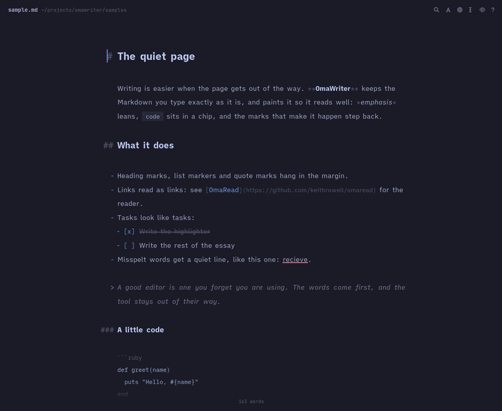
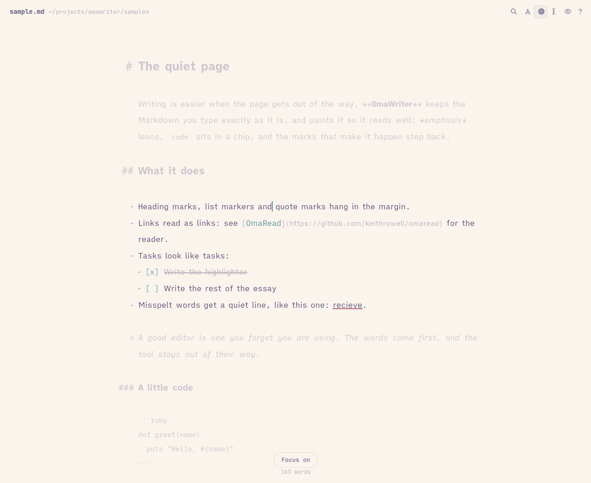
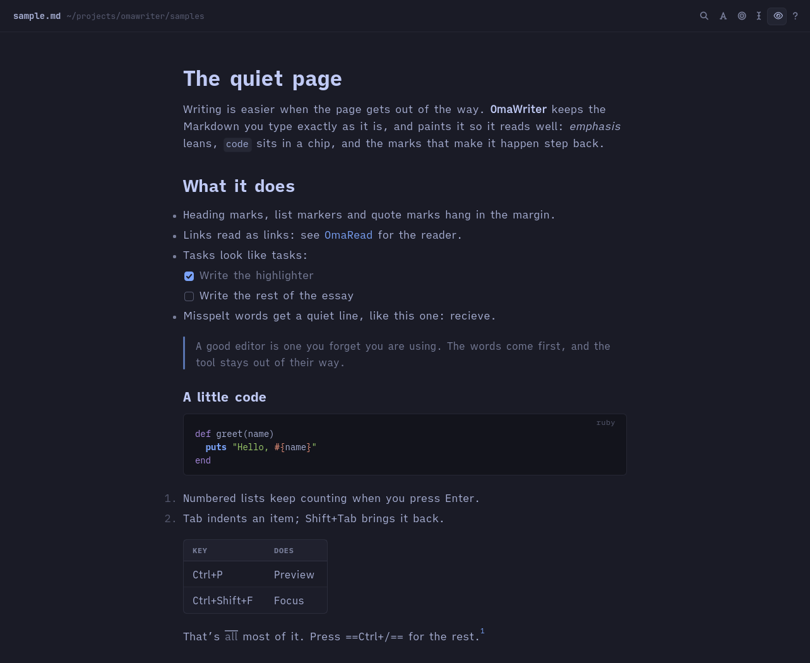

# OmaWriter

A Markdown editor for [Omarchy](https://omarchy.org), in the spirit of Byword. You type plain Markdown and it looks finished as you write: emphasis leans, code sits in a chip, links read as links, and the marks that make it happen fade back. Heading marks, list markers and quote marks hang in the left margin, so the text keeps one clean edge.



Version 0.1.0. Built in QML on Quickshell on [Omarky](https://github.com/keithrowell/omarky), the library it shares with OmaRead: the editor, its one small native module for the live styling, the theme handling and the renderer all live there.

## Install

On Omarchy (Arch Linux with Hyprland), with `quickshell`, `ttf-ia-writer`, `sonnet` and `hunspell-en_au` installed:

```
~/projects/omawriter/ops/install
```

The script builds the native highlighter (CMake and the Qt 6 headers), links `omawriter` into `~/.local/bin`, and adds a desktop entry and icon. It leaves the default Markdown app alone. To make OmaWriter the default:

```
xdg-mime default omawriter.desktop text/markdown
```

## Use

```
omawriter notes/essay.md
omawriter
```

With no file you get a new untitled document. It is saved as a draft while you type, so closing the window loses nothing. Ctrl+R lists recent files and drafts, and Ctrl+Shift+S gives a draft a name and a place. Named files save themselves a moment after you stop typing. Ctrl+S is there for habit.

One background process owns every window. A second `omawriter file.md` hands the file to it, and a file that is already open comes to the front. Hyprland sees the window class `omawriter`.

## Writing

The text in the window is always exactly the file's Markdown. OmaWriter never rewrites it behind you. The keys below are the only things that change it.

| Keys | Does |
|---|---|
| Enter | Continues a list, a numbered list (counting up), a task list or a quote. Enter on an empty item ends the list. |
| Tab, Shift+Tab | Indents or outdents a list item |
| Ctrl+B, Ctrl+I, Ctrl+E | Bold, italic, inline code; again to remove |
| Ctrl+Shift+X | Strikethrough |
| Ctrl+K | Link around the selection, cursor in the URL |
| Ctrl+1 to Ctrl+6, Ctrl+0 | Heading level, or back to a paragraph |

Misspelt words get a red line once you have moved past them, never while you are typing them. Right-click one for suggestions or to add it to your dictionary. Spelling is Australian English through Sonnet and Hunspell, and Ctrl+Shift+L turns it off.

## Views



Focus (Ctrl+Shift+F) fades everything but the paragraph you are in. Typewriter scrolling (Ctrl+Shift+T) keeps the line you are writing in the middle of the window. The header and the word count step aside while you type and come back when you move the mouse. Hover over the count for characters and reading time.



Ctrl+P shows the document rendered by OmaRead's renderer, opened at the block you were writing in, and Esc brings you back to the same place in the source. It updates as the file changes.

Ctrl+Shift+M cycles the editor font through iA Writer Quattro S (the default), Duospace and Mono S. Ctrl+= and Ctrl+− change the size. The colours follow your Omarchy theme as you switch, light or dark.


## Files on disk

A file changed by another program while OmaWriter has it open is reloaded in place when you have nothing unsaved. If you do, a strip under the header offers to load their version or keep yours. Settings, the recent list and drafts live in `~/.local/state/omawriter`. The log is `~/.local/state/omawriter/qs.log`.

## Development

| Path | Holds |
|---|---|
| `ui/app/` | The window, the help sheet and the settings, in QML |
| `vendor/omarky/` | [Omarky](https://github.com/keithrowell/omarky), the library shared with OmaRead, as a submodule: the editor (`Editor`, `Buffer`, `PopupMenu`, `lib/editing.js`), the native highlighter under `native/`, the renderer the preview uses, the theme and the chrome. `tools/vendor` moves it |
| `bin/omawriter` | Ruby on `Omarky::Instance` and `Omarky::Native`: one background process, and the highlighter built into `build/` |
| `tools/test` | The library's suites: `editing.js` and the native highlighter, headless |
| `tools/check` | Drives an offscreen OmaWriter through IPC: keys, autosave, reload from disk, a clean log. `--plain` runs it without the native module |
| `tools/shot` | Offscreen screenshot of a file under any Omarchy theme |

The launcher rebuilds the native module when a file under `vendor/omarky/native/` changes or Qt is upgraded. The library's `docs/decisions/` (0014 to 0016) record why the highlighter is native, why its layout stays out of the undo history, and why the editor lives there.
